# BE-ERD-001 통합 데이터 모델

- **버전:** V1.2

- **상태:** 승인(Accepted)

- **기준일:** 2026-11-11

- **승인일:** 2026-11-12

- **승인 기준:** BE-TECH-SPEC-001~006의 확정 데이터 모델

- **테이블:** 18개

- **관련 문서:** [001 V1.1](../tech-spec/BE-TECH-SPEC-001-데이터-수집-정규화-검증.md), [002 V1.1](../tech-spec/BE-TECH-SPEC-002-가격-데이터-모델링-및-산지-도매가격-산출.md), [003 V1.1](../tech-spec/BE-TECH-SPEC-003-PDF-기사-수집-및-정보-추출.md), [004 v0.2](../tech-spec/BE-TECH-SPEC-004-Price-Insight-생성-검증-게시.md), [005 V1](../tech-spec/BE-TECH-SPEC-005-사용자-식별-인증-세션.md), [006 V1](../tech-spec/BE-TECH-SPEC-006-실시간-채팅.md)

## 1 목적과 관리 기준

하나의 통합 Batch에 여러 Job과 문서 추출 Batch를 두고 원본·관측값·근거 및 Price Insight 게시 스냅샷을 연결한다. 관측값은 여러 Evidence로 뒷받침할 수 있으며, 관측 없는 정성 근거도 어종별로 보존한다. Price Insight 생성·검증·원자 게시 정책은 BE-TECH-SPEC-004를 따른다. 게시 대상은 통합 배치 시작 시 고정하고 전체 대상의 검증 성공 시 함께 전환한다.

본 문서는 Tech Spec 001~006의 영속 테이블·컬럼·관계 기준이다. Tech Spec의 발췌 모델은 별도 테이블 정의가 아니다. 전체 구조는 기존 승인 모델과 같고 토큰 사용량 컬럼은 없다. 문서의 V1 버전과 가격 정책 price-aggregation-v2는 서로 다른 식별자다.

## 2 테이블별 주요 명세

| 주요 명세                                | 테이블                                                                                                         |
| ---------------------------------------- | -------------------------------------------------------------------------------------------------------------- |
| 005 익명 사용자 | APP_USER |
| 001 공통 실행                            | COLLECTION_BATCH, COLLECTION_JOB, COLLECTION_REQUEST, COLLECTED_SOURCE                                         |
| 001 어종과 관측                          | SPECIES, SPECIES_EXTERNAL_CODE, NORMALIZED_OBSERVATION, PRICE_OBSERVATION, TRADE_OBSERVATION, VALIDATION_ISSUE |
| 002 가격 집계                            | PERIOD_PRICE, PERIOD_PRICE_INPUT                                                                               |
| 003 문서 분석 및 근거 / 004 Insight 게시 | DOCUMENT_EXTRACTION_BATCH, DOCUMENT_ANALYSIS_RUN, EVIDENCE, OBSERVATION_EVIDENCE, PRICE_INSIGHT_SNAPSHOT       |

주요 명세 담당은 배타적인 쓰기 권한을 의미하지 않는다. 예를 들어 API 수치의 Evidence는 001의 처리기가 공통 저장 계약으로 생성하며 analysis_run_id는 NULL이다. 공통 Entity와 저장 경계를 사용한다.

## 3 전체 Mermaid ERD

Mermaid의 datetime은 논리 시각 타입이며 물리 저장은 시간대가 있는 시각으로 매핑한다. 관측일·기간은 date다. decimal의 물리 정밀도와 인덱스는 원천 범위·실제 쿼리로 확정한다. PK/FK/UK 표기 외의 복합 키·NULL·상태별 제약은 다음 절을 함께 적용한다.

```mermaid

erDiagram

    direction TB

    APP_USER {
        bigint id PK "익명 사용자 ID"
        datetime created_at "최초 생성 시각"
    }

    %% 001 배치와 공통 수집 및 정규화

    COLLECTION_BATCH ||--o{ COLLECTION_JOB : dispatches
    COLLECTION_BATCH ||--o{ DOCUMENT_EXTRACTION_BATCH : schedules

    COLLECTION_JOB ||--o{ COLLECTION_REQUEST : contains

    COLLECTION_REQUEST ||--o{ COLLECTED_SOURCE : obtains

    SPECIES ||--o{ SPECIES_EXTERNAL_CODE : maps
    SPECIES ||--o{ DOCUMENT_EXTRACTION_BATCH : subjects

    SPECIES |o--o{ NORMALIZED_OBSERVATION : observed

    SPECIES |o--o{ EVIDENCE : subject

    COLLECTED_SOURCE ||--o{ NORMALIZED_OBSERVATION : provenance

    NORMALIZED_OBSERVATION ||--o| PRICE_OBSERVATION : price

    NORMALIZED_OBSERVATION ||--o| TRADE_OBSERVATION : trade

    %% 003 문서 기사 AI 분석

    DOCUMENT_EXTRACTION_BATCH |o--o{ DOCUMENT_ANALYSIS_RUN : groups
    COLLECTED_SOURCE ||--o{ DOCUMENT_ANALYSIS_RUN : analyzes

    DOCUMENT_ANALYSIS_RUN |o--o{ NORMALIZED_OBSERVATION : extracts

    DOCUMENT_ANALYSIS_RUN |o--o{ EVIDENCE : extracts

    COLLECTED_SOURCE ||--o{ EVIDENCE : originates

    NORMALIZED_OBSERVATION ||--o{ OBSERVATION_EVIDENCE : supported_by

    EVIDENCE ||--o{ OBSERVATION_EVIDENCE : supports

    COLLECTED_SOURCE |o--o{ VALIDATION_ISSUE : source_errors

    DOCUMENT_ANALYSIS_RUN |o--o{ VALIDATION_ISSUE : analysis_errors

    NORMALIZED_OBSERVATION |o--o{ VALIDATION_ISSUE : observation_errors

    EVIDENCE |o--o{ VALIDATION_ISSUE : evidence_errors

    %% 002 가격 집계

    SPECIES ||--o{ PERIOD_PRICE : aggregates

    PERIOD_PRICE ||--o{ PERIOD_PRICE_INPUT : calculated_from

    PRICE_OBSERVATION ||--o{ PERIOD_PRICE_INPUT : contributes

    %% 004 Price Insight 입력과 게시 결과의 버전 스냅샷

    SPECIES ||--o{ PRICE_INSIGHT_SNAPSHOT : analyzes

    COLLECTION_BATCH ||--o{ PRICE_INSIGHT_SNAPSHOT : triggers

    COLLECTION_BATCH {

        uuid id PK "통합 배치 실행 ID"

        string execution_key UK "예정 회차와 실행 목적의 중복 방지 키"

        datetime scheduled_at "배치 예정 시각"

        datetime started_at "배치 실제 시작 시각"

        datetime completed_at "배치 종료 시각"

        string status "PENDING RUNNING SUCCEEDED PARTIAL_SUCCESS FAILED CANCELLED"
        jsonb target_insight_keys "배치 시작 시 고정한 게시 대상 Key 목록"
        string publication_status "NOT_PUBLISHED PUBLISHED; 실행 상태와 독립"
        datetime published_at "전체 대상 원자 게시 시각"

    }

    COLLECTION_JOB {

        uuid id PK "수집 작업 ID"

        uuid batch_id FK "상위 통합 배치"

        string execution_key UK "배치 ID와 작업 정의의 중복 방지 키"

        string collection_type "PUBLIC_API PUBLICATION NEWS"

        string provider "수집 기관"

        string dataset "수집 데이터셋"

        string status "작업 상태"

        datetime scheduled_at "예정 실행 시각"

        datetime started_at "실제 시작 시각"

        datetime completed_at "완료 시각"

        string error_code "마지막 작업 오류"

    }

    COLLECTION_REQUEST {

        uuid id PK "수집 요청 ID"

        uuid job_id FK "상위 수집 작업"

        string request_key UK "작업 ID와 실제 요청 조건의 중복 방지 키"

        jsonb request_params "API 조건 또는 크롤링 조건"

        string retry_policy_key "요청에 적용한 재시도 정책과 버전"

        string status "요청 상태"

        int attempt_count "재시도 포함 시도 횟수"

        datetime next_attempt_at "다음 재시도 시각"

        uuid lease_token "현재 작업 점유 토큰"

        datetime lease_until "작업 점유 만료 시각"

        datetime completed_at "요청 완료 시각"

        string error_code "최근 실패 코드"

    }

    COLLECTED_SOURCE {

        uuid id PK "수집 원본 ID"

        uuid request_id FK "원본 수집 요청"

        string source_type "API PDF NEWS"

        string source_key "기관 데이터셋 요청 조건 또는 정규 문서 식별 키"

        string source_url "원본 URL"

        string content_hash "원본 SHA256"

        string content_ref "R2 객체 키 또는 본문 참조"

        jsonb metadata "발행일 제목 원천별 부가정보"

        datetime collected_at "원본 수집 시각"

    }

    SPECIES {

        bigint id PK "내부 어종 ID"

        string code UK "내부 어종 코드"

        string korean_name "어종 한글명"

    }

    SPECIES_EXTERNAL_CODE {

        bigint id PK "품목 코드 매핑 ID"

        bigint species_id FK "내부 어종 ID"

        string provider "외부 제공기관"

        string dataset "적용 데이터셋"

        string external_code "외부 품목 코드"

        string mapping_level "정확 또는 상위 분류 매핑"

        boolean active "매핑 활성 여부"

    }

    DOCUMENT_EXTRACTION_BATCH {
        uuid id PK "뉴스 전용 어종×플랫폼 추출 배치 ID"
        uuid collection_batch_id FK "상위 통합 배치"
        string batch_key UK "통합 배치·어종·플랫폼 멱등 키"
        bigint species_id FK "대상 어종"
        string search_platform "뉴스 검색 플랫폼"
        string status "PENDING RUNNING SUCCEEDED PARTIAL_SUCCESS FAILED CANCELLED"
        int target_article_count "어종×플랫폼별 최대 15개 기사"
        datetime started_at "실행 시작 시각"
        datetime completed_at "실행 종료 시각"
    }

    DOCUMENT_ANALYSIS_RUN {

        uuid id PK "Gemini 분석 실행 ID"

        uuid source_id FK "분석 대상 원본"
        uuid extraction_batch_id FK "뉴스 전용 추출 배치이며 PDF는 빈 값"

        string idempotency_key UK "owner_kind:execution_owner_id:digest 형식의 배치 소유 실행 키"

        string model_id "실제 Gemini 모델 ID"

        string prompt_version "추출 프롬프트 버전"

        string schema_version "응답 스키마 버전"

        string status "PENDING RUNNING SUCCEEDED RETRY_PENDING REVIEW FAILED_PERMANENT CANCELLED"

        int attempt_count "실행 시도 횟수"

        datetime next_attempt_at "재시도 예정 시각"

        datetime lease_until "작업 점유 만료 시각"

        uuid lease_token "오래된 작업 결과 차단 토큰"

        string response_ref "보존한 Gemini 분석 응답 참조"

        string error_code "최근 분석 오류"

        datetime completed_at "분석 완료 시각"

    }

    EVIDENCE {

        uuid id PK "가격 관련 근거 ID"

        uuid source_id FK "원본 API 응답 문서 또는 기사"

        uuid analysis_run_id FK "Gemini 실행이며 API 근거는 빈 값"

        bigint species_id FK "근거 대상 어종이며 공통 근거는 빈 값"

        string evidence_type "수급 생산 기상 정책 등"

        string statement "추출된 사실 또는 주장"

        string quote "원문 근거 문장"

        jsonb source_locator "페이지 문단 표 위치"

        string cited_origin_key "재인용 원출처 식별 키"

        date period_start "근거 대상 기간 시작"

        date period_end "근거 대상 기간 종료"

        string validation_status "근거 검증 상태"
        jsonb fact_payload "검증 가능한 추출 사실의 구조화 값"

    }

    NORMALIZED_OBSERVATION {

        uuid id PK "공통 관측값 ID"

        uuid source_id FK "관측값 원본"

        uuid analysis_run_id FK "AI 추출 실행 선택값"

        bigint species_id FK "대상 어종"

        string observation_type "PRICE TRADE 등 관측 유형"

        date period_start "관측 기간 시작"

        date period_end "관측 기간 종료"

        string extraction_method "API 매핑 또는 AI 추출"

        jsonb source_locator "원본 API 행 키 또는 문서 내부 위치"

        string normalization_version "관측 정규화 규칙 버전"

        string citation_status "DIRECT VERIFIED_CITATION UNKNOWN"

        string independence_key "동일 독립 관측 사건 식별 키 또는 빈 값"

        string validation_status "관측값 검증 상태"

        string dedupe_fingerprint UK "원본 행과 추출 정규화 버전을 포함한 중복 방지 지문"

    }

    PRICE_OBSERVATION {

        uuid observation_id PK,FK "공통 관측값 ID"

        string price_type "PRODUCER WHOLESALE RETAIL"

        decimal price "관측 가격"

        string currency "통화 코드"

        string unit "가격 단위"

        string price_statistic "평균 최저 최고 등"

        jsonb product_conditions "등급 규격 시장 등 조건"

        decimal price_krw_per_kg "검증된 표준 가격이며 환산 불가하면 빈 값"

        jsonb normalization_basis "단위 환산계수 근거와 적용 규칙"

    }

    TRADE_OBSERVATION {

        uuid observation_id PK,FK "공통 관측값 ID"

        decimal quantity "거래 또는 출하 수량"

        string quantity_unit "수량 단위"

        decimal total_amount "거래 총액 선택값"

        string market_code "거래 시장 코드"

        string trade_type "거래 유형"

    }

    OBSERVATION_EVIDENCE {

        uuid observation_id PK,FK "정규화 관측값 ID"

        uuid evidence_id PK,FK "원문 근거 ID"

        string evidence_role "SUPPORTS_VALUE EXPLAINS_CHANGE CONTEXT"

    }

    VALIDATION_ISSUE {

        uuid id PK "검증 오류 ID"

        uuid source_id FK "관련 원본 ID"

        uuid analysis_run_id FK "관련 분석 실행 ID"

        uuid observation_id FK "관련 관측값 ID"

        uuid evidence_id FK "관련 근거 ID"

        string issue_code "검증 오류 유형"

        jsonb details "실패 필드 실제값 기대 조건과 상세 사유"

        string severity "오류 심각도"

        string resolution_status "해결 여부"

        datetime created_at "오류 기록 시각"

    }

    PERIOD_PRICE {

        bigint id PK "기간 대표가격 ID"

        bigint species_id FK "집계 대상 어종"

        string price_type "산지 또는 도매가격"

        string granularity "HALF_MONTH MONTH"

        date period_start "집계 시작 날짜"

        date period_end "집계 종료 날짜"

        decimal price "일별 대표가격 평균"

        string provider "기준 가격 제공기관"

        string dataset "기준 데이터셋"

        jsonb reference_filter "가격 비교 기준 조건"

        int observation_count "절사 전 적격 관측 건수"

        int excluded_count "일별 절사 제외 건수"

        int observed_day_count "평균 계산 유효 일수"

        string calculation_policy_version "가격 집계 정책 버전"

        string input_signature UK "집계 키 정책 입력 버전과 절사 역할의 해시"

        datetime calculated_at "가격 산출 시각"

    }

    PERIOD_PRICE_INPUT {

        bigint period_price_id PK,FK "기간 대표가격 ID"

        uuid observation_id PK,FK "가격 상세를 가진 적격 관측 버전 ID"

        string inclusion_role "INCLUDED TRIMMED_MIN TRIMMED_MAX"

    }

    PRICE_INSIGHT_SNAPSHOT {

        uuid id PK "PriceInsight 버전 식별자"

        uuid batch_id FK "생성을 최초 요청한 배치"

        bigint species_id FK "분석 대상 어종"

        string insight_key "어종 대상 기간 등 Insight 조회 키"

        string content_fingerprint "사용자 표시 변경 판단 해시이며 NULL 허용"

        string input_signature "입력 재현용 서명; 전역 UNIQUE 없음"

        string payload_schema_version "입력과 결과 JSONB 계약 버전"

        jsonb input_payload "관측 가격 근거 원문 검증 상태와 누락 정보의 고정 입력"

        jsonb output_payload "검증한 PriceInsight 설명 방향성과 불확실성"

        string model_id "PriceInsight 생성 모델"

        string prompt_version "생성 프롬프트 버전"

        datetime as_of "사용한 입력의 기준 시각"

        string status "PENDING RUNNING GENERATED PUBLISHED FAILED"

        int attempt_count "생성 호출 시도 횟수"

        datetime next_attempt_at "다음 생성 재시도 시각"

        uuid lease_token "생성 작업 점유 토큰"

        datetime lease_until "생성 작업 점유 만료 시각"

        string error_code "최근 생성 또는 출력 검증 오류"

        datetime published_at "정상 게시 시각"

    }

```

## 4 키와 멱등성

`APP_USER.id`는 BIGINT IDENTITY 기본키이며 `created_at`은 NOT NULL, 기본값은 현재 시각인 TIMESTAMPTZ다. APP_USER는 가격·수집·Insight 테이블에 FK를 두지 않는다. 채팅 참여자 세션과 메시지는 서버 메모리 상태이며 영속 테이블이 아니다.

| 대상     | 키와 의미                                                                                      |
| -------- | ---------------------------------------------------------------------------------------------- |
| Batch    | execution_key: 스케줄·예정 회차·실행 목적                                                      |
| Job      | execution_key: batch_id와 유형·기관·데이터셋·범위                                              |
| Request  | request_key: job_id와 단계·실제 요청 조건                                                      |
| Source   | UNIQUE(source_key, content_hash). source_key는 기관·데이터셋·실제 API 조건 또는 정규 문서 식별 |
| Analysis | idempotency_key: 실행 소유자 유형·ID를 식별 가능한 접두부로 보존하고 Source·내용 해시·소유자·모델·프롬프트·응답 스키마를 해시 |
| 관측     | dedupe_fingerprint: 원본 행·처리 설정·정규화 버전과 상세 내용                                  |
| 기간가격 | input_signature: 집계 키·정책·선택한 관측 버전·정규화 버전·절사 역할                           |
| Insight  | UNIQUE(batch_id, insight_key); content_fingerprint NULL 허용. 게시 계약은 004                  |

Price Insight 스냅샷은 (batch_id, insight_key) 복합 UNIQUE를 적용한다. input_signature는 전역 UNIQUE로 두지 않는다. COLLECTION_BATCH.target_insight_keys는 실행 시작 시 고정한다.

해시는 타입·숫자·날짜·NULL·정렬 규약을 고정한 표현으로 만든다. source_key 또는 independence_key 자체를 전역 UNIQUE로 만들지 않는다. 같은 원본의 여러 버전, 같은 사건의 정정 버전을 보존해야 한다. 같은 Source 버전을 재사용하면 request_id는 최초 확보 요청을 유지하며 재수집 요청의 완료는 현재 Request에 별도 기록한다.

## 5 NULL과 관계 제약

| 대상                     | 규칙                                                                  |
| ------------------------ | --------------------------------------------------------------------- |
| 관측 analysis_run_id     | API 매핑이면 NULL, AI 추출이면 해당 원본의 실행                       |
| Evidence analysis_run_id | API 근거이면 NULL, 문서 AI 근거이면 해당 실행                         |
| 관측 species_id          | 미매핑 후보는 NULL 허용, 자동 가격 집계 제외                          |
| Evidence species_id      | 어종 미특정 공통 근거는 NULL, 모든 어종에 자동 적용 금지              |
| 실행 시각·lease·오류     | 상태에 따라 미완료·미점유·오류 없음은 NULL                            |
| 관측/근거 기간           | 미상은 NULL, 임의의 수집일/발행일로 보완 금지. 둘 다 있으면 시작≤종료 |
| 가격 표준값              | 승인 환산이 불가하면 price_krw_per_kg=NULL, 원천 수치와 단위는 보존   |
| 검증 이슈 FK             | source/analysis/observation/evidence 중 정확히 하나                   |

각 PK와 필수 실행 키·유형·상태·시도 수는 NOT NULL로 보호한다. 유효한 PRICE/TRADE 상세에 필요한 원천 값·단위는 반드시 확인되어야 하며, 파싱 불가능한 값은 원본/응답/이슈로 남긴다. 필수 관계와 상태에 따른 유효 값은 물리 제약 또는 저장 검증에 명시한다.

VALIDATION_ISSUE에는 `CHECK(num_nonnulls(source_id, analysis_run_id, observation_id, evidence_id)=1)`을 적용한다. 관측/Evidence와 AnalysisRun의 source_id 일치는 복합 FK 또는 저장 트랜잭션/제약 트리거로 보호한다. 다른 테이블을 조회하는 일반 CHECK 함수에 의존하지 않는다.

활성 EXACT 외부 매핑은 provider·dataset·external_code가 서로 다른 어종으로 중복되지 않게 부분 유일성 또는 동등한 제약으로 보호한다. GROUP은 별도 비교 가능성 판단이 필요하다. attempt_count와 확인 가능한 건수는 음수가 아니어야 한다. 기간가격은 observed_day_count>0, observation_count≥observed_day_count, 0≤excluded_count≤observation_count를 만족하고 하나 이상의 입력 연결을 원자적으로 갖춰야 한다.

관측 유형과 가격/거래 상세를 일치시킨다. PERIOD_PRICE_INPUT.observation_id의 FK는 PRICE_OBSERVATION(observation_id)다. VALID 관측에는 하나 이상의 SUPPORTS_VALUE 근거를 원자 저장으로 연결한다. 후보·실패 관측과 정성 Evidence는 연결이 없는 상태로 보존할 수 있으므로 도면의 연결 최소 개수는 0이며 사용 적격 조건에서 1개 이상을 강제한다.

## 6 공통 상태와 이력

| 대상            | 상태                                                                                      |
| --------------- | ----------------------------------------------------------------------------------------- |
| Batch / Job     | PENDING, RUNNING, SUCCEEDED, PARTIAL_SUCCESS, FAILED, CANCELLED                           |
| Request         | PENDING, RUNNING, SUCCEEDED, NO_DATA, RETRY_PENDING, EXCLUDED_BY_POLICY, FAILED_PERMANENT |
| AnalysisRun     | PENDING, RUNNING, SUCCEEDED, RETRY_PENDING, REVIEW, FAILED_PERMANENT, CANCELLED           |
| 관측 검증       | VALID, REVIEW_REQUIRED, INVALID                                                           |
| Evidence 검증   | UNREVIEWED, PASS, REVIEW, REJECTED                                                        |
| citation_status | DIRECT, VERIFIED_CITATION, UNKNOWN                                                        |
| 근거 연결 역할  | SUPPORTS_VALUE, EXPLAINS_CHANGE, CONTEXT                                                  |
| 가격 입력 역할  | INCLUDED, TRIMMED_MIN, TRIMMED_MAX                                                        |
| ExtractionBatch | PENDING, RUNNING, SUCCEEDED, PARTIAL_SUCCESS, FAILED, CANCELLED                           |
| Snapshot        | PENDING, RUNNING, GENERATED, PUBLISHED, FAILED                                            |
| 게시 상태       | NOT_PUBLISHED, PUBLISHED (`COLLECTION_BATCH.publication_status`)                        |

요청/분석은 배치 실행 기한 안에서 제한된 재시도를 RETRY_PENDING으로 예약한다. 배치 기한 내 완료되지 않은 재시도 작업은 해당 실행에서 최종 상태로 정리한다. 다음 일일 통합 배치가 이전 배치를 CANCELLED 처리하면 미완료 Request는 재실행하지 않고, PENDING·RUNNING·RETRY_PENDING AnalysisRun과 PENDING·RUNNING 뉴스 ExtractionBatch는 CANCELLED로 전이한다. AnalysisRun의 error_code에는 PARENT_BATCH_CANCELLED를 기록하고 lease_token·lease_until·next_attempt_at을 비워 늦은 결과와 재점유를 차단한다. 취소된 AnalysisRun 행은 재실행하지 않는다. 다음 배치는 정상 저장된 Source·Observation·Evidence와 동일 설정의 성공 분석을 재사용한다. 기존 실행이 없거나 상위 배치 취소로 이전 실행이 CANCELLED된 경우에만 새 실행 소유자의 AnalysisRun을 등록한다. REVIEW·FAILED_PERMANENT는 자동 재실행하지 않는다. PDF 실행 소유자는 현재 실행의 COLLECTION_BATCH ID이며 뉴스 실행 소유자는 새 DOCUMENT_EXTRACTION_BATCH ID다. AnalysisRun.idempotency_key는 `owner_kind:execution_owner_id:digest` 형식으로 저장하고 digest에는 source_id·content_hash·owner_kind·execution_owner_id·model_id·prompt_version·schema_version이 포함된다. 실행 소유자 접두부로 부모 배치를 검증하며 뉴스는 extraction_batch_id와 소유자 ID의 일치를 확인한다. 성공 결과 검색은 별도 저장 키를 만들지 않고 Source·내용 해시·모델·프롬프트·스키마가 같고 SUCCEEDED인 실행을 조회한다. 결과 반영은 부모 배치 상태와 현재 lease 소유권을 확인한다. Snapshot은 RUNNING에서 PENDING과 next_attempt_at으로 예약하고 시도 상한 소진 시 FAILED다. Batch/Job 종료 상태는 해당 실행 창의 요약이다.

Batch/Job 실행 상태 어휘는 PENDING, RUNNING, SUCCEEDED, PARTIAL_SUCCESS, FAILED, CANCELLED다. `publication_status`는 실행 상태와 독립적이다. 허용된 선택 원천의 실패가 있어 실행이 PARTIAL_SUCCESS여도 필수 가격 조건과 모든 게시 검증이 충족되면 PUBLISHED가 될 수 있다. 게시 성공은 실행 상태를 SUCCEEDED로 바꾸지 않으며, 실패·취소 배치나 게시 검증이 실패한 배치는 PUBLISHED가 될 수 없다.

현재 검증 상태와 VALIDATION_ISSUE의 문제·해결 이력을 분리한다. 확정된 정정으로 대체된 버전은 다시 현재 적격 값으로 선택하지 않도록 상태와 사유를 기록한다. 새 미검증 후보가 실패했다는 이유로 기존 정상 값을 무효화하지 않는다.

## 7 불변 데이터와 집계 재현

원본 내용·관측 수치·위치·단위·상품 조건·정규화 버전·환산 근거는 버전별 불변이다. 정정은 새 Source/Observation ID로 기록하고 원문·분석 응답을 비공개 content_ref/response_ref로 보존한다.

PERIOD_PRICE와 PERIOD_PRICE_INPUT은 입력 서명별로 고정한다. 가격 정책은 price-aggregation-v2를 유지한다. 날짜별 1~4건 중앙값, 5건 이상 최저·최고 각 1건 절사평균을 구한 뒤 유효 일별 가격을 단순평균한다. 절사한 원본도 입력 역할로 보존하며 원본 건수를 기간 가중치로 쓰지 않는다. 상세 규칙과 동률은 002를 따른다.

과거 계산 재현에는 고정된 입력 버전과 정책을 사용하고 현재 검증 상태로 입력을 재선택하지 않는다. 현재 유효 가격 선택과 과거 이력 보존은 구분한다. 원본·관측·가격·근거를 삭제해 과거 스냅샷/lineage가 끊기지 않게 참조 삭제 정책을 제한한다.

## 8 Price Insight 스냅샷과 원자 게시

input_payload는 실제 입력 관측 버전과 값·단위·기간·상태, 기간가격 ID·가격·원천·정책, 실제 전달한 Evidence ID·문장·인용·위치·출처·당시 검증 상태, 비교값·변동률·누락 정보를 고정한다. output_payload는 검증한 설명·방향·요인·참조·불확실성을 보존한다. JSONB 안의 ID는 일반 FK로 보장되지 않으므로 저장 시 참조를 확인한다.

입력은 등록 후 불변, 출력은 성공 결과 확정 후 불변이다. 실행 상태·시도·lease만 전이 규칙에 따라 변경한다. content_fingerprint는 사용자 표시 가격·기준 기간·비교값·관련 이슈와 의미 있는 검증 상태를 비교한다. 수집 시각·배치 ID·내부 ID만의 변화는 제외한다. fingerprint는 UNIQUE가 아니며 A→B→A도 최신 게시본과 다르면 새 버전을 만든다.

게시 대상 Key는 COLLECTION_BATCH.target_insight_keys에 배치 시작 시 고정한다. 각 어종의 월간·반월 대상은 가격 데이터 유무와 무관하게 유지하며 대상 Key를 임의로 제거하지 않는다. 상세 생성 정책은 BE-TECH-SPEC-004를 따른다.

변경 판단은 최신 PUBLISHED와 비교한다. 같은 입력의 대기/실패 작업이 있으면 새 작업을 무한 생성하지 않고 기존 작업의 고정 입력·정책으로 재시도한다. 생성·검증 실패 시 이전 게시본을 유지하고 마지막 실제 데이터 기준시각을 보존한다. 기존 게시본이 없고 유효 가격이 없으면 파악 중으로 처리한다.

게시 조회는 먼저 `publication_status=PUBLISHED`인 COLLECTION_BATCH 중 `published_at DESC, id DESC` 순서로 최신 배치 하나를 선택한다. 요청 Key가 해당 배치의 `target_insight_keys` manifest에 포함된 경우에만 그 배치의 `(batch_id, insight_key)` Snapshot 중 PUBLISHED 결과를 조회한다. Key가 manifest에 없거나 해당 배치에 게시된 Snapshot이 없으면 과거 배치에서 같은 `insight_key`를 찾아 대체하지 않고 결과가 없는 것으로 처리한다. 따라서 기간이 바뀌어 새 manifest에서 빠진 과거 기간의 Snapshot은 현재 게시 결과로 반환되지 않는다. 화면의 가격 차트와 설명은 같은 게시 배치의 스냅샷·가격 버전·기준을 사용한다. 하나의 배치에서 모든 대상이 검증을 통과해야 전체를 한 트랜잭션으로 게시한다. 생성·검증·게시 실패 시 직전 정상 게시 배치를 제공하며 새 배치의 일부 결과만 노출하지 않는다. 자세한 계약은 BE-TECH-SPEC-004를 따른다.

## 9 JSONB와 실행 제약

Source.metadata는 원천별 JSON Schema와 schema_version으로 검증한다. PDF의 제목·발행일·권한·페이지·파일 정보, 기사의 canonical URL·본문 추출기 버전, API의 실제 요청·페이지·형식과 원천 식별 정보를 보존한다. Source의 content_ref는 비공개 R2 키 또는 저장소별 명명 규칙의 응답/본문 참조다. R2 객체 테이블과 원천별 상세 테이블은 만들지 않는다.

Evidence.source_locator는 페이지·문단·표 위치와 재인용 원출처 하위 구조를 가진다. NORMALIZED_OBSERVATION.source_locator는 API 행/경로 또는 문서 위치다. normalization_basis는 적용한 단위 환산 근거다. JSONB에 관계형 FK를 옮겨 가격 집계 연결을 대체하지 않는다.

작업 점유는 짧은 트랜잭션에서 토큰과 만료 시각을 발급하고 완료 반영 시 RUNNING·현재 토큰·유효 점유를 확인한다. 외부 HTTP·R2·Gemini·대기 시간은 트랜잭션 밖이다. 외부 호출의 정확히 한 번을 가정하지 않고 DB 반영을 멱등하게 한다.

토큰 사용량 컬럼, 모델 예산 테이블, 사용량 이벤트 테이블은 없다. 모델 호출 제한은 공통 실행 설정과 limiter로 처리한다. 선택적 공급자 관측·운영 로그를 업무 DB 컬럼으로 다시 추가하지 않는다. 물리 인덱스는 실제 작업 큐·어종/기간·관계 조회에 맞춰 추가하고 JSONB 전체 GIN을 일괄 생성하지 않는다.

## 10 변경 이력

### V1 — 2026-11-09

승인된 16개 논리 테이블과 토큰 사용량 컬럼 제거 조건을 기준으로 통합 ERD를 정리했다. Mermaid 전체 정의는 이 파일에 포함하며 추가 ERD 파일을 필수로 요구하지 않는다.

### V1.1 — 2026-11-11

승인된 001·002·003 V1.1 및 004 v0.2와 정합시켜 17개 논리 테이블 기준을 반영하고, 통합 배치 취소 후 기존 미완료 AnalysisRun 행의 종료, 새 소유자 실행 등록, 성공 분석 및 정상 저장 데이터 재사용 조건을 명시했다. 004의 후속 조회를 위해 최신 게시 배치 manifest 기준 선택 규칙을 반영했다. 테이블·컬럼·관계·제약은 승인된 개정 범위를 따른다. 문서 개정은 구현·마이그레이션 실행이나 성능 검증 완료를 의미하지 않는다.

### V1.2 — 2026-11-11 작성, 2026-11-12 승인

기존 가격·수집·Insight 모델의 17개 테이블과 관계를 유지하고 BE-TECH-SPEC-005의 APP_USER를 추가하여 18개 논리 테이블로 정리했다. BE-TECH-SPEC-006의 채팅 참여자 세션은 Spring 서버 메모리에서 관리하고 메시지는 영구 저장하지 않는다. 2026-11-12 최종 승인했다.
