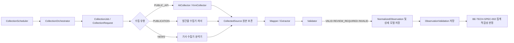
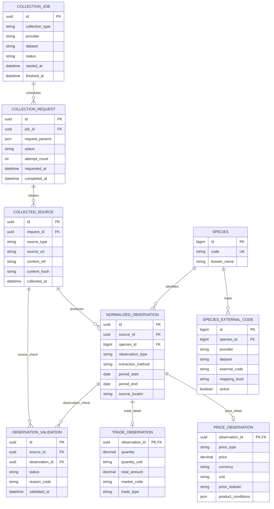

# BE-TECH-SPEC-001 — 데이터 수집·정규화·검증

- **상태:** Accepted
- **버전:** v0.4
- **승인일:** 2026-11-06
- **관련 문서:** [BE-TECH-SPEC-002 v0.4](BE-TECH-SPEC-002-가격-데이터-모델링-및-산지-도매가격-산출.md), BE-ADR-007, BE-ADR-008, POC-003. 논리 ERD는 본 문서 §6.1과 BE-TECH-SPEC-002 §5.2를 함께 기준으로 한다.

## Summary

공공 API, 발간행물, 기사 스크랩을 공통 수집 작업으로 관리하고, 확보한 원본에서 가격·거래 관측값을 추출·정규화·검증한다. 원본과 공통 관측 모델을 보존하며, 검증된 관측값의 산지·도매 가격 집계는 [BE-TECH-SPEC-002](BE-TECH-SPEC-002-가격-데이터-모델링-및-산지-도매가격-산출.md)가 담당한다.

## 1. Scope and Responsibilities

- `PUBLIC_API`, `PUBLICATION`, `NEWS` 수집 유형을 지원한다.
- 수집 작업·요청·원본 관리는 `collection_job`, `collection_request`, `collected_source`를 공유한다.
- 원천별 수집·파싱·추출 구현은 분리하고, 결과는 공통 관측 모델로 정규화한다.
- 공공 API 수집은 `PublicDataCollector`와 제공기관별 구현체를 사용한다.
- 문서·기사의 AI 추출은 구조화 후보를 생성하며, 검증된 사실 또는 가격 집계 입력으로 자동 간주하지 않는다.

## 2. Components

| 컴포넌트                      | 책임                                     |
| ----------------------------- | ---------------------------------------- |
| `CollectionScheduler`         | 정기 수집 작업 시작                      |
| `CollectionOrchestrator`      | 비동기 작업 실행·상태·재시도 관리        |
| `CollectionProcessor`         | 원본 보존, 정규화 결과 및 검증 결과 저장 |
| `PublicDataCollector`         | 공공 API 수집 계약                       |
| `AtCollector`, `KmiCollector` | aT·KMI API 호출                          |
| `PublicDataMapper`            | API 응답을 공통 모델로 변환하는 계약     |
| `AtMapper`, `KmiMapper`       | 제공기관별 응답 매핑                     |
| `PublicDataValidator`         | 정규화 관측값 검증 계약                  |
| `SpeciesMappingService`       | 외부 품목 코드와 내부 어종 연결          |

### 2.1 Implementation Contracts

아래 코드는 책임과 의존 관계를 나타내는 Java 논리 모델이다. 인터페이스는 원천별 구현을 교체할 경계이며, DTO·record는 처리 단계 사이의 데이터 계약이다. 영속 데이터 모델은 JPA Entity 또는 동등한 저장 모델로 구현하고 외부 API 응답 DTO와 분리한다.

```java
// API 원천별 호출 계약. aT와 KMI는 각각 별도 구현체를 제공한다.
public interface PublicDataCollector {
    boolean supports(Dataset dataset);
    CollectionResult collect(CollectionRequest request);
}

// 원천 응답 DTO를 공통 관측 후보로 변환하는 계약.
public interface PublicDataMapper {
    boolean supports(Dataset dataset);
    MappingResult map(RawApiResponse response, Dataset dataset);
}

// 정규화된 관측 후보의 기본 유효성을 판정한다.
public interface PublicDataValidator {
    ValidationResult validate(NormalizedObservation observation);
}

// 불변 값 객체: 외부 코드는 내부 어종 ID와 구분한다.
public record CollectionRequest(
    UUID jobId,
    Dataset dataset,
    Long speciesId,
    LocalDate startDate,
    LocalDate endDate
) {}

// 공통 도메인 모델. 실제 영속화 시 테이블 관계에 맞춘 Entity로 매핑한다.
public class NormalizedObservation {
    UUID id;
    UUID sourceId;
    Long speciesId;
    ObservationType observationType;
    ExtractionMethod extractionMethod;
    LocalDate periodStart;
    LocalDate periodEnd;
    String sourceLocator;
}

public class PriceObservation {
    UUID observationId; // NormalizedObservation의 1:1 상세
    PriceType priceType;
    BigDecimal price;
    String currency;
    String unit;
    String priceStatistic;
    Map<String, Object> productConditions;
}
```

`CollectionOrchestrator`는 적절한 Collector를 선택하고, `CollectionProcessor`는 원본 저장·매핑·검증·영속화를 조정한다. `AtCollector`·`KmiCollector`, `AtMapper`·`KmiMapper`는 해당 인터페이스의 원천별 구현이다.

### 2.2 Collection Pipeline



## 3. Providers and Species Mapping

공공 API 대상은 aT 정산정보와 KMI 유통정보다. KAMIS는 수집 대상에서 제외한다.

| 구분      | aT 정산정보                   | KMI 유통정보         |
| --------- | ----------------------------- | -------------------- |
| API       | `/B552845/katSale/trades`     | `/API/openAPI.do`    |
| 품목 식별 | 대·중·소분류 코드             | `kdfshCode`          |
| 날짜      | `trd_clcln_ymd`               | `creatDate`          |
| 가격      | `avgprc`, `lwprc`, `hgprc` 등 | `pc`, `yr` 등        |
| 거래량    | `unit_tot_qty`                | 확인된 응답에는 없음 |

내부 어종은 `species.id`, `species.code`로 식별하고 외부 코드는 `species_external_code`에서 관리한다. 외부 품목 코드와 서비스 내부 어종 ID를 같은 식별자로 사용하지 않는다.

| 내부 코드  | 어종       | aT 대/중분류     | KMI 코드  |
| ---------- | ---------- | ---------------- | --------- |
| `FLATFISH` | 광어(넙치) | —                | `KDFSH08` |
| `ROCKFISH` | 우럭       | —                | `KDFSH09` |
| `HAIRTAIL` | 갈치       | `71/04`          | `KDFSH02` |
| `MACKEREL` | 고등어     | `71/06`          | `KDFSH01` |
| `ABALONE`  | 전복       | `62/09`, `72/09` | —         |
| `SHRIMP`   | 새우       | —                | —         |

빈 코드는 등록 전 확인이 필요한 값이다. 매핑 수준은 `EXACT`, `GROUP`으로 구분한다. `GROUP`은 상품군 대응이며 가격 비교 가능성까지 의미하지 않는다. 매핑 실패는 원본을 보존하고 사유를 기록한다.

## 4. Collection and Normalization Flow

1. Orchestrator가 수집 유형·제공기관·데이터셋별 작업을 생성한다.
2. Collector 또는 Scraper가 API 응답, 발간물 또는 기사를 확보한다.
3. Processor가 요청 조건, 원본 위치·해시 및 수집 시각을 보존한다.
4. 원천별 Mapper 또는 Extractor가 공통 관측 후보를 생성한다.
5. Validator가 어종, 값, 단위, 기간, 출처, 중복 및 추출 근거를 검사한다.
6. Processor가 정규화 관측값과 검증 결과를 저장한다.

| 모델                    | 책임                                       |
| ----------------------- | ------------------------------------------ |
| `CollectionJob`         | 수집 유형·제공기관·데이터셋 및 작업 상태   |
| `CollectionRequest`     | 요청 조건·상태·시도 횟수                   |
| `CollectedSource`       | API 응답·발간물·기사의 원본과 출처         |
| `NormalizedObservation` | 어종, 관측 유형·기간, 추출 방법, 출처 위치 |
| `PriceObservation`      | 가격·가격 유형·단위·통계·상품 조건         |
| `TradeObservation`      | 거래량·단위·거래금액·시장·거래 방식        |
| `ObservationValidation` | 원본 또는 관측값의 검증 상태·사유          |

`observation_type`은 관측 내용(`PRICE`, `TRADE` 등)을, `extraction_method`는 추출 방식(`API_MAPPING`, `PARSER`, `AI_EXTRACTION` 등)을 나타낸다. 관측 기준 기간은 발행일·게시일과 구분한다. 근거 수치를 확인할 수 없으면 상세 관측값을 만들지 않고 원문과 분석 근거를 보존한다.

## 5. Validation Policy

검증 상태는 `VALID`, `REVIEW_REQUIRED`, `INVALID`로 구분한다. 수집 성공과 관측값의 유효성은 별도로 기록한다.

- KMI `pc=0`은 원본을 보존하되 유효한 0원 가격으로 자동 처리하지 않는다.
- 동일 날짜 복수값은 독립 관측 여부 확인 전 평균하거나 제거하지 않는다.
- aT 가격은 거래 단위와 상품 조건을 확인한다.
- 문서·기사 가격은 원문 위치, 관측 기준 기간 및 인용 출처를 확인한다.
- 타 기관의 수치를 재인용한 자료는 독립적인 새 가격 관측으로 중복 집계하지 않는다.
- 정상적인 0건 응답은 수집 성공으로 기록하고, 관측값이 없음을 별도로 나타낸다.
- 재수집 또는 검증 실패로 기존 정상 관측값을 덮어쓰지 않는다.

가격 관측값이 `VALID`여도 가격 집계 적합성을 자동으로 의미하지 않는다. BE-TECH-SPEC-002는 가격 비교 가능성과 집계 입력 조건을 별도로 판정한다.

## 6. Execution and Storage

작업 상태와 요청 상태는 PostgreSQL에 저장하고, 관측 검증 상태와 분리한다.

```text
PENDING → RUNNING → SUCCEEDED
                  ↘ PARTIAL_SUCCESS
                  ↘ FAILED → RETRY_PENDING
```

제공기관별 호출 수·타임아웃·재시도를 제한하고 요청 단위로 재처리할 수 있게 한다. 서버 재시작 시 영속 상태를 확인해 미완료 작업을 복구한다. API 호출 중 장시간 데이터베이스 트랜잭션을 유지하지 않는다.

| 테이블                   | 책임                       |
| ------------------------ | -------------------------- |
| `species`                | 내부 어종                  |
| `species_external_code`  | 외부 품목 코드 매핑        |
| `collection_job`         | 수집 작업 상태             |
| `collection_request`     | 개별 요청·조건·재시도      |
| `collected_source`       | 원본·출처·해시             |
| `normalized_observation` | 공통 관측값·기간·추출 방식 |
| `price_observation`      | 가격 관측 상세             |
| `trade_observation`      | 거래 관측 상세             |
| `observation_validation` | 원본·관측 검증 결과        |

원본 전체 또는 외부 저장 위치를 보존해 규칙 변경 후 재처리할 수 있게 한다. 상세 가격 집계 정책과 `period_price` 결과 저장은 BE-TECH-SPEC-002에서 정의한다.

### 6.1 Logical ERD


