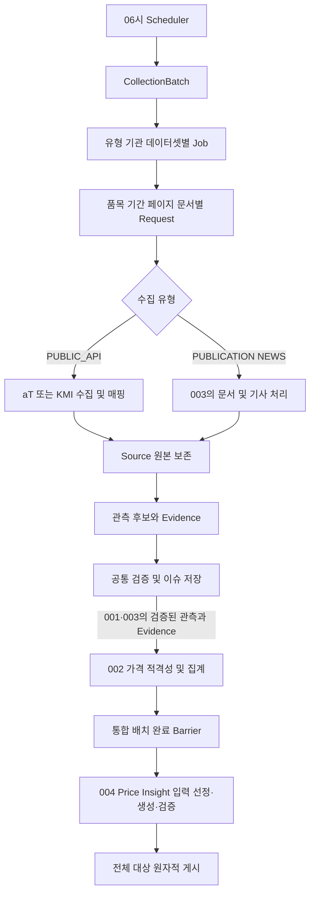

# BE-TECH-SPEC-001 데이터 수집 정규화 검증

- **버전:** V1.1
- **상태:** 승인
- **기준일:** 2026-11-11
- **기존 정책 기준:** 사용자 제공 BE-TECH-SPEC-001 v0.4 Accepted
- **관련 문서:** [002 V1.1](BE-TECH-SPEC-002-가격-데이터-모델링-및-산지-도매가격-산출.md), [003 V1.1](BE-TECH-SPEC-003-PDF-기사-수집-및-정보-추출.md), [004 v0.2](BE-TECH-SPEC-004-Price-Insight-생성-검증-게시.md), [통합 ERD V1.1](../erd/BE-ERD-001-통합-데이터-모델.md)

## 1 목적과 책임

공공 API·PDF·기사의 수집을 하나의 Batch 아래 독립적인 Job과 Request로 관리한다. 원본을 보존하고 가격·거래 관측값을 정규화·검증해 후속 가격 집계와 설명 생성의 입력으로 제공한다. 수집 성공, 관측 유효성, 가격 집계 적격성을 각각 구분한다.

테이블 전체 정의는 ERD를 기준으로 한다. 001의 관측·검증 계약은 API와 문서 경로에 공통 적용하고, 원천별 추출 구현은 분리한다. 단일 Spring Boot 배포와 PostgreSQL 상태 관리, 제한된 백그라운드 실행을 기본으로 하며 외부 호출 중 DB 트랜잭션을 유지하지 않는다. 문서별 상세 책임 경계는 `tech-spec/README.md`에서 관리한다.

## 2 배치와 실행 단위

매일 06:00 `Asia/Seoul`에 통합 배치를 시작한다. 배치는 공공 API·발간물·기사 Job을 수집 유형·기관·데이터셋별로 생성한다. 각 Job은 날짜·품목·페이지·문서 등 독립 처리 범위를 가진 Request를 등록한다. 원천 하나의 실패가 다른 Job의 성공을 취소하지 않는다.

| 모델               | 의미                    | 중복 방지                                  |
| ------------------ | ----------------------- | ------------------------------------------ |
| COLLECTION_BATCH   | 통합 실행 회차          | 스케줄·예정 회차·실행 목적의 execution_key |
| COLLECTION_JOB     | 한 원천/데이터셋의 실행 | batch_id와 작업 정의의 execution_key       |
| COLLECTION_REQUEST | 독립 재시도 단위        | job_id와 실제 요청 조건의 request_key      |
| COLLECTED_SOURCE   | 확보한 원본 버전        | UNIQUE(source_key, content_hash)           |

같은 Request의 재시도는 기존 ID와 attempt_count를 사용한다. Request를 호출 시도마다 새로 만들지 않는다. retry_policy_key는 버전이 고정된 정책 설정을 참조하며 실제 호출 시도 번호는 운영 로그로 연결한다. 날짜·페이지·검색 조건이 달라지면 다른 Request다.

목록/페이지 탐색도 Request로 기록한다. 발견한 후속 Request 등록과 탐색 Request의 성공 처리를 같은 트랜잭션에 묶는다. 조회 페이지·수집 건수·배치 실행 시간에 상한을 두며 제한 없이 탐색하지 않는다. 입력 조건과 정책 키는 작업 시작 후 임의로 변경하지 않는다.



## 3 구성 요소와 구현 계약

| 컴포넌트                    | 책임                                        |
| --------------------------- | ------------------------------------------- |
| CollectionScheduler         | 배치 시작, 중복 회차 확인, 복구 실행 트리거 |
| CollectionOrchestrator      | 원천별 실행 선택, 상태·기한·재시도 조정     |
| CollectionProcessor         | 원본·관측·근거·검증 결과의 원자 저장        |
| PublicDataCollector         | 제공기관별 API 호출 계약                    |
| AtCollector / KmiCollector  | aT·KMI 호출·페이지·오류 해석                |
| PublicDataMapper            | 외부 응답을 공통 관측 후보로 변환           |
| PublicDataValidator         | 어종·값·기간·단위·근거·중복 검사            |
| SpeciesMappingService       | 외부 품목 코드와 내부 어종 연결             |
| ObservationIdentityResolver | 처리 중복과 독립 관측 사건 구분             |

다음 코드는 구현 경계를 설명하는 Java 논리 계약이다. 외부 API DTO, 처리 명령, 영속 Entity를 구분한다. 완성된 애플리케이션 구현이나 컴파일 검증 결과는 아니다.

```java
public interface PublicDataCollector {
    boolean supports(Dataset dataset);
    CollectionResult collect(CollectionRequestCommand request);
}

public interface PublicDataMapper {
    boolean supports(Dataset dataset);
    MappingResult map(RawApiResponse response, Dataset dataset);
}

public interface PublicDataValidator {
    ValidationResult validate(NormalizedObservationCandidate candidate);
}

public record CollectionRequestCommand(
    UUID requestId, UUID jobId, Dataset dataset, Long speciesId,
    LocalDate startDate, LocalDate endDate, Map<String, Object> parameters
) {}
```

외부 API 응답 형식 변경과 오류 해석은 해당 Collector/Mapper가 담당한다. 공급자 응답 DTO를 Entity로 직접 저장하지 않으며, 모델 호출 없이 API를 결정적으로 매핑한다.

## 4 제공기관과 어종 매핑

공공 API 대상은 aT 정산정보와 KMI 유통정보다. KAMIS는 MVP 수집 대상에서 제외한다. 아래 API 식별·필드는 기존 승인본의 참조 정보이며, 실제 배포 시 접근 권한과 현재 응답 계약을 확인한다.

| 구분   | aT 정산정보               | KMI 유통정보            |
| ------ | ------------------------- | ----------------------- |
| API    | `/B552845/katSale/trades` | `/API/openAPI.do`       |
| 품목   | 대·중·소분류 코드         | kdfshCode               |
| 날짜   | trd_clcln_ymd             | creatDate               |
| 가격   | avgprc, lwprc, hgprc 등   | pc, yr 등               |
| 거래량 | unit_tot_qty              | 기존 확인 응답에는 없음 |

| 내부 코드 | 어종      | aT 대/중분류 | KMI 코드 |
| --------- | --------- | ------------ | -------- |
| FLATFISH  | 광어 넙치 | 미확인       | KDFSH08  |
| ROCKFISH  | 우럭      | 미확인       | KDFSH09  |
| HAIRTAIL  | 갈치      | 71/04        | KDFSH02  |
| MACKEREL  | 고등어    | 71/06        | KDFSH01  |
| ABALONE   | 전복      | 62/09, 72/09 | 미확인   |
| SHRIMP    | 새우      | 미확인       | 미확인   |

내부 species.id/code와 외부 품목 코드는 같은 식별자로 사용하지 않는다. SPECIES_EXTERNAL_CODE의 provider·dataset·external_code·mapping_level·active를 조회한다. 미확인 코드를 추정해 채우지 않으며, 이 목록이 모든 품목의 실제 가격 제공 가능성을 보장하지 않는다.

EXACT는 정확 대응, GROUP은 상품군 대응이다. GROUP 매핑만으로 가격 비교 가능성을 인정하지 않는다. 활성 EXACT 매핑이 서로 다른 어종으로 모호하게 연결되지 않도록 보호한다. 미매핑 관측을 보존할 경우 species_id=NULL과 검토 상태를 사용하고 자동 집계에서 제외한다.

## 5 원본 보존과 API 처리

1. 실행 범위·요청 파라미터·retry_policy_key를 고정하고 Request를 점유한다.
2. Collector가 API를 호출하고 응답 상태·페이지·정상 0건 여부를 해석한다.
3. 허용된 저장소에 원본 응답을 보존하고 Source의 content_ref·content_hash·실제 요청 조건을 기록한다.
4. Mapper가 원본 행 키/JSON 경로/페이지 내 위치를 가진 관측 후보를 만든다.
5. 가격·거래 상세와 수치를 지지하는 API Evidence를 구성한다.
6. Validator가 공통 규칙을 검사한 뒤 관측·상세·근거·연결·이슈를 함께 저장한다.

content_hash는 원본 바이트 또는 규약으로 고정한 원본 표현의 SHA-256이다. source_key에는 기관·데이터셋·품목·날짜·페이지 등 실제 요청 범위를 포함한다. 서로 다른 요청의 빈 응답 해시가 같다는 이유로 출처를 하나로 합치지 않는다. URL만 같고 내용이 달라지면 새 Source 버전이다.

Source.metadata는 유형별 JSONB 계약을 사용한다. API에는 schema_version, 실제 요청 조건, 응답 형식, 페이지 정보, 해시 규약 버전과 제공기관 원천 식별 정보를 보존한다. 제공기관 응답에 실제 데이터 기준시각이 포함되면 이 metadata에 보존한다. 정기 작업의 dataset은 Job이 소유하고, 실제 호출 조건은 원본 재현에 필요한 스냅샷으로 metadata에 기록할 수 있다. 권한·본문·파일 규약은 003과 같은 Source 저장 경계를 사용한다.

정상 0건은 Request.NO_DATA로 기록하고, 확보한 빈 원본 응답도 재현 가능하게 보존한다. 0건을 가격 0원이나 기존 관측 삭제로 변환하지 않는다. 원본은 수집됐으나 유효 관측이 없는 경우 수집 성공과 관측 검토/무효 상태를 구분한다.

## 6 정규화 관측과 근거

NORMALIZED_OBSERVATION은 원본·어종·유형·기간·추출 방식·위치·정규화 버전·독립성·검증 상태를 보존한다. PRICE_OBSERVATION은 원천 가격·통화·단위·통계·상품 조건과 검증된 KRW/kg 가격·환산 근거를 보존한다. TRADE_OBSERVATION은 거래량·단위·총액·시장·거래 유형을 보존한다.

observation_type은 PRICE/TRADE 등 관측 내용을, extraction_method는 API_MAPPING/PARSER/AI_EXTRACTION을 구분한다. 관측 기간과 게시·수집 시각을 혼용하지 않는다. 승인 모델에 없는 수급 지표를 거래량으로 바꾸지 않으며, 해당 주장은 003의 Evidence와 원본 응답에 보존한다.

API 관측의 analysis_run_id와 API Evidence의 analysis_run_id는 NULL이다. Evidence.source_locator에는 원본 행 키·JSON 경로·단위 필드 등 수치를 확인할 위치를 남긴다. quote는 해당 원천 값을 확인할 수 있는 응답 발췌다. 검증된 관측에는 하나 이상의 SUPPORTS_VALUE 연결이 있어야 한다. 변동 설명과 일반 맥락은 EXPLAINS_CHANGE/CONTEXT로 구분한다.

### 6.1 저장 중복과 독립 표본

dedupe_fingerprint는 원본 행·처리 설정·어종·유형·상세 값·normalization_version을 포함해 동일 처리 결과가 반복 저장되는 것을 막는다. 독립 관측 사건을 식별하는 independence_key는 별개다. 원출처·원천 사건/행·관측일·시장·상품 조건·지표를 사용하며 가격값만으로 만들지 않는다.

같은 날짜·가격의 서로 다른 거래는 독립 표본일 수 있다. 같은 KMI 수치를 여러 문서가 재인용하면 하나의 사건의 여러 근거일 수 있다. DIRECT/VERIFIED_CITATION도 독립성 검증을 생략하지 않는다. UNKNOWN 또는 사건 식별이 불명확하면 자동 집계에서 제외한다.

### 6.2 정정과 버전

관측 수치·원문 위치·단위·상품 조건·환산 근거는 버전별 불변이다. 정정·재추출·재정규화는 새 observation_id와 fingerprint를 만든다. 같은 사건의 여러 버전 중 현재 사용 가능한 버전 선택은 검증 근거에 따라 명시적으로 결정한다. 새 후보가 실패했다고 기존 정상 버전을 자동으로 무효화하지 않는다.

정정이 확인되어 구버전을 대체하는 경우 구버전의 현재 검증 상태와 VALIDATION_ISSUE에 대체 사유를 기록한다. 대체된 구버전을 다시 최신 적격 값으로 선택하지 않는다. 과거 PERIOD_PRICE_INPUT과 스냅샷의 수치·입력은 수정하지 않는다.

## 7 검증 정책

관측은 VALID, REVIEW_REQUIRED, INVALID로 분류한다. Evidence는 UNREVIEWED, PASS, REVIEW, REJECTED다. 구조 파싱 성공은 관측 VALID나 Evidence PASS를 뜻하지 않는다.

| 검증 항목           | 처리                                               |
| ------------------- | -------------------------------------------------- |
| KMI pc=0            | 원본 보존, 유효 0원 가격으로 자동 처리 금지        |
| 같은 날짜의 복수 값 | 통계 의미와 독립성을 확인하기 전 평균·제거 금지    |
| aT 가격·단위        | 거래 단위·규격·등급·시장·상품 조건 확인            |
| 기간·단위 미확인    | 값 유지 또는 후보 보존, 검토 상태와 자동 집계 제외 |
| 문서·기사 재인용    | 같은 사건을 독립 표본으로 중복 사용하지 않음       |
| 신규 검증 실패      | 기존 정상 관측·가격·게시본 덮어쓰기 금지           |

현재 검증 상태와 구체적인 문제 이력은 분리한다. 기존 ObservationValidation의 역할은 각 관측/Evidence의 상태와 VALIDATION_ISSUE로 대체하며 별도 테이블을 만들지 않는다. 이슈의 source/analysis/observation/evidence FK 중 정확히 하나만 지정하고 details에 실패 위치·실제값·기대 조건을 남긴다.

VALID는 기본 유효성 판정이다. 집계할 가격 단계·기준 원천·상품 조건·독립 사건·표준 단위 적격성은 002가 추가로 판단한다.

## 8 상태와 트랜잭션

| 대상                 | 정상 경로                                 | 실패 또는 기타 상태                                           |
| -------------------- | ----------------------------------------- | ------------------------------------------------------------- |
| Batch / Job          | PENDING → RUNNING → SUCCEEDED             | PARTIAL_SUCCESS, FAILED, CANCELLED                            |
| Request              | PENDING → RUNNING → SUCCEEDED / NO_DATA   | RETRY_PENDING → RUNNING, EXCLUDED_BY_POLICY, FAILED_PERMANENT |
| AnalysisRun          | PENDING → RUNNING → SUCCEEDED             | RETRY_PENDING → RUNNING, REVIEW, FAILED_PERMANENT, CANCELLED  |
| PriceInsightSnapshot | 004의 상태·전이 정책 적용                 | 생성·검증·게시 상태는 004에서 관리                            |

Batch/Job은 해당 실행 창의 요약이며 기존 SUCCEEDED·PARTIAL_SUCCESS 의미는 유지한다. 새 일일 통합 배치가 시작될 때 이전 미완료 배치는 `CANCELLED`로 처리한다. 취소된 배치의 Request는 다음 배치에서 재실행하지 않는다. 미완료 AnalysisRun은 `CANCELLED` 처리하고 같은 행은 재실행하지 않는다. 다음 배치는 성공한 동일 설정 분석을 재사용하며, 기존 실행이 없거나 이전 실행이 상위 배치 취소로 `CANCELLED`된 경우에만 정상 Source·Observation·Evidence를 기반으로 새 배치 소유의 AnalysisRun을 등록한다. `REVIEW`·`FAILED_PERMANENT` 실행은 자동 재실행하지 않는다. 정상 0건만 있는 작업은 실패가 아니다. Request 성공 뒤 문서 분석이 실패해도 원본 수집 성공을 취소하지 않는다. 실행 상태와 별도인 `publication_status`는 ERD와 004의 정책을 따른다.

| 트랜잭션   | 함께 반영할 작업                                  |
| ---------- | ------------------------------------------------- |
| 실행 준비  | Batch 고유키 확보·Job·초기 Request 생성           |
| 작업 점유  | 대기 행 잠금·상태 변경·lease_token·lease_until    |
| 원본 확보  | Source UPSERT·Request 결과·필요한 후속 분석 등록  |
| API 정규화 | 관측·가격/거래·API Evidence·연결·이슈의 원자 저장 |
| 실패 기록  | 현재 토큰 확인·오류·재시도 시각 또는 최종 상태    |

API는 점유 후 원본 확보·매핑·검증을 수행하고, 원본 수집 완료와 정규화 결과를 같은 완료 트랜잭션에 반영할 수 있다. 큰 응답은 Request 범위를 페이지 단위로 제한한다. 분석이 별도인 문서는 003의 트랜잭션 경계를 사용한다.

외부 HTTP·파일 저장·모델 호출·backoff는 트랜잭션 밖이다. 작업 회수 시 토큰을 새로 발급한다. Worker는 완료 결과를 반영할 때 부모 배치가 활성 상태인지, 현재 lease 소유자인지 확인하며 둘 중 하나라도 아니면 지연 결과를 저장하거나 게시하지 않는다. 배치 취소와 결과 반영은 같은 잠금 순서로 직렬화한다. 고유키만으로 외부 호출의 정확히 한 번 실행을 보장한다고 가정하지 않는다.

제공기관별 timeout·최대 시도·페이지·수집량·실행 기한을 버전 설정으로 고정한다. 영구 입력/권한 오류는 자동 재시도하지 않고 일시 오류는 제한된 backoff를 적용한다. 호출 제한·기본 실행안은 003과 공통 실행기를 통해 관리한다. 필수 설정 누락은 작업 시작 전에 탐지한다.

## 9 후속 처리와 운영

저장된 관측과 Evidence는 후속 가격 집계 및 Insight 생성에 활용한다. 기간가격의 재계산은 BE-TECH-SPEC-002의 입력 멱등성 정책을 따른다. Price Insight는 데이터 변경 여부와 관계없이 BE-TECH-SPEC-004의 일일 통합 배치 정책에 따라 신규 생성한다.

로그에는 Batch/Job/Request/Analysis ID, 시도, 원본 해시, 오류·소요 시간을 연결한다. 원문·자격 증명은 일반 로그에 남기지 않는다. 원본·관측·근거·가격 입력·게시 스냅샷 삭제는 재현성과 FK 보존을 고려한 별도 정책을 따른다. 토큰 사용량 컬럼은 만들지 않는다.

## 10 구현 인수 기준

아래는 구현 시 확인할 기준이며 문서 작성 중 실행한 테스트 결과가 아니다.

- 배치·작업·요청 재기동 시 중복 생성 없이 같은 논리 작업을 회수한다.
- 정상 0건과 통신 실패를 구분하고 기존 정상 가격을 보호한다.
- 미매핑·단위 불명·pc=0·독립성 미확인 관측을 자동 집계하지 않는다.
- API 원본 행과 관측·Evidence를 역추적할 수 있다.
- 같은 사건의 재인용은 중복 표본이 되지 않고 다른 독립 거래는 유지된다.
- 만료된 작업자의 늦은 응답이 새 작업의 결과를 덮어쓰지 않는다.
- 이전 통합 배치 취소 후 미완료 Request는 재실행하지 않고 기존 AnalysisRun은 CANCELLED 처리하며, 새 실행은 새 배치 소유 키를 사용한다.
- 취소된 Worker의 지연 결과가 저장·게시되지 않는다.
- 새 배치에서 기존 정상 Source·Observation·Evidence를 재사용할 수 있다.
- 승인 ERD의 컬럼·상태·NULL 규칙과 002/003의 공통 계약이 일치한다.

## 11 변경 이력

### V1

기존 001 v0.4의 원천·매핑·검증 정책을 유지하고 Batch→Job→Request, 원본 metadata, 관측 위치·정규화 버전·독립성, Evidence 연결, 이슈 이력, 멱등성과 lease를 승인 ERD에 맞춰 통합했다. 전체 테이블 정의는 통합 ERD V1에서 관리한다.

### V1.1 — 2026-11-11

BE-TECH-SPEC-003 V1.1, BE-TECH-SPEC-004 v0.2 및 BE-ERD-001 V1.1과 배치 취소, 기존 미완료 AnalysisRun 종료 및 새 배치 소유 실행 등록, Insight 생성 책임·참조를 정합화했다. 기존 데이터 원천·정규화·검증 정책은 유지한다.
