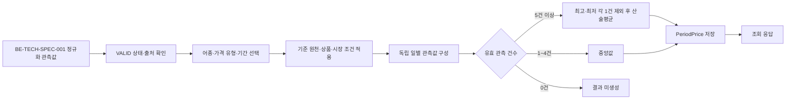
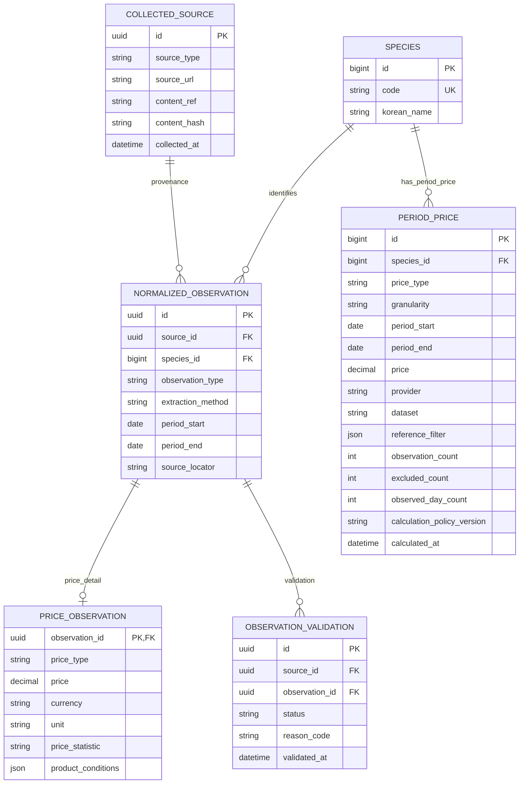

# BE-TECH-SPEC-002-가격-데이터-모델링-및-산지-도매가격-산출

- **상태:** Accepted
- **버전:** v0.4
- **승인일:** 2026-11-06
- **관련 문서:** [BE-TECH-SPEC-001 v0.4](BE-TECH-SPEC-001-데이터-수집-정규화-검증.md), 논리 ERD는 BE-TECH-SPEC-001 §6.1과 본 문서 §5.2를 함께 기준으로 한다.

## Summary

검증된 독립 일별 가격 관측값을 어종·가격 유형·기준 원천별로 집계해 반월·월 산지 및 도매 대표가격을 산출한다. 가격 관측값과 원본은 BE-TECH-SPEC-001의 공통 모델을 사용하고, 계산 결과는 `period_price`에 저장한다.

## 1. Scope and Responsibilities

- **BE-TECH-SPEC-001:** 수집, 원본 보존, 추출·매핑, 정규화 및 기본 데이터 검증
- **본 문서(BE-TECH-SPEC-002):** 가격 비교 가능성 판정, 기준 원천 선택, 기간 가격 집계 및 조회
- 가격 유형은 산지(`PRODUCER`)와 도매(`WHOLESALE`)를 독립적으로 관리한다.
- 산지 가격과 도매 가격, 서로 다른 기관·데이터셋의 값은 하나의 표본 집합으로 합치지 않는다.

## 2. Data Model

| 모델                    | 책임                                               |
| ----------------------- | -------------------------------------------------- |
| `NormalizedObservation` | 내부 어종, 관측 유형·기간, 출처 및 추출 방식       |
| `PriceObservation`      | 가격, 가격 유형, 통화·단위, 통계 종류 및 상품 조건 |
| `ObservationValidation` | 검증 상태와 검증 사유                              |
| `PeriodPrice`           | 기간별 대표 가격과 계산 근거                       |

`PriceObservation`은 `NormalizedObservation`의 가격 상세 모델이다. 가격 도메인에서 원본이나 정규화 관측값을 중복 저장하지 않는다.

### 2.1 Implementation Contracts

가격 계산 규칙은 인터페이스와 도메인 서비스로 구현하고, 가격 관측값·기간 가격은 영속 데이터 모델로 구현한다. 아래 Java 코드는 구현 경계와 모델 책임을 보여주는 논리 예시다. 외부 응답 DTO는 이 도메인 모델로 직접 사용하지 않는다.

```java
// 검증된 관측값 중 집계 입력으로 사용할 수 있는 값만 선택한다.
public interface PriceObservationSelector {
    List<EligiblePriceObservation> select(PriceAggregationCriteria criteria);
}

// 승인된 표본 수 정책에 따라 대표가격을 산출한다.
public interface PeriodPriceCalculator {
    CalculationResult calculate(List<EligiblePriceObservation> observations);
}

// 원천 선택, 입력 조회, 계산 및 결과 저장을 조정한다.
public class PeriodPriceService {
    PeriodPriceCalculator calculator;
    PriceObservationSelector selector;
    PeriodPriceRepository repository;
}

public record PriceAggregationCriteria(
    Long speciesId,
    PriceType priceType,       // PRODUCER 또는 WHOLESALE
    Granularity granularity,   // HALF_MONTH 또는 MONTH
    LocalDate periodStart,
    LocalDate periodEnd,
    String provider,
    String dataset,
    Map<String, Object> referenceFilter
) {}

// 입력 관측값 참조와 가격 값. 검증·비교 가능성은 선택 단계에서 확인한다.
public record EligiblePriceObservation(
    UUID observationId,
    LocalDate observedAt,
    BigDecimal priceKrwPerKg
) {}

// 저장되는 계산 결과 모델; 실제 구현에서는 Entity/Repository로 매핑한다.
public class PeriodPrice {
    Long id;
    Long speciesId;
    PriceType priceType;
    Granularity granularity;
    LocalDate periodStart;
    LocalDate periodEnd;
    BigDecimal price;
    String provider;
    String dataset;
    Map<String, Object> referenceFilter;
    int observationCount;
    int excludedCount;
    int observedDayCount;
    String calculationPolicyVersion;
    Instant calculatedAt;
}
```

`PriceObservationSelector`는 BE-TECH-SPEC-001의 검증 상태와 출처를 확인하고 가격 도메인의 비교 조건을 적용한다. `PeriodPriceCalculator`는 선택된 값에 집계 정책만 적용하며 원천 데이터 수집이나 정규화를 수행하지 않는다.

### `period_price`

| 필드                         | 설명                         |
| ---------------------------- | ---------------------------- |
| `id`                         | 기간 가격 ID                 |
| `species_id`                 | 내부 어종 ID                 |
| `price_type`                 | `PRODUCER` 또는 `WHOLESALE`  |
| `granularity`                | `HALF_MONTH` 또는 `MONTH`    |
| `period_start`, `period_end` | 집계 기간                    |
| `price`                      | 대표 가격 (KRW/kg)           |
| `provider`, `dataset`        | 기준 원천 및 데이터셋        |
| `reference_filter`           | 기준 상품·시장 조건          |
| `observation_count`          | 집계에 사용된 유효 관측 건수 |
| `excluded_count`             | 절사 제외 건수               |
| `observed_day_count`         | 유효 관측일 수               |
| `calculation_policy_version` | 적용한 계산 정책 버전        |
| `calculated_at`              | 계산 시각                    |

## 3. Aggregation Eligibility

집계 입력은 다음 조건을 충족해야 한다.

- 검증 상태가 `VALID`이고 원본 출처와 관측 근거를 추적할 수 있다.
- 내부 어종, 산지·도매 가격 유형, 관측 기준일 및 가격 단위를 식별할 수 있다.
- 상품·등급·규격·시장 조건이 선택된 기준 원천과 비교 가능하다.
- 독립 관측값이어야 하며, 기사나 발간물의 재인용 수치를 중복 계산하지 않는다.
- 가격 값과 단위의 의미가 유효해야 한다.

`REVIEW_REQUIRED`, `INVALID`, 매핑 실패, 기간·단위 불명확 또는 독립 여부가 확인되지 않은 값은 자동 집계에서 제외한다. 외부 품목의 `GROUP` 매핑은 가격 비교 가능성을 보장하지 않는다.

동일 날짜의 복수값은 임의로 평균하거나 제거하지 않는다. 해당 값의 통계 의미와 독립 관측 여부를 확인해 집계 적합성을 판단한다.

## 4. Aggregation Policy

집계는 어종, 가격 유형, 기준 원천, 비교 조건 및 기간별로 독립 수행한다. 기준 원천과 참조 조건은 결과에 기록한다.

| 유효 관측 건수 | 산출 방식                                 | 제외 건수 |
| -------------: | ----------------------------------------- | --------: |
|       5건 이상 | 최고값 1건과 최저값 1건을 제외한 산술평균 |         2 |
|          1~4건 | 중앙값                                    |         0 |
|            0건 | 결과를 산출하지 않음                      |         0 |

짝수 개 중앙값은 가운데 두 값의 산술평균이다. 입력은 독립적인 일별 관측값으로 구성하며 중복 일자값으로 표본 수를 부풀리지 않는다. 결과 가격의 기준 단위는 KRW/kg이다. 승인된 변환 근거가 없는 서로 다른 단위는 함께 집계하지 않는다.

반월 기간은 매월 1~15일과 16일~말일이며, 월 기간은 매월 1일~말일이다. 집계에는 관측 기준일을 사용하고 발행일과 게시일은 관측일과 구분한다.

## 5. Result Traceability

계산 결과에는 어종, 가격 유형, granularity, 기간, 기준 원천, 참조 조건, 관측 건수, 절사 건수, 관측일 수, 계산 정책 버전 및 계산 시각을 기록한다. 각 결과를 산출한 입력 관측값을 추적할 수 있도록 한다. 재계산 시 과거 결과와 정책 버전을 구분해 보존한다.

### 5.1 Aggregation Pipeline



### 5.2 Logical ERD


