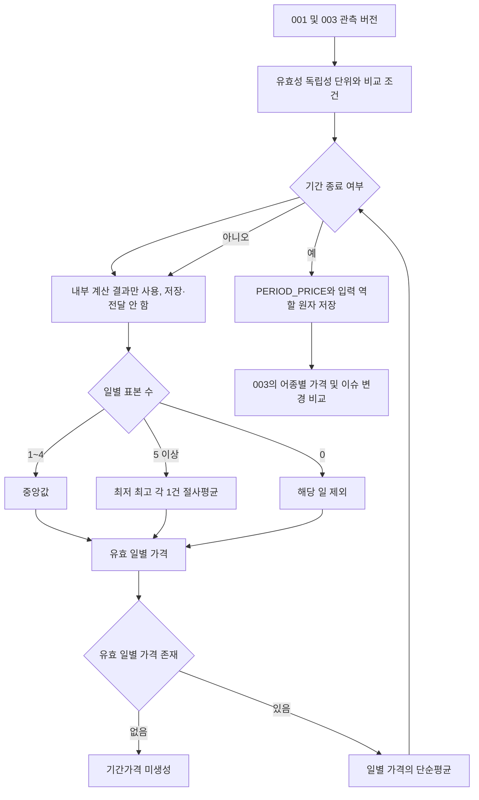

# BE-TECH-SPEC-002 가격 데이터 모델링 및 산지 도매가격 산출

- **버전:** V1
- **상태:** 승인
- **기준일:** 2026-11-09
- **기존 정책 기준:** 사용자 제공 BE-TECH-SPEC-002 v0.5 Accepted
- **집계 정책:** price-aggregation-v2 유지
- **관련 문서:** [001 V1](BE-TECH-SPEC-001-데이터-수집-정규화-검증.md), [003 V1](BE-TECH-SPEC-003-PDF-기사-수집-및-정보-추출.md), [통합 ERD V1](../erd/BE-ERD-001-통합-데이터-모델.md)

## 1 목적과 책임

검증된 독립 가격 관측값에서 날짜별 대표가격을 구하고, 유효 일별 가격을 단순평균해 반월·월 산지 및 도매가격을 산출한다. 원본과 공통 관측은 001/003에서 생성하며 본 문서는 집계 적격성·비교 조건·기준 원천·가격 산출·버전·입력 재현을 담당한다.

산지(PRODUCER)와 도매(WHOLESALE)는 독립 관리한다. 서로 다른 기관·데이터셋·비교 불가능한 상품·시장의 값을 하나의 표본 집합으로 합치지 않는다. RETAIL 원천 값은 보존할 수 있지만 본 산지·도매 집계에는 포함하지 않는다. 대표가격 계산을 AI에 위임하지 않는다.

## 2 데이터 모델과 집계 키

| 모델                            | 책임                                                     |
| ------------------------------- | -------------------------------------------------------- |
| NORMALIZED_OBSERVATION          | 어종·관측일·원본·정규화 버전·독립성·검증 상태            |
| PRICE_OBSERVATION               | 원천 가격·단위·통계·상품 조건과 표준 KRW/kg 값·환산 근거 |
| EVIDENCE / OBSERVATION_EVIDENCE | 가격 수치의 원문 근거와 연결 역할                        |
| VALIDATION_ISSUE                | 관측·근거 문제와 처리 이력                               |
| PERIOD_PRICE                    | 집계 키별 불변 대표가격 버전                             |
| PERIOD_PRICE_INPUT              | 해당 버전의 적격 원본 관측 및 일별 절사 역할             |

집계 키는 `(species_id, price_type, provider, dataset, reference_filter, granularity, period_start, period_end)`다. reference_filter는 규격·등급·시장·원산지 등 비교 기준을 정해진 타입·키·값 규약으로 정규화한다. 빈 조건이 모든 상품의 혼합 허용을 뜻하지 않는다.

일별 그룹은 같은 어종·가격 유형·기준 원천/데이터셋·비교 조건·표준 단위·관측일로 구성한다. granularity와 기간은 일별 결과를 묶을 때 적용한다. period_start/end는 관측 기준 기간이며 수집일이나 문서 발행일이 아니다.

## 3 집계 적격성

다음 조건을 모두 충족한 가격 관측만 자동 선택한다.

1. 관측 상태가 VALID이고 원본 위치와 수치를 지지하는 근거를 추적할 수 있다.
2. 어종·산지/도매 구분·단일 관측일을 식별할 수 있다. 일별 입력은 관측 period_start=period_end다.
3. 기준 원천과 상품·규격·시장 조건이 비교 가능하다.
4. 승인된 근거로 `price_krw_per_kg`가 준비되어 있다.
5. 독립 사건이 확인되어 있고 같은 사건의 중복 버전을 제거할 수 있다.
6. 현재 적용할 정정·검증 버전이 명시적으로 선택되어 있다.

REVIEW_REQUIRED, INVALID, 미매핑, 미확인 단위/기간, citation_status=UNKNOWN 또는 independence_key 미확인 값은 자동 집계에서 제외한다. Evidence PASS 또는 관측 VALID만으로 나머지 조건을 생략하지 않는다. 문서의 월평균 가격을 일별 가격 여러 건으로 복제하지 않는다.

KMI pc=0은 유효한 0원으로 자동 처리하지 않는다. aT 가격은 원천 통계와 거래 단위를 확인하며 평균·최저·최고 필드들을 독립 거래 여러 건으로 무조건 펼치지 않는다. GROUP 매핑은 별도의 비교 가능성 확인 없이는 적격하지 않다.

### 3.1 독립 사건과 정정

independence_key가 같은 여러 관측은 같은 사건의 재인용 또는 처리 버전일 수 있다. 검증된 적용 버전 하나만 선택한다. 확정된 정정으로 대체된 구버전을 다시 적격 값으로 선택하지 않으며, 구버전의 대체 사유는 001의 현재 검증 상태와 이슈로 관리한다.

원출처 문서 키 하나에 여러 독립 거래가 들어갈 수 있으므로 cited_origin_key만으로 전체 문서의 거래를 합치지 않는다. 같은 날짜·가격의 다른 거래는 독립 표본일 수 있다. 여러 기사가 전달한 같은 원출처 사건은 근거가 여러 개여도 가격 표본 하나다.

### 3.2 표준 단위

원천 price/currency/unit는 보존하고 표준가격은 별도 필드로 사용한다. normalization_basis에는 승인된 환산계수·규칙·근거를 고정하고 관측 normalization_version과 연결한다. 원/kg이면 항등 환산, 원/상자이면 확인된 상자 중량 등 승인 근거가 필요하다. 근거 없는 단위·통화 변환은 하지 않는다.

표시용 반올림 값을 집계 입력이나 독립 사건 판정에 사용하지 않는다. 계산과 표시 정밀도를 구분하고 구현의 나눗셈·저장 반올림 규약을 정책 버전과 함께 고정한다. 물리 NUMERIC 정밀도는 실제 원천 범위 확인 후 정한다.

## 4 두 단계 집계 정책

### 4.1 일별 대표가격

해당 날짜의 적격 독립 원본 건수 n에 따라 계산한다.

| n      | 일별 가격                             | 제외 건수 |
| ------ | ------------------------------------- | --------: |
| 0      | 산출하지 않음                         |         0 |
| 1~4    | 중앙값                                |         0 |
| 5 이상 | 최저 1건과 최고 1건을 제외한 산술평균 |         2 |

짝수 중앙값은 가운데 두 값의 산술평균이다. 동률의 절사 대상은 `(price_krw_per_kg, observation_id)`로 안정 정렬해 고정한다. 값이 같아도 최저·최고 각각 정확히 한 관측만 절사한다.

### 4.2 반월과 월 대표가격

유효 일별 가격이 존재하는 날짜 집합을 D라고 하면 기간가격은 `sum(daily_price[d]) / |D|`다. 원본 관측 수를 가중치로 사용하지 않고, 관측이 없는 날짜를 0원으로 채우지 않는다. 유효 일별 가격이 없으면 기간 결과를 산출하지 않는다.

반월은 매월 1~15일과 16일~말일, 월은 1일~말일이다. 미완료 기간 가격은 내부 검토·계산할 수 있지만 `PERIOD_PRICE`에 저장하지 않는다. 사용자 API, 홈, 차트 및 PriceInsight 생성 입력은 완료된 기간의 가격만 사용한다. 기간 종료 후 해당 기간의 유효 일별 가격을 집계해 저장한다. 완료 기간의 관측 일수가 적더라도 실제 유효 일별 가격만 평균하며 누락일을 0원으로 보간하지 않는다. `observed_day_count`와 실제 데이터 기준시각(`data_as_of`)을 결과 전달에 보존한다. `data_as_of`는 선택 입력 원천이 제공한 실제 기준시각을 사용하며, 계산 시각 `calculated_at`으로 대체하지 않는다. 원천에 기준시각이 없으면 임의 생성하지 않고 미제공으로 처리한다.

### 4.3 지표

| 결과 항목                  | 정의                                        |
| -------------------------- | ------------------------------------------- |
| observation_count          | 기간 내 절사 전 적격 독립 원본 관측 총수    |
| excluded_count             | 일별 최고·최저 절사로 제외한 원본 관측 합계 |
| observed_day_count         | 유효 일별 가격 수. 기간 평균의 분모         |
| calculation_policy_version | price-aggregation-v2                        |

`observation_count`는 기간 평균의 분모나 가중치가 아니다. `data_as_of`는 결과 전달 시 사용하는 값이며, 선택 입력과 연결된 `COLLECTED_SOURCE.metadata`의 실제 데이터 기준시각을 보존해 전달한다. 이는 `PERIOD_PRICE` 컬럼이 아니며 새 테이블이나 컬럼을 추가하지 않는다. 정책의 표본 규칙이나 집계 단계를 변경하면 새 정책 식별자를 사용한다.

### 4.4 계산 예시

| 예시 | 같은 일별 그룹의 가격                      | 일별 결과 | 절사 수 |
| ---- | ------------------------------------------ | --------: | ------: |
| 0건  | 없음                                       |    미산출 |       0 |
| 1건  | 12,000                                     |    12,000 |       0 |
| 4건  | 10,000 / 12,000 / 14,000 / 20,000          |    13,000 |       0 |
| 5건  | 10,000 / 11,000 / 12,000 / 13,000 / 30,000 |    12,000 |       2 |

기간 예시에서 1일 `[10,000,14,000]`은 중앙값 12,000, 2일 `[1,000,10,000,20,000,30,000,100,000]`은 절사평균 20,000, 3일은 무관측이라고 가정한다. 기간가격은 `(12,000+20,000)/2=16,000원/kg`이다. observation_count=7, excluded_count=2, observed_day_count=2다. 원본 수로 가중하면 약 17,714원이므로 잘못된 계산이다.

## 5 구현 계약과 파이프라인

```java
public interface PriceObservationSelector {
    List<EligiblePriceObservation> select(PriceAggregationCriteria criteria);
}
public interface DailyPriceCalculator {
    Optional<DailyPrice> calculate(List<EligiblePriceObservation> observations);
}
public interface PeriodPriceCalculator {
    PeriodPriceResult calculate(
        PriceAggregationCriteria criteria, List<DailyPrice> dailyPrices
    );
}
public record PriceAggregationCriteria(
    Long speciesId, PriceType priceType, Granularity granularity,
    LocalDate periodStart, LocalDate periodEnd,
    String provider, String dataset, Map<String, Object> referenceFilter
) {}
public record EligiblePriceObservation(
    UUID observationId, String independenceKey,
    LocalDate observedAt, BigDecimal priceKrwPerKg
) {}
public record DailyPrice(
    LocalDate observedAt, BigDecimal priceKrwPerKg,
    int observationCount, int excludedCount
) {}
```

코드는 논리 계약이며 영속 Entity 정의나 완성 구현이 아니다. PeriodPriceService가 기준 원천 선택→적격 입력 조회→일별 계산→기간 계산을 조정하고, 기간 종료 여부를 확인해 완료된 기간만 버전으로 저장한다. 미완료 기간의 내부 계산 결과는 저장·전달하지 않는다. 입력 선택기는 원본과 검증을 확인하고 계산기는 순수 계산만 담당한다.



## 6 버전과 입력 재현

PERIOD_PRICE는 집계 키별 계산 결과의 불변 버전이다. 입력·정규화·정책이 달라지면 새 ID를 만든다. input_signature는 집계 키·정책·선택된 관측 버전·정규화 버전·절사 역할의 정렬된 입력으로 만든다. calculated_at 같은 실행 시각만으로 입력 서명을 바꾸지 않는다. 같은 서명은 기존 계산 버전을 재사용한다.

PERIOD_PRICE_INPUT에는 적격 표본을 INCLUDED/TRIMMED_MIN/TRIMMED_MAX로 모두 보존한다. 중앙값 계산에서도 적격 원본 전체를 INCLUDED로 남겨 정책으로 재현한다. 부적격·미매핑 후보는 연결하지 않으며 제외 사유는 원본/관측 검증 이력에 둔다. 연결 FK는 PRICE_OBSERVATION(observation_id)다.

원본 관측과 표준가격·환산 근거, 기간가격과 입력 링크는 수정하지 않는다. 현재 검증 상태가 변경되어도 과거 계산은 당시 링크와 정책으로 재현하며 현재 적격성으로 입력을 다시 선택하지 않는다. 현재 조회용 적격성은 별도로 판정한다.

## 7 트랜잭션과 재계산

완료 기간 키별 REPEATABLE READ 트랜잭션에서 적격 입력을 고정하고 일별·기간 계산, input_signature, PERIOD_PRICE 및 모든 입력 링크를 함께 저장한다. 미완료 기간은 내부 계산만 허용하며 해당 결과와 입력 링크를 PERIOD_PRICE에 저장하거나 사용자·PriceInsight 입력으로 전달하지 않는다. 외부 호출을 포함하지 않으며 중복 서명 충돌은 기존 버전 재사용으로 처리한다. 직렬화 충돌·DB 재시도는 짧은 트랜잭션 범위에서 제한한다.

새 관측·정정·검증 변경이 발생하면 해당 관측일이 포함된 반월·월 집계 키만 재검토한다. 독립 사건/적격성 선택이 바뀌지 않아 입력 서명이 같으면 계산 결과를 다시 쓰지 않는다. 입력 lineage가 바뀌어 새 가격 버전이 생겨도 사용자 표시 가격과 이슈가 같다면 PriceInsight 재생성은 생략할 수 있다.

기존 정상 관측을 신규 수집 실패로 지우지 않는다. 정상 0건은 기존 원본의 철회가 아니다. 반면 명시적으로 가격의 오류·철회가 확인되어 적격 입력이 없어지면 기존 결과를 현재 유효 가격이라고 재선택하지 않는다. 현재 선택기는 PERIOD_PRICE_INPUT의 원본 상태와 해당 집계 키의 재평가 결과를 확인하고, 과거 가격은 이력으로 보존한다.

## 8 조회와 PriceInsight 게시

기본 가격 조회는 동일 집계 키에서 현재 적격 입력과 일치하는 버전을 선택한다. `MAX(id)`나 다른 원천의 결과를 섞어 최신값으로 취급하지 않는다. 정상 버전의 calculated_at과 입력 재현 정보를 함께 사용한다. 실패한 수집·재계산으로 가짜 새 가격이나 0원 결과를 만들지 않는다.

사용자에게는 가격값·단위·기간·기준 원천·비교 조건·관측일 수·산출 시각을 제공할 수 있다. 대표가격의 데이터 기준과 마지막 배치 확인 시각을 구분한다. 데이터가 없으면 미산출로 표현하며 누락일을 보간하지 않는다.

PriceInsight 화면의 차트와 설명은 같은 PUBLISHED 스냅샷의 가격 버전과 기준시각으로 제공한다. 계산 결과를 DB에 저장하는 것과 화면의 게시본을 전환하는 것은 다른 단계다. 새 생성 실패 시 이전 설명에 새 가격을 조용히 결합하지 않는다. 기존 게시본을 유지하되 그 실제 기준시각을 그대로 표시한다. 가격의 무효화가 확인된 경우 최신 정상 데이터라는 표시는 금지하고 검토 상태를 알린다.

변경 없는 광어는 기존 차트와 Insight를 유지한다. 가격이 같아도 광어의 관련 이슈가 새로 생기거나 정정되면 003이 Insight 갱신을 판단한다. 최종 변경 판단은 003의 content_fingerprint를 사용하며 수집 시각이나 내부 ID 변화만으로 갱신하지 않는다.

## 9 인수 기준과 버전 이력

구현 시 §4.4 예시와 0/1/4/5건 경계, 동률 절사, 기간 무관측, 원천·상품 조건 분리, 재인용 중복, 정정 버전, 단위 환산, 과거 입력 재현을 확인한다. 이는 문서의 기대 결과이며 실행한 테스트 결과가 아니다.

V1은 기존 002 v0.5의 두 단계 정책을 유지하면서 표준가격·환산 근거, 독립 사건·정정 선택, 불변 기간가격·입력 역할·input_signature, 영향 기간 재계산, 차트와 Insight의 게시 기준을 통합했다. 전체 컬럼과 관계는 통합 ERD V1을 따른다.
