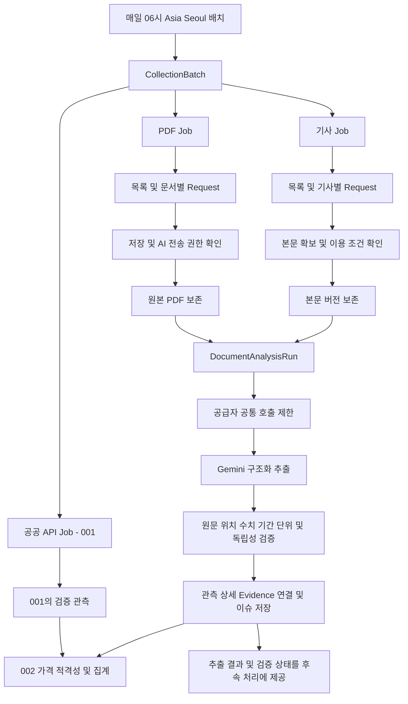
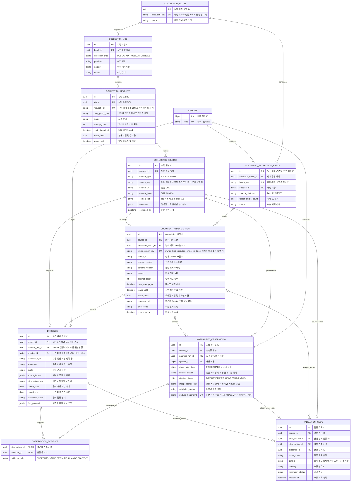

# BE-TECH-SPEC-003 PDF 및 기사 수집과 정보 추출

- **버전:** V1

- **상태:** 승인

- **기준일:** 2026-11-11

- **대상:** 오늘의 수산 백엔드 MVP

- **관련 문서:** [001 V1](BE-TECH-SPEC-001-데이터-수집-정규화-검증.md), [002 V1](BE-TECH-SPEC-002-가격-데이터-모델링-및-산지-도매가격-산출.md), [004 V1](BE-TECH-SPEC-004-Price-Insight-생성-검증-게시.md), [통합 ERD V1](../erd/BE-ERD-001-통합-데이터-모델.md)

## Summary

PDF와 기사 원본을 보존하고 Gemini 분석으로 관측 후보와 Evidence를 추출한다. 원문·기간·단위·어종·독립성을 검증한 뒤 공통 관측과 근거로 저장한다. 모델 응답 성공과 가격 집계 적격성을 구분한다.

이 문서는 PDF·뉴스 원본 수집과 구조화 추출, 근거·관측 검증 및 저장 계약을 정의한다. Price Insight 입력 확정·생성·검증·게시 정책은 승인된 BE-TECH-SPEC-004가 정의한다.

## 1 기준 문서

| 문서 | 적용 기준                                  |
| ---- | ------------------------------------------ |
| 001  | 공통 수집·정규화·검증 계약                 |
| 002  | 가격 집계와 입력 재현 계약                 |
| 004  | Price Insight 입력·생성·검증·게시 계약     |
| ERD  | V1.1 기준 17개 논리 테이블, 컬럼·관계·키·NULL·불변성 |

001/002는 사용자가 제공한 Accepted v0.4/v0.5의 업무 정책을 유지하면서 승인 ERD로 통합한 V1.1을 참조한다. 본 문서는 기존 003 v0.2를 통합했다. ERD는 토큰 사용량 컬럼을 제거한 사용자 승인 모델을 유지한다. 초기 실행 수치·배포 설정은 §11의 구현 기본안이며 실측치가 아니다.

실행 근거는 승인된 [ADR-007](https://github.com/today-fish/today-fish-docs/blob/main/MVP/architecture/backend/BE-ADR-007-가격수집-PDF-AI-파이프라인.md), [ADR-008](https://github.com/today-fish/today-fish-docs/blob/main/MVP/architecture/backend/BE-ADR-008-AI-실행-아키텍처.md)이다. 전자는 경량 실행과 유효 가격 필수, 후자는 Spring 백그라운드 AI 호출과 추출/설명 계약 분리를 정의한다. POC-005의 직접 PDF 입력 결과는 활용 가능성의 근거이며 신규 문서 정확도나 운영 성능 보장이 아니다.

본 문서는 PDF·뉴스 수집·분석과 추출 결과의 검증·저장 계약만 정의한다. Price Insight 책임 경계는 docs 저장소의 tech-spec/README.md에서 관리한다.

## 2 범위와 불변 조건

1. PDF·기사는 공공 API와 독립적인 Job으로 처리한다. 한 원천의 실패로 다른 원천의 성공을 롤백하지 않는다.

2. PDF 저장 허용과 외부 AI 전송 허용을 각각 확인한다. 허용 여부가 불명확하면 해당 동작을 보류한다.

3. 원본과 분석 응답을 비공개 참조로 보존한다. PostgreSQL에는 파일 바이너리를 넣지 않는다.

4. PDF는 Gemini 직접 입력을 기본 구현 경로로 삼는다. ADR-007이 허용한 결정적 파싱 경로는 원천별 설정으로 선택할 수 있으며 필수 선행 텍스트 추출을 강제하지 않는다.

5. 기사는 확보한 본문을 경량 모델에 전달한다. PDF 모델과 기사 모델은 별도 설정하되 공급자 프로젝트·모델 한도는 공유 범위에 맞춰 제한한다. 뉴스는 어종×플랫폼 단위 DOCUMENT_EXTRACTION_BATCH로 묶고 최대 15개 기사를 처리한다. 각 기사 분석 결과와 실패·재시도 상태는 기사별로 보존한다.

6. 생성된 후보는 검증 전 사실이나 가격 표본이 아니다. 설명용 근거의 PASS도 가격 비교 가능성을 자동 보장하지 않는다.

7. 관측값의 원문 위치와 가격·거래 상세를 보존한다. 수치로 저장할 수 없는 정성 주장은 Evidence로 보존한다.

8. 원본 내용과 관측 수치·환산 근거는 버전별 불변이다. 정정·재정규화는 새 버전으로 추가한다.

9. DB에 토큰 사용량 컬럼·AI 예산 테이블·사용량 이벤트 테이블을 추가하지 않는다. 공급자 호출 제한은 실행 설정과 호출 제어 책임이다.

10. 한 문서나 기사 분석의 실패는 다른 문서·기사의 성공 결과를 되돌리지 않는다. 기사별 성공·실패와 재시도 상태를 보존한다.

## 3 배치 실행 구조

### 3.1 구성



06시 통합 시작과 어종별 변경 시 갱신은 사용자 승인 요구다. 목록 탐색 창은 마지막 정상 탐색 시점과 원천 설정의 중첩 구간을 사용한다. 오늘 발행된 자료만 검색해서 늦게 등록된 문서나 정정본을 놓치지 않는다.

### 3.2 실행 단위

| 단위        | 의미와 완료 기준                                                                          |
| ----------- | ----------------------------------------------------------------------------------------- |
| Batch       | 한 번의 통합 실행 회차. `execution_key`로 중복 시작 방지                                  |
| Job         | 수집 유형·기관·데이터셋별 실행. `execution_key`에 batch_id 포함                           |
| Request     | 목록 한 페이지, 문서 하나, 기사 하나 등 독립 재시도 단위. 같은 요청 재시도는 기존 ID 사용 |
| Source      | 확보한 원본 버전. 같은 요청에서 원본 여러 개 또는 0개 가능                                |
| AnalysisRun | 하나의 원본과 모델·프롬프트·스키마 설정에 대한 분석 실행. 수집 Request와 별도 재시도      |

목록 탐색도 Request로 기록하고, 발견한 다운로드 Request를 고유키 기반으로 일괄 등록한다. 목록 Request를 성공 처리하는 트랜잭션에 자식 요청 등록을 포함해 장애 후 요청 유실을 막는다. 부모 자식 관계의 표시가 필요하면 `request_params`의 단계와 탐색 요청 ID를 사용하며 새 관계 테이블을 추가하지 않는다.

Request의 SUCCEEDED는 원본 확보 성공이다. 분석 실패 때문에 원본을 다시 다운로드하지 않는다. Job 종료 집계에는 그 Job의 Source에 연결된 AnalysisRun도 포함한다. 배치 실행 기한 내 완료되지 않은 재시도 작업은 현재 실행에서 최종 상태로 정리한다. 이번 Job/Batch는 성공 결과가 있으면 PARTIAL_SUCCESS, 없으면 FAILED로 종료한다. 다음 일일 통합 배치가 이전 배치를 `CANCELLED` 처리하면 해당 배치의 미완료 Request는 재실행하지 않고 미완료 AnalysisRun은 `CANCELLED`로 종료해 같은 행을 재실행하지 않는다. 이미 정상 저장된 Source·Observation·Evidence와 성공한 동일 설정의 분석 결과는 다음 배치에서 재사용한다. 새 AnalysisRun은 같은 설정의 이전 실행이 없거나 상위 배치 취소로 이전 실행이 `CANCELLED`된 경우에만 새 배치 소유로 등록한다. 결과 반영 시 부모 배치 상태와 현재 lease 소유권을 확인한다.

## 4 모듈과 구현 계약

Spring Boot 모듈형 구조와 PostgreSQL 영속 상태를 사용한다. 별도 Python Worker·Spring Batch·메시지 브로커는 본 명세의 필수 구성요소가 아니다. 분석 작업은 웹 요청 스레드와 분리된 제한된 실행 풀에서 처리한다.

| 컴포넌트                                             | 책임                                                  |
| ---------------------------------------------------- | ----------------------------------------------------- |
| `CollectionScheduler`                                | 배치 시작과 현재 실행 안의 재시도 트리거               |
| `CollectionOrchestrator`                             | 001의 공통 실행 경계. 유형별 실행 선택과 상태 조정    |
| `PublicationOrchestrator` / `NewsOrchestrator`       | 원천별 단계 순서와 부분 실패 처리                     |
| `PublicationCatalogCrawler` / `NewsDiscoveryCrawler` | 신규·변경 자료 탐색과 후속 Request 등록               |
| `SourcePolicyService`                                | 원본 저장 허용과 AI 전송 허용을 각각 판단             |
| `PrivateObjectStore`                                 | 비공개 원본·본문·분석 응답 저장                       |
| `StructuredExtractionPort`                           | 공급자와 SDK에 독립적인 추출 호출                     |
| `DocumentValidationService`                          | 스키마·원문·기간·수치·단위·인용 검증                  |
| `ObservationIdentityResolver`                        | 처리 중복과 독립 관측 사건 식별                       |
| `CollectionProcessor`                                | 001의 원본·정규화·검증 저장 책임에 문서 경로 연결     |
| `InsightEvidenceProvider`                            | PriceInsight 입력에 검증 상태와 원문을 가진 맥락 제공 |
| `PriceInsightService`                                | 본 문서 범위 밖. 상세 계약은 승인된 004에서 정의      |

아래 코드는 구현 경계를 나타내는 Java 논리 계약이며 컴파일 가능한 완성 구현은 아니다. 공급자 SDK 타입과 외부 JSON을 DB Entity에 직접 매핑하지 않는다.

```java

public interface StructuredExtractionPort {

    ExtractionResponse extract(ExtractionRequest request);

}

public record ExtractionRequest(

    UUID analysisRunId,

    String sourceType,

    String contentRef,

    String contentHash,

    String modelId,

    String promptVersion,

    String schemaVersion

) {}

public record ExtractionResponse(

    String providerRequestId,

    String structuredJson,

    String finishReason

) {}

public interface InsightEvidenceProvider {

    List\<InsightEvidenceInput> findForInsight(

        Long speciesId, LocalDate start, LocalDate end, Instant asOf

    );

}

public record InsightEvidenceInput(

    UUID evidenceId,

    Long speciesId,

    String evidenceType,

    String statement,

    String quote,

    Map\<String, Object> sourceLocator,

    UUID sourceId,

    String sourceTitle,

    String sourceUrl,

    LocalDate periodStart,

    LocalDate periodEnd,

    String validationStatus,

    String citedOriginKey,

    String inclusionRole

) {}

```

## 5 원본 확보와 보존

### 5.1 PDF

1. 허용된 공급원에서 목록과 첨부를 탐색한다. 게시물 ID, landing URL, 파일 URL, 발행일, 제목을 수집한다.

2. 저장 권한과 AI 전송 권한을 확인한다. 저장 불가이면 본문을 보존하지 않고 Request에 EXCLUDED_BY_POLICY와 사유를 남긴다. 저장은 허용되나 AI 전송이 불가하면 Source를 보존하고 분석 실행을 만들지 않는다.

3. 연결·다운로드 전체 시간과 누적 바이트 상한을 적용한다. Content-Length만 신뢰하지 않고 스트리밍 중에도 제한한다. PDF 시그니처·파손·암호화 여부·물리 페이지 수를 검사한다.

4. 원본 바이트 SHA-256을 계산한다. 파일 크기·페이지 수·MIME·이용 조건 근거는 `metadata`에 보존한다.

5. 비공개 R2에 원본을 저장한다. 예시 키는 `publications/{provider}/{documentId}/{sha256}.pdf`이며 ID는 경로에 안전하게 인코딩한다. `content_ref`는 비공개 Object Key이고 버킷·저장소 설정은 명명 규약으로 해석한다.

6. Source와 Request의 수집 결과를 같은 DB 트랜잭션으로 반영한다. 동일 Source 버전이면 기존 ID를 재사용한다.

7. AI 전송이 허용된 새 분석 설정이면 AnalysisRun을 등록한다. 성공한 동일 분석이 있으면 재사용한다.

R2와 PostgreSQL은 하나의 원자 트랜잭션이 아니다. R2 성공 후 DB 실패는 동일 객체 키로 재연결하며, DB에서 참조하지 않는 객체는 일정 유예 후 재조정한다. 유예 시간과 삭제 권한은 운영 설정으로 정한다. DB 실패 직후 원본을 즉시 삭제하지 않는다.

R2는 장기 원본 저장소다. 공급자 업로드 파일의 URI는 일시 참조이며 원본 `content_ref`를 대체하지 않는다. 만료되면 보존한 원본에서 다시 업로드한다. 직접 PDF 입력과 파일 전달 방식은 [Gemini 문서 이해 공식 문서](https://ai.google.dev/gemini-api/docs/document-processing?hl=en)에 따라 어댑터가 구현한다. 실제 모델·방식별 제한은 배포 시 확인한다.

### 5.2 기사

기사는 어종과 검색 플랫폼 조합별 DOCUMENT_EXTRACTION_BATCH로 묶는다. 각 조합에서 최대 15개 기사를 대상으로 하며, 하나의 기사마다 독립된 Request와 DOCUMENT_ANALYSIS_RUN 결과를 둔다. 일부 기사가 실패해도 성공한 기사 결과는 보존하고 실패 기사만 기존 재시도 정책에 따라 다시 처리한다. 배치 상태에는 성공·부분 성공·실패를 반영한다.

1. RSS·API·허용 목록에서 후보를 탐색하고 기사별 Request를 만든다.

2. 제공기관 기사 ID를 우선 사용하고 canonical URL을 정규화한다. 추적 파라미터만 제거하며 문서 식별에 필요한 query는 유지한다. 허용 호스트 검사는 redirect에도 적용한다.

3. 본문·제목·발행일·작성자를 확보한다. 광고·내비게이션 등 반복 영역을 제거하고 추출기 버전을 기록한다.

4. 제목·본문·의미 있는 발행정보를 포함하는 정해진 원본 표현을 생성하고 SHA-256을 계산한다. 해시 규약을 `metadata`의 버전으로 관리해 제목만의 정정도 누락하지 않는다.

5. 이용 조건상 보존 가능한 본문을 비공개로 저장한다. `content_ref`와 원본 해시를 함께 기록한다. 차단·빈 본문·불완전한 본문은 해당 오류로 종료하고 분석하지 않는다.

6. 제목·본문·발행정보를 기사 모델에 전달한다. 원문 내부의 지시문은 분석 데이터이며 시스템 지시로 실행하지 않는다.

저장 권한의 보존 기간은 원천별 설정으로 관리한다. 보존 불가 자료를 모든 기사에 대한 영구 저장 정책으로 우회하지 않는다. 링크·메타데이터만 허용되는 자료는 그 범위만 처리한다.

### 5.3 원천 메타데이터 계약

| 종류 | `metadata` 필수 또는 조건부 필드                                                                                                            |
| ---- | ------------------------------------------------------------------------------------------------------------------------------------------- |
| 공통 | `schema_version`, `title`, `published_at`(미상은 null), `storage_allowed`, `ai_transfer_allowed`, `license_evidence`, `hash_policy_version` |
| PDF  | `publication_id`, `landing_page_url`, `physical_page_count`, `size_bytes`, `content_type`, `stored_at`                                      |
| NEWS | `article_id`(있을 때), `canonical_url`, `author`(있을 때), `extractor_version`, `paragraph_index_version`, `retention_policy`               |

유형별 JSON Schema는 애플리케이션에서 검증한다. 알려지지 않은 발행일을 수집일로 대신 채우지 않는다. API 응답 참조 및 API 메타데이터 규약은 001 소유이며 같은 Source 테이블을 사용한다. PDF·기사 상세 테이블과 R2 객체 테이블을 다시 만들지 않는다.

## 6 분석과 검증

### 6.1 모델 응답 계약

Structured Output은 후보 형식을 제한하는 수단이다. 유효 JSON이어도 값의 의미와 원문 일치는 별도로 검사한다. 공급자가 지원하는 JSON Schema 하위 집합과 애플리케이션의 전체 검증 스키마를 구분한다. [Gemini Structured Output 공식 문서](https://ai.google.dev/gemini-api/docs/structured-output?lang=rest)

다음은 모델 응답 구조의 요약이다. 필수 필드·enum·길이·배열 상한은 `schema_version`별 계약으로 고정한다.

```text

ExtractionDocument

  sourceType: PDF | NEWS

  summary: string

  observations[]

    candidateKey: 원본 안에서 참조할 후보 키

    subjectName: string | null

    observationType: PRICE | TRADE

    periodStart, periodEnd: date | null

    price?: priceType, rawValue, currency, unit, statistic, productConditions

    trade?: quantity, quantityUnit, totalAmount, marketCode, tradeType

    sourceLocator: 원본 위치

    evidenceKeys[]: 후보를 지지하는 근거 키

  evidence[]

    candidateKey: 원본 안에서 참조할 근거 키

    subjectName: string | null

    evidenceType: SUPPLY | PRODUCTION | DEMAND | WEATHER | POLICY | COST | OTHER

    statement, quote: string

    periodStart, periodEnd: date | null

    sourceLocator: locatorType, physicalPageNumber 또는 paragraphIndex, 표 위치 등

    citedSource?: 제공기관, 원문 URL, 제목, 원천 행 식별 정보

  uncertainties[]: string

```

PRICE 후보에는 price만, TRADE 후보에는 trade만 허용한다. 원문이 생산량을 말한다는 이유로 거래량으로 바꾸지 않는다. 승인 모델이 지원하지 않는 수급 지표·비교율은 Evidence의 문장·인용과 보존한 분석 응답에 남기고 의미가 다른 상세 테이블에 억지로 저장하지 않는다. 일반 수급 관측 모델 확장은 별도 ERD 변경이다.

후보 키는 서버가 부여하는 UUID와 구분한다. 모델이 생성한 DB ID를 신뢰하지 않고 검증 후 서버에서 매핑한다. rawValue·원본 단위는 원본/보존 응답과 대조하며, 표준가격은 서버의 승인된 환산 규칙으로 결정한다.

### 6.2 검증 순서

| 단계   | 검사                                                | 실패 처리                                            |
| ------ | --------------------------------------------------- | ---------------------------------------------------- |
| 구조   | 버전·필수 필드·타입·enum·배열/문자열 상한·후보 참조 | 응답 전체를 미검증으로 보존, 제한된 구조 오류 재시도 |
| 위치   | 물리 페이지 범위, 본문 버전과 문단 인덱스, 표 행·열 | 해당 근거 REVIEW 또는 REJECTED                       |
| 원문   | 실제 인용 존재, 수치·부호·단위·배율 일치            | 확인 불가 REVIEW, 존재하지 않는 인용 REJECTED        |
| 기간   | 관측 기간 순서, 발행일과 관측일 구분                | 관측 REVIEW_REQUIRED 또는 INVALID                    |
| 어종   | 내부 매핑과 문맥 확인                               | 미매핑 후보는 species_id=NULL, 자동 집계 제외        |
| 수치   | 원문 값·단위·환산 근거, 표준가격                    | 환산 불가면 표준가격 NULL, 원문 값 유지              |
| 독립성 | 원출처·관측 사건·재인용·중복 버전                   | UNKNOWN 또는 독립 사건 미확인 값은 자동 집계 제외    |
| 의미   | 한 문서 내 충돌, 범위 차이, 인과 표현               | 원문을 각각 보존하고 이슈 기록, 임의 하나 선택 금지  |

PDF 위치는 표지 포함 물리 페이지를 1부터 센다. 기사 문단/문장 인덱스는 저장된 본문 버전 기준이다. 최소 공백 정규화는 허용하지만 의미 유사도만으로 인용 PASS를 부여하지 않는다. 시각 자료의 수치를 자동 검증할 수 없으면 REVIEW로 남긴다. 원문 대조용 선택적 텍스트 추출·렌더링은 가능하며, 모든 문서에 선행 파싱을 강제하는 것과 구분한다.

### 6.3 상태와 저장 규칙

관측 상태는 001의 `VALID`, `REVIEW_REQUIRED`, `INVALID`를 따른다. Evidence는 `UNREVIEWED`, `PASS`, `REVIEW`, `REJECTED`를 사용한다. 현재 상태는 해당 행에, 구체적인 문제·해결 상태는 VALIDATION_ISSUE에 기록한다.

검증을 통과한 관측은 하나 이상의 `SUPPORTS_VALUE` 근거를 갖는다. `EXPLAINS_CHANGE`와 `CONTEXT`는 설명 역할이며 수치 지지 근거를 대신하지 않는다. 관측 없이도 정성 Evidence를 저장할 수 있다. Evidence 한 행은 한 어종에 관한 하나의 주장 단위이고, 공통 근거는 species_id=NULL로 둔다. 공통 근거를 모든 어종에 자동 적용하지 않는다.

한 문서의 일부 후보가 실패해도 독립적으로 검증된 다른 후보는 저장할 수 있다. 구조·검증 파이프라인이 완료된 분석은 SUCCEEDED이고 개별 문제는 행 상태와 이슈로 구분한다. 응답 전체가 검토 없이는 판정 불가하면 분석을 REVIEW로 종료한다. 후속 가격 선택은 각 관측과 근거의 상태를 다시 확인한다.

분석 응답은 `response_ref`로 비공개 보존한다. 원문 재인용 URL·제목·기관 등 세부 정보는 `EVIDENCE.source_locator.cited_source`의 명시된 하위 스키마와 원문 응답에 보존하고 `cited_origin_key` 산출 근거로 사용한다. 승인 ERD 밖의 DOCUMENT_FACT 테이블을 만들지 않는다.

## 7 멱등성과 독립 관측

### 7.1 처리 키

```text

Batch.execution_key = H(스케줄 이름, 예정 회차, 실행 목적)

Job.execution_key = H(batch_id, collection_type, provider, dataset, 작업 범위)

Request.request_key = H(job_id, 단계, 실제 요청 조건)

Source unique = (source_key, content_hash)

Analysis.idempotency_key = owner_kind + ":" + execution_owner_id + ":" +
  H(source_id, content_hash, owner_kind, execution_owner_id,
    model_id, prompt_version, schema_version)

Observation.dedupe_fingerprint =

  H(source_id, 분석 설정 또는 API 매핑 버전, 원본 후보 위치,

    어종, 관측 유형, 상세 값과 조건, normalization_version)

```

`execution_owner_id`는 PDF의 경우 현재 실행의 COLLECTION_BATCH ID, 뉴스의 경우 현재 DOCUMENT_EXTRACTION_BATCH ID다. `owner_kind`와 `execution_owner_id`를 키 앞부분에 보존해 Worker가 실행 소유자와 부모 배치를 다시 확인할 수 있게 하며, 두 값을 해시에도 포함해 소유자 간 유일성을 보장한다. 뉴스는 `extraction_batch_id`와 키의 소유자 ID가 일치해야 한다. H는 타입·키 순서·날짜·숫자·NULL 규약을 고정한 정규 표현의 SHA-256이다. URL만으로 문서 버전을 판단하거나 모든 빈 API 응답의 같은 해시를 하나의 출처로 합치지 않는다. 서로 다른 원천의 동일 바이트는 저장 객체를 공유할 수 있지만 원천 식별 정보까지 무조건 병합하지 않는다.

성공 결과 재사용은 idempotency_key와 분리한다. 같은 Source·내용 해시·모델·프롬프트·스키마의 SUCCEEDED AnalysisRun이 있으면 그 결과와 저장된 Observation·Evidence를 재사용하고 새 실행을 만들지 않는다. 이는 별도 컬럼이나 유일 키가 아니라 기존 행을 조회하는 기준이다. 같은 배치·같은 소유자·같은 설정의 재등록은 기존 실행을 찾는다. 새 배치 소유의 새 AnalysisRun은 이전 실행이 없거나, 이전 실행이 상위 배치 취소로 `CANCELLED`된 경우에 등록한다. `REVIEW`와 `FAILED_PERMANENT`는 기존 오류 처리 정책에 따라 자동 재실행하지 않는다. 뉴스 실행은 새 배치의 DOCUMENT_EXTRACTION_BATCH를 extraction_batch_id로 참조한다. 취소된 이전 실행 행 자체는 재실행하지 않는다. 모델/프롬프트/스키마가 달라지면 새 분석이다. 정규화 규칙만 바뀌면 기존 성공 응답을 다시 매핑해 새 관측 버전을 만들 수 있으며 불필요한 AI 재호출을 하지 않는다. 같은 실행의 실패는 정책에 따른 제한 재시도로 처리한다. SDK 내부 재시도는 기본 비활성화하거나 외부 정책과 합산하여 최대 호출 수를 넘지 않게 한다.

### 7.2 가격 표본 독립성

`dedupe_fingerprint`는 저장 중복을, `independence_key`는 같은 실제 관측 사건의 중복 집계를 구분한다. independence_key는 원출처·원천 행/사건 ID·관측일·시장·상품 조건·지표 등으로 식별한다. 값이나 수집 문서 ID만으로 만들지 않는다. 값 정정은 같은 사건의 새 버전일 수 있고, 같은 날짜·같은 가격의 다른 거래는 독립 사건일 수 있다.

원출처 문서 전체를 식별하는 `cited_origin_key`만으로 문서 안의 여러 거래를 하나로 합치지 않는다. 사건 식별 정보가 부족하면 독립성을 미확인으로 남긴다. `citation_status`는 DIRECT, VERIFIED_CITATION, UNKNOWN이며 DIRECT도 독립 사건 식별을 생략하는 사유가 아니다.

002의 선택기는 같은 independence_key에서 비교 가능한 적격 버전 하나를 선택한다. 동일 원출처 수치를 여러 기사가 전달해도 표본 수는 늘리지 않는다. 근거 연결은 여러 개 보존한다. 재인용 사실을 검증했다는 이유로 해당 값이 자동으로 대표가격 입력이 되지는 않는다.

## 8 상태 전이와 트랜잭션

### 8.1 상태

| 대상                 | 정상 경로                               | 실패 또는 기타 경로                                           |
| -------------------- | --------------------------------------- | ------------------------------------------------------------- |
| Batch / Job          | PENDING → RUNNING → SUCCEEDED           | PARTIAL_SUCCESS, FAILED 또는 다음 배치 시작 시 CANCELLED     |
| Request              | PENDING → RUNNING → SUCCEEDED / NO_DATA | RETRY_PENDING → RUNNING, EXCLUDED_BY_POLICY, FAILED_PERMANENT |
| AnalysisRun          | PENDING → RUNNING → SUCCEEDED           | RETRY_PENDING → RUNNING, REVIEW, FAILED_PERMANENT, CANCELLED  |
| PriceInsightSnapshot | 본 문서 관리 대상 아님                  | 생성·검증·게시 상태는 BE-TECH-SPEC-004 적용                   |

정상 0건은 NO_DATA이며 장애가 아니다. 수집 원문 안에 유효 관측이 없다는 이유만으로 다운로드 Request를 실패시키지 않는다. 관측 INVALID와 네트워크 실패도 구분한다. 완성된 과거 분석 결과는 다른 설정의 새 분석 실패로 무효화하지 않는다.

### 8.2 짧은 트랜잭션 경계

| 경계      | 함께 반영할 작업                                                   |
| --------- | ------------------------------------------------------------------ |
| 배치 준비 | 고유 실행 키 확보, Job과 초기 Request 생성                         |
| 목록 처리 | 발견한 후속 Request 등록과 목록 Request 완료                       |
| 원본 반영 | Source UPSERT, Request 수집 결과, 허용된 분석 실행 등록            |
| 점유      | 대기 작업 SELECT FOR UPDATE SKIP LOCKED, attempt 증가, lease 발급  |
| 분석 성공 | 관측·상세·Evidence·연결·이슈, response_ref, 분석 완료 상태         |
| 분석 실패 | 현재 점유 확인, error_code, 다음 시각 또는 최종 상태               |
| 검증 변경 | 현재 상태와 이슈 해결 상태를 함께 갱신하고 영향 조회 대상으로 노출 |

외부 HTTP·R2·공급자 업로드·Gemini 생성·재시도 대기는 이 트랜잭션 밖에서 수행한다. 다운로드와 분석의 결과 크기는 설정으로 제한하고 한 문서의 결과 반영은 원자적으로 완료한다. 분석 성공 반영이 실패하면 SUCCEEDED만 먼저 기록하지 않는다.

결과 반영 시 실행 소유자를 `idempotency_key`에서 확인하고 해당 부모 배치가 활성 상태인지, RUNNING·현재 lease_token·유효 lease를 확인한다. 뉴스는 `extraction_batch_id`가 같은 부모 배치에 속하며 활성 상태인지도 확인한다. 어느 조건이든 충족하지 않으면 지연 결과를 저장하지 않는다. 처리에 긴 시간이 필요하면 같은 토큰으로 lease를 연장하되, 연장 실패 후에는 결과를 반영하지 않는다. 만료된 작업을 현재 활성 배치 안에서 회수할 때 새 토큰을 발급하고 이전 실행의 응답은 차단한다. 배치 취소 트랜잭션은 PENDING·RUNNING·RETRY_PENDING AnalysisRun 및 PENDING·RUNNING ExtractionBatch를 CANCELLED로 전이하고 error_code를 `PARENT_BATCH_CANCELLED`로 기록하며, AnalysisRun의 lease_token·lease_until·next_attempt_at을 비워 늦은 결과와 재점유를 차단한다. 취소된 AnalysisRun 행은 재실행하지 않는다. 다음 배치는 SUCCEEDED 결과를 재사용하고, 같은 설정의 이전 실행이 없거나 상위 배치 취소로 이전 실행이 CANCELLED된 경우에만 새 실행 소유자의 멱등 키로 새 AnalysisRun을 등록한다. REVIEW·FAILED_PERMANENT는 자동 재실행하지 않는다. 외부 API 정확히 한 번 호출은 보장하지 않으며, 고유키와 점유 검증으로 DB 중복 반영을 방지한다.

## 9 가격과 PriceInsight 연계

### 9.1 002에 제공할 가격 입력

003은 원문 수치·단위·상품 조건·기간·독립성과 근거를 검증하고 표준가격을 준비한다. 집계의 기준 원천과 비교 조건은 002가 결정한다. 산지와 도매, 기관과 데이터셋이 다른 값을 임의로 합치지 않는다. KMI pc=0·GROUP 매핑·독립성 미확인·단위 불명확·REVIEW_REQUIRED/INVALID 값은 자동 집계 적격으로 만들지 않는다.

002 V1의 `price-aggregation-v2`는 날짜별 1~4건 중앙값, 5건 이상 최고·최저 각 1건 절사평균 후 유효 일별 가격의 기간 단순평균이다. 누락일은 제외하고 원본 관측 건수로 가중하지 않는다. `observation_count`는 절사 전 원본 수, `excluded_count`는 일별 절사 합계, `observed_day_count`는 기간 평균 분모다. 이 규칙을 본 문서에서 변경하지 않는다.

PERIOD_PRICE_INPUT은 적격 가격 관측 중 INCLUDED/TRIMMED_MIN/TRIMMED_MAX를 모두 보존한다. 가격 버전과 연결 입력은 고정하며 새 계산은 새 ID를 사용한다. FK 대상은 PRICE_OBSERVATION(observation_id)이다.

### 9.2 후속 처리 연계

003은 문서에서 추출한 관측 후보, Evidence, 원문 인용·위치, 검증 상태 및 부분 실패 결과를 저장한다. 문서 수집이나 추출의 성공·실패만으로 Price Insight 게시 상태를 변경하지 않는다.

가격 기간 선택, 게시 대상 Key 고정, 입력 스냅샷 구성, 생성·출력 검증, 전체 대상의 원자 게시, 실패 시 Last Known Good 유지 및 게시 조회 규칙은 승인된 BE-TECH-SPEC-004가 정의한다. 003은 검증된 데이터와 재현 가능한 출처 정보를 004의 입력으로 제공한다.

## 10 데이터 모델과 DB 제약

### 10.1 승인 ERD 적용

전체 테이블·컬럼의 기준은 [통합 ERD V1](../erd/BE-ERD-001-통합-데이터-모델.md)이다. 아래는 003이 사용하는 관계와 주요 컬럼의 발췌이며, 공통 테이블의 별도 복제 모델이 아니다.



### 10.2 저장 책임

| 테이블                                                         | 본 도메인의 쓰기 책임                             |
| -------------------------------------------------------------- | ------------------------------------------------- |
| COLLECTION_JOB / COLLECTION_REQUEST                            | 공통 실행기를 통한 PDF·기사 작업과 재시도 상태    |
| COLLECTED_SOURCE                                               | 원본 식별·참조·해시와 유형별 metadata             |
| DOCUMENT_ANALYSIS_RUN                                          | 원본별 분석 설정·점유·시도·응답 참조·완료 상태    |
| NORMALIZED_OBSERVATION / PRICE_OBSERVATION / TRADE_OBSERVATION | 검증된 유형과 단위의 관측 버전 및 후보 상태       |
| EVIDENCE / OBSERVATION_EVIDENCE                                | 원문 근거, 어종, 기간, 재인용 키와 관계 역할      |
| VALIDATION_ISSUE                                               | 원본·분석·관측·근거 중 한 대상의 문제와 처리 상태 |

SPECIES와 외부 매핑은 001 기준을 조회한다. PERIOD_PRICE와 입력은 002가 쓰고, PRICE_INSIGHT_SNAPSHOT의 생성·검증·게시 책임은 BE-TECH-SPEC-004에 있다. 본 도메인은 해당 테이블의 토큰 필드나 원천 상세 테이블을 추가하지 않는다.

### 10.3 제약

```sql

-- 논리 제약 예시. 기존 마이그레이션과 이름/기존 데이터 충돌을 확인한 후 적용한다.

ALTER TABLE collected_source

  ADD CONSTRAINT uq_source_version UNIQUE (source_key, content_hash);

ALTER TABLE validation_issue

  ADD CONSTRAINT ck_validation_target CHECK (

    num_nonnulls(source_id, analysis_run_id, observation_id, evidence_id) = 1

  );

```

각 PK·필수 실행 키·상태는 NOT NULL로 둔다. 선택값은 분석 없는 API 관측/Evidence의 analysis_run_id, 미매핑 관측 및 공통 Evidence의 species_id, 미상 기간과 현재 미완료 시각 등이다. 기간을 모두 제공한 경우 시작≤종료를 검사하고, 일부 날짜만 확인되면 임의 보완하지 않고 REVIEW로 처리한다.

관측/Evidence의 source_id와 AnalysisRun.source_id 일치는 복합 FK 또는 저장 트랜잭션/제약 트리거로 보장한다. 다른 테이블을 읽는 일반 CHECK 함수에 의존하지 않는다. 관측 유형과 상세 행의 일치, VALID 관측의 수치 지지 근거 존재는 원자 저장 및 검증기로 보장한다.

최소 인덱스 후보는 Request(status,next_attempt_at), AnalysisRun(status,next_attempt_at), 분석 source_id, 관측(source_id), 관측(species_id,period_start), Evidence(source_id), Evidence(species_id,period_start), OBSERVATION_EVIDENCE(evidence_id), 대상별 이슈 FK다. PK/UK와 중복되는 인덱스를 만들지 않고 실제 쿼리로 검토한다. JSONB 전체 GIN은 기본 생성하지 않는다.

## 11 재시도와 운영 설정

### 11.1 실행 기본안

아래 수치는 003 재작성본의 초기 구현 제안이며 운영 검증값이 아니다. 정책을 변경하면 retry_policy_key의 버전을 바꾸고 이미 실행 중인 요청은 해당 요청의 고정 정책으로 처리한다.

| 항목                             | 초기 구현 제안                                                             |
| -------------------------------- | -------------------------------------------------------------------------- |
| PDF 분석 동시성                  | 1                                                                          |
| 기사 분석 동시성                 | 1, 전체 AI 동시성 및 같은 모델 호출 제한을 함께 적용                       |
| 일시적 네트워크·5xx 오류         | 최초 포함 최대 3회, 지수 backoff와 jitter                                  |
| JSON 파싱·잘림                   | 추가 재시도 최대 1회이며 전체 호출 상한 안에서 처리                        |
| 401/403·정책 차단·지원 불가 입력 | 자동 재시도 금지, 코드 기록과 경보                                         |
| 원문 인용 불일치·수치 충돌       | 재호출로 자동 PASS 만들지 않고 검토 상태 보존                              |
| 429                              | Retry-After/다음 가능 시각 우선, 실행·시간 예산 안에서 재시도하고 기한 초과 시 최종 상태 처리 |

Request와 AnalysisRun의 시도 횟수는 별도다. timeout 후 공급자가 처리했는지 불확실한 호출도 다시 호출하면 새 시도로 센다. 회수·재예약·빈 큐 폴링 역시 배치별 실행/시간 예산을 제한한다. 모든 재시도는 next_attempt_at으로 예약하며 DB 트랜잭션을 잡고 대기하지 않는다.

retry_policy_key는 버전이 고정된 설정 레지스트리를 참조한다. 예를 들어 기본 일시 오류 정책은 최초 포함 3회, JSON 오류는 현재 전체 attempt_count가 2 미만일 때만 한 번 더 허용하는 보수적 정책으로 정의한다. 오류 유형이 바뀌어도 전체 호출 상한을 리셋하지 않는다. 대기열의 단순 점검·쿼터 대기는 실제 외부 호출 시도와 구분하되 별도의 실행/시간 예산 안에서 제한한다.

### 11.2 설정 계약

```yaml
collection:
  cron: "0 0 6 * * *"

  zone: Asia/Seoul

  publication:
    allowed-hosts: ${PUBLICATION_ALLOWED_HOSTS}

    crawler-max-bytes: ${PUBLICATION_CRAWLER_MAX_BYTES}

    max-pages: ${PUBLICATION_MAX_PAGES}

    connect-timeout: ${PUBLICATION_CONNECT_TIMEOUT}

    download-timeout: ${PUBLICATION_DOWNLOAD_TIMEOUT}

    max-requests-per-batch: ${PUBLICATION_MAX_REQUESTS}

  news:
    allowed-hosts: ${NEWS_ALLOWED_HOSTS}

    max-body-chars: ${NEWS_MAX_BODY_CHARS}

    extractor-version: ${NEWS_EXTRACTOR_VERSION}

    max-requests-per-batch: ${NEWS_MAX_REQUESTS}

ai:
  publication:
    model: ${GEMINI_PUBLICATION_MODEL}

    prompt-version: ${PUBLICATION_PROMPT_VERSION}

    schema-version: ${PUBLICATION_SCHEMA_VERSION}

    concurrency: 1

    request-timeout: ${PUBLICATION_AI_TIMEOUT}

  news:
    model: ${GEMINI_NEWS_MODEL}

    prompt-version: ${NEWS_PROMPT_VERSION}

    schema-version: ${NEWS_SCHEMA_VERSION}

    concurrency: 1

    request-timeout: ${NEWS_AI_TIMEOUT}

  execution:
    global-concurrency: ${AI_GLOBAL_CONCURRENCY}

    lease-duration: ${AI_LEASE_DURATION}

    max-elapsed-per-batch: ${AI_BATCH_TIME_BUDGET}

    provider-project: ${GEMINI_PROJECT_ID}

    quota-policy-version: ${AI_QUOTA_POLICY_VERSION}

  extraction-limits:
    max-observations: ${EXTRACTION_MAX_OBSERVATIONS}

    max-evidence: ${EXTRACTION_MAX_EVIDENCE}

    max-quote-chars: ${EXTRACTION_MAX_QUOTE_CHARS}

    max-response-bytes: ${EXTRACTION_MAX_RESPONSE_BYTES}

    max-output-tokens: ${EXTRACTION_MAX_OUTPUT_TOKENS}
```

필수 설정이 누락된 대상 Job은 실행 전에 구성 오류로 처리한다. 모델 ID·계정 한도·파일 크기·페이지·출력 상한은 실제 환경에서 확인한 값을 설정하며 공급자 수치 한도를 이 문서에서 고정하지 않는다. 크롤러의 byte 상한과 공급자의 MB·페이지·컨텍스트 제한은 별도 제약이고, AI 입력은 모두 충족해야 한다.

### 11.3 토큰 컬럼 제거와 호출 제한

승인 ERD에는 `input_tokens`, `output_tokens` 및 기타 토큰 사용량 영속 컬럼이 없다. Entity·업무 영속 DTO·마이그레이션에 이를 다시 추가하지 않는다. `response_ref`는 검증에 필요한 출력·완료 사유·버전·추적 정보를 보존하기 위한 참조다. 공급자 usage 메타데이터가 응답에 포함되어도 별도 업무 컬럼으로 옮기지 않는다. 필요하면 공급자 운영 대시보드 또는 접근을 제한한 운영 로그에서 선택적으로 확인한다.

토큰 컬럼 제거가 공급자 제한 제거를 의미하지는 않는다. 문서·기사·Insight가 공유하는 프로젝트/모델 단위로 동시 실행·호출 간격·입출력 상한·429 backoff를 적용한다. Gemini의 한도는 API 키별 독립 예산으로 간주하지 않으며 실제 프로젝트 설정을 확인한다. [Gemini 호출 제한 공식 문서](https://ai.google.dev/gemini-api/docs/rate-limits?hl=en)

MVP는 단일 실행 인스턴스를 기본으로 한다. 필요 시 요청 크기 추정치는 메모리에서만 사용하고 재시작 후 잔여 할당량이 복원됐다고 가정하지 않는다. 공급자 제한 응답과 다음 가능 시각을 따르며 미확인 상태에서 무한 재호출하지 않는다. 정확한 영속 예산 예약·복원이 필요한 규모로 확대되면 별도 실행 설계 변경으로 다룬다. 외부 로그를 DB의 정확한 예산 장부로 취급하지 않는다.

### 11.4 관측과 복구

운영 로그에는 batch_id, job_id, request_id, analysis_run_id, 시도 번호, 원본 해시, 모델·프롬프트·스키마, 단계·소요 시간, provider_request_id, 결과 코드를 남긴다. 인증키·원문 전체는 일반 운영 로그에 기록하지 않는다. 토큰 사용량의 선택적 운영 관측과 업무 DB 컬럼 제거는 구분한다.

확인할 지표는 원천별 발견/보존/분석 성공·실패 수, 정상 0건, 정책 제외, 큐 대기·처리 시간, 재시도·429, lease 회수, REVIEW/INVALID, 중복 차단, R2 미참조 객체, 문서별 추출 결과와 부분 실패 수다. 지표는 관측 시스템에서 관리하며 승인 ERD에 통계 컬럼을 추가하지 않는다.

현재 배치 실행 중에는 만료된 RUNNING 작업을 회수해 제한된 재시도를 수행한다. 배치 실행 기한 내 완료되지 않은 재시도 작업은 현재 실행에서 최종 상태로 정리한다. 새 일일 통합 배치가 시작되면 이전 배치를 취소하는 트랜잭션에서 미완료 AnalysisRun과 활성 DOCUMENT_EXTRACTION_BATCH를 `CANCELLED`로 전이하고 lease를 무효화한다. 이전 AnalysisRun 행은 재실행하지 않는다. 다음 배치는 정상 저장된 Source·Observation·Evidence를 재사용하고 같은 설정의 성공 AnalysisRun이 있으면 해당 결과를 재사용한다. 이전 실행이 없거나 상위 배치 취소로 CANCELLED된 경우에만 PDF는 새 CollectionBatch 소유 키, 뉴스는 새 DOCUMENT_EXTRACTION_BATCH 소유 키로 별도 AnalysisRun을 등록한다. REVIEW·FAILED_PERMANENT는 자동 재실행하지 않는다. 결과 반영 시 부모 배치 상태와 현재 lease 소유권을 확인하므로 취소된 실행의 늦은 응답은 저장하지 않는다. R2·DB 불일치는 해시와 참조를 기준으로 조정한다.

## 12 구현 인수 기준

아래는 구현 시 검증할 시나리오이며 이번 문서 재작성에서 실행한 테스트 결과가 아니다.

| 시나리오                       | 기대 결과                                         |
| ------------------------------ | ------------------------------------------------- |
| 같은 배치·Job·Request 재기동   | 고유키로 기존 작업을 찾고 중복 저장하지 않음      |
| 정상 0건 또는 변경 없는 자료   | 수집 성공/NO_DATA와 기존 원본·관측 보존           |
| 같은 URL의 변경 PDF            | 새 Source 버전과 필요한 분석만 생성               |
| 원본 저장 성공 후 DB 실패      | 같은 객체 참조로 복구, 정상 원본 유실 없음        |
| 분석 성공 저장 직전 장애       | 결과·완료 원자성 유지, 재실행에도 중복 관측 없음  |
| lease 만료 뒤 이전 응답 도착   | 이전 토큰 결과 저장 거부                          |
| 한 문서의 일부 수치 충돌       | 개별 이슈와 검토 상태 보존, 다른 유효 후보와 구분 |
| 기사 두 개가 같은 가격 재인용  | 근거는 복수, 가격 독립 사건 표본은 하나           |
| 같은 날짜·가격의 다른 거래     | 사건 식별이 다르면 독립 표본 보존                 |
| 가격·거래 수치 없는 어종 이슈  | 해당 어종 Evidence만 저장하고 가격 관측과 구분    |
| 미매핑·환산 불가·독립성 미확인 | 원본/후보 보존, 가격 자동 집계 제외               |
| 뉴스 일부 기사 실패            | 성공 기사 결과 보존, 실패 기사만 재시도           |
| 분석 응답 성공이나 인용 불일치 | REVIEW/INVALID로 보존, 자동 PASS 금지             |
| PDF 개별 분석 실패             | PDF 원본 보존, 실패 분석만 재시도                 |
| 뉴스 플랫폼 내 기사 15건 초과  | 상한 내 기사만 해당 추출 배치에 등록              |
| 취소된 배치에서 분석 미완료    | 기존 실행은 CANCELLED, 새 배치 소유 AnalysisRun 등록 |
| 이전 배치의 동일 설정 분석 성공 | Observation·Evidence와 성공 분석 결과 재사용       |
| DB/DTO 스키마 확인             | 토큰 사용량 컬럼과 제거한 상세/예산 테이블 없음   |

## 13 설정 확인과 V1 이력

배포 전 원천별 저장·AI 전송 권한, 모델 실제 ID와 지원 전달 방식, 계정 호출 제한, 크기·페이지·배열·본문 상한, timeout·lease·재시도 시간 예산, 원문 보존 기간을 확인한다. PoC의 성공률·지연·비용을 운영 보장으로 사용하지 않는다.

V1.1은 003 v0.2를 통합 ERD V1.1 및 승인된 004와 정합시킨 기준본이다. 배치 취소 시 기존 미완료 AnalysisRun을 종료하고 새 배치 소유 실행으로 이어가는 멱등 키와 재사용 기준을 명시한다. 제거한 원천 상세·R2 객체·모델 예산·사용량 이벤트·Insight 입력 관계 테이블을 다시 도입하지 않는다. Insight 생성·검증·게시 정책은 004가 소유한다. Source metadata, 문서 실행, 관측과 Evidence 연결, 검증 이슈는 본 문서와 ERD의 계약을 따른다. 토큰 사용량 컬럼은 제외한다. 기존 001·002의 후속 개정 목록은 각 문서에 반영한다.
