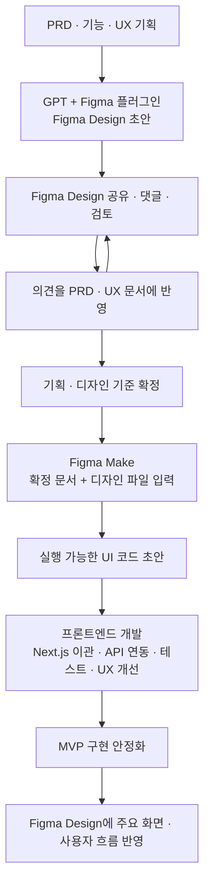

# FE-ADR-004. 스타일링 및 디자인 시스템 적용 전략

| 항목           | 결정                                      |
| -------------- | ----------------------------------------- |
| 프로젝트       | 오늘의 수산                               |
| 작성일         | 2026-10-23                                |
| 스타일링 기술  | **Tailwind CSS + CSS 변수 (확정)**        |
| UI 구현 출발점 | **Figma Make 생성 코드 초안**             |
| 관련 문서      | FE-ADR-001~003, PRD·UX·디자인 시스템 문서 |

## 1. 핵심 결론

**Tailwind CSS + CSS 변수**를 기본 스타일링 기술로 사용하고, 승인된 `tokens.json`을 디자인 값의 원본으로 유지한다. **Figma Design은 기획을 시각화하고 의견을 수렴하는 협업 공간**, **Figma Make는 확정된 기획과 디자인을 바탕으로 실행 가능한 UI 코드 초안을 생성하는 도구**로 사용한다. Make 결과물을 그대로 운영에 배포하지 않고 Next.js 환경에서 API 연동·리팩터링·검증을 거쳐 MVP 코드로 완성한다.

**선정 근거 (3줄)**

1. **일관성:** `tokens.json` → CSS 변수 → Tailwind로 공통 디자인 값을 재사용한다.
2. **협업:** Figma Design에서 화면을 공유·댓글로 논의하고 결과를 PRD·UX 문서에 반영해 설계를 확정한다.
3. **개발 효율:** 직접 비교해 시각적 완성도가 높다고 판단한 Figma Make 결과를 초안으로 활용하되 운영 품질은 코드 검증으로 확보한다.

## 2. 도구별 역할과 제작 과정

| 도구·산출물          | 역할                                                            |
| -------------------- | --------------------------------------------------------------- |
| PRD·기능·UX 문서     | 제품 요구사항과 사용자 흐름의 기준                              |
| GPT + Figma 플러그인 | 기획 내용을 Figma Design에 초기 스케치·디자인 시스템으로 시각화 |
| Figma Design         | 팀원 간 화면 공유·댓글·검토, 디자인 기준 협의                   |
| Figma Make           | 확정된 문서와 디자인 파일을 입력받아 UI/UX 및 코드 초안 생성    |
| 프론트엔드 코드      | Make 초안을 보완해 API 연동·테스트를 거친 실제 MVP 구현         |

**실제 비교 결과:** 이번 프로젝트에서는 GPT–Figma 플러그인으로 만든 초기 화면보다 **Figma Make 결과물의 UI/UX 완성도가 높다고 평가**했다. 이에 Make 코드를 구현 출발점으로 채택한다. 이는 도구의 일반적인 품질 우열에 대한 주장은 아니다.

## 3. 스타일링·토큰 적용 정책

| 항목       | 적용 원칙                                                           |
| ---------- | ------------------------------------------------------------------- |
| 스타일링   | **Tailwind CSS + CSS 변수 사용**                                    |
| 디자인 값  | 승인된 `tokens.json`을 단일 원본으로 관리                           |
| 토큰 구조  | Primitive + Semantic 우선, 컴포넌트 전용 토큰은 필요 시 추가        |
| 토큰 연결  | JSON 기반 CSS 변수 생성 및 Tailwind 매핑을 목표로 적용              |
| 코드 전환  | 기존 Make UI를 보존하면서 중복 스타일·하드코딩 값을 점진적으로 정리 |
| Figma 연동 | API 실시간 동기화는 MVP 범위에서 제외                               |

`tokens.json`과 CSS에 색상·간격 값을 각각 수동으로 중복 정의하지 않는다. 생성된 CSS는 원본이 아니며, 변환 스크립트의 구체적인 구현은 실제 토큰 구조 확인 후 정한다.

## 4. 대안과 트레이드오프

| 선택지                                    | 판단 근거                                                 | 결과     |
| ----------------------------------------- | --------------------------------------------------------- | -------- |
| Figma Design 시안을 그대로 재구현         | 디자인 파일과 일치하지만 기존 Make 코드의 재사용성이 낮음 | 미채택   |
| **Make 초안 재사용 + Tailwind·토큰 정리** | **기존 UI 품질과 코드를 활용, API 연동 중 개선 가능**     | **채택** |
| 생성 코드 전면 폐기 후 재작성             | 구조 통제는 쉽지만 초기 재작업 비용이 큼                  | 미채택   |

**트레이드오프:** Make 코드와 Design 시안의 레이아웃·글자 크기 등 미세한 차이는 허용한다. 단, **PRD 필수 기능·핵심 UX 흐름·승인된 토큰·접근성**과 충돌하면 수정한다. Tailwind 전환 시에도 기존 UI를 불필요하게 전면 재작성하지 않는다.

## 5. MVP 구현 및 검증

1. Make 코드의 컴포넌트·의존성·스타일을 점검하고 **Next.js 16 + React 19**로 필요한 부분만 이전한다.
2. Tailwind와 CSS 변수를 연결하고 승인된 토큰에서 벗어난 주요 스타일을 정리한다.
3. Mock 데이터를 실제 API로 교체하며 로딩·오류·결측·반응형·접근성을 검증한다.
4. 변경된 핵심 사용자 흐름과 디자인 규칙만 간단히 기록하고, 안정화 이후 Figma Design에 반영한다.

**주의:** Figma Make의 생성 코드는 운영 코드가 아닌 **초안**이다. 테스트·리팩터링·API 연동을 마쳐야 실제 MVP 구현으로 채택한다.

## 6. 주요 질문과 답변

**Q. Figma Make 결과가 더 좋다면 Figma Design은 불필요한가?**  
A. 아니다. Design은 초기 시각화뿐 아니라 협업자가 댓글로 논의하고 기획 문서를 개선하는 공간이며, 확정 후 Make의 입력 자료가 된다.

**Q. Design과 Make의 모든 픽셀을 같게 만들어야 하는가?**  
A. 아니다. 작은 시각적 차이는 허용하되 기능·디자인 규칙·접근성 문제는 수정한다.

**Q. Make가 생성한 코드를 그대로 배포하는가?**  
A. 아니다. Next.js 환경에 맞게 정리하고 API 연결 및 테스트를 거쳐 사용한다.

## 7. 최종 결정 및 재검토

**Tailwind CSS + CSS 변수를 확정**하고, Figma Design에서 **협업·기획 반복 → 확정 문서와 디자인을 Figma Make에 입력 → 생성 코드 기반 개발·검증** 순서로 MVP를 제작한다.

추후 토큰 불일치가 반복되거나, Make 코드의 유지보수 비용이 커지거나, 협업 과정에서 변경 추적이 어려워지면 관련 운영 규칙을 재검토한다.
