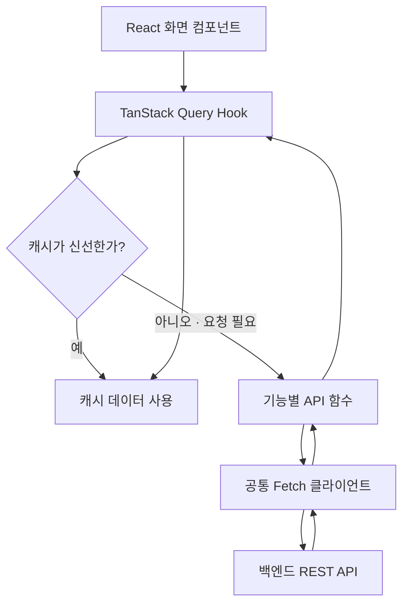

# FE-ADR-007. 백엔드 REST API 연동 및 통신 전략

| 항목      | 내용                                                               |
| --------- | ------------------------------------------------------------------ |
| 프로젝트  | 오늘의 수산                                                        |
| 작성일    | 2026-10-23                                                         |
| 선정 전략 | **TanStack Query → 기능별 API 함수 → 공통 Fetch 클라이언트**       |
| 관련 문서 | FE-ADR-002 렌더링 전략, FE-ADR-003 캐싱 전략, FE-ADR-005 상태 관리 |

## 1. 핵심 결론

오늘의 수산 MVP는 **기능별 API 함수와 공통 Fetch 클라이언트를 분리**한다. 컴포넌트는 TanStack Query Hook으로 서버 데이터를 사용하며, 캐시 조회·갱신 판단은 TanStack Query에 맡긴다. 공통 클라이언트는 HTTP 통신을 담당하고, 인증 방식 자체는 별도 ADR에서 결정한다.

**선정 근거**

1. **유지보수:** 가격·차트·Insight·최근 이슈 등의 엔드포인트와 비즈니스 처리를 기능별로 분리한다.
2. **재사용성:** HTTP 메서드, 공통 헤더, 요청 취소 및 오류 변환을 중복 구현하지 않는다.
3. **단순성:** 기본 Fetch API와 기존 TanStack Query를 활용하고 불필요한 HTTP 라이브러리를 추가하지 않는다.

## 2. 통신 구조



> 캐시가 오래됐더라도 기존 데이터를 표시하면서 백그라운드에서 다시 조회할 수 있다. 재조회 조건과 실패 정책은 FE-ADR-003을 따른다. 컴포넌트가 직접 캐시 존재 여부를 검사하지 않는다.

| 계층                  | 책임                                                                      |
| --------------------- | ------------------------------------------------------------------------- |
| UI 컴포넌트           | 데이터 표시, 로딩·오류·빈 상태 표현                                       |
| TanStack Query Hook   | Query Key, 캐싱, 조건부 재조회, 요청 상태                                 |
| 기능별 API 함수       | 엔드포인트, 요청 파라미터, 응답 타입, 인증 필요 여부 선언                 |
| 공통 Fetch 클라이언트 | Base URL, GET·POST·PUT·PATCH·DELETE, JSON·헤더·AbortSignal·공통 오류 처리 |
| 백엔드                | 실제 인증·인가, 데이터 검증, 비즈니스 로직                                |

### 간단한 파일 구성 예시

```text
src/
  lib/api/
    client.ts
    errors.ts
  features/
    seafood/api.ts
    seafood/queries.ts
    price/api.ts
    price/queries.ts
    insight/api.ts
    issues/api.ts
    auth/api.ts
```

파일은 실제 코드 규모에 따라 통합할 수 있으며, 기능마다 `queries.ts`를 의무적으로 생성하지 않는다.

## 3. 대안 비교

| 대안                                        | 장점                                                | 한계                                            | 판단     |
| ------------------------------------------- | --------------------------------------------------- | ----------------------------------------------- | -------- |
| 컴포넌트에서 직접 Fetch 호출                | 초기 코드가 짧음                                    | 요청·오류 처리 중복, 테스트와 변경 관리 어려움  | 제외     |
| **기능별 API 함수 + 공통 Fetch 클라이언트** | **책임 분리, 공통 처리 재사용, API 변경 대응 용이** | **얇은 계층과 파일 관리 필요**                  | **선정** |
| Axios 등 외부 HTTP 클라이언트               | 인터셉터 등 편의 기능                               | 현재 요구사항에서는 추가 의존성의 이점이 제한적 | 유보     |

## 4. API 및 인증 계약 원칙

- 기능별 API 함수는 `auth: 'none' | 'optional' | 'required'`와 같이 **인증 필요 여부**를 선언한다.
- 공통 Fetch 클라이언트는 추후 확정되는 인증 수단에 따라 헤더 또는 쿠키 전송을 처리한다. 기능별 함수가 토큰 문자열의 저장·갱신을 각각 구현하지 않는다.
- 공개 가격·차트·Insight 조회에는 불필요한 인증 정보를 첨부하지 않는다.
- `auth: 'required'`는 프론트엔드 요청 정책일 뿐이며 **인증·인가는 반드시 백엔드가 검증**한다.
- API 주소 및 타입은 백엔드 계약에 맞춰 확정한다. 아래 코드는 구조 예시이며 실제 엔드포인트가 아니다.

```ts
const getPrice = (itemCode: string, signal?: AbortSignal) =>
  apiClient.get(`/prices/${itemCode}`, { auth: "none", signal });

const getMyProfile = (signal?: AbortSignal) =>
  apiClient.get("/users/me", { auth: "required", signal });
```

- 읽기 요청의 캐싱·재시도는 **FE-ADR-003** 정책을 따른다. 변경 요청(POST 등)에 동일한 자동 재시도 정책을 일괄 적용하지 않는다.
- 공통 클라이언트는 HTTP 오류를 일관된 형식으로 변환하며, 화면별 안내 문구는 UI에서 결정한다.

## 5. 트레이드오프 및 적용 범위

| 기대 효과                              | 감수할 제약                                                        |
| -------------------------------------- | ------------------------------------------------------------------ |
| 기능별 API 변경 범위 명확화            | 일부 파일·함수 계층 증가                                           |
| 공통 HTTP 오류·헤더 처리 일관성        | 공통 클라이언트가 과도하게 비대해지지 않도록 관리 필요             |
| Mock 데이터에서 실제 API로 단계적 전환 | 백엔드 요청·응답 계약 검증 필요                                    |
| 정적 배포(SSG + CSR) 구조 유지         | 운영 중 Next.js 서버를 전제한 API 프록시·인증 처리는 사용하지 않음 |

**MVP 범위:** REST API 조회·변경에 필요한 최소 공통 계층만 구현한다. 범용 SDK 생성, 복잡한 인터셉터 체계, 전역 오류 UI 등은 필요성이 확인되면 검토한다.

## 6. 기술 회의 주요 Q&A

**Q1. 컴포넌트에서 TanStack Query 캐시를 먼저 직접 조회해야 하나요?**  
A. 아닙니다. 컴포넌트는 Query Hook을 사용하고, TanStack Query가 캐시의 신선도와 조회 필요성을 판단합니다.

**Q2. API 종류가 다른데 공통 Fetch 클라이언트 하나로 처리할 수 있나요?**  
A. HTTP 요청·응답 공통 처리만 공유하고, 엔드포인트와 도메인별 처리는 기능별 API 함수로 분리합니다.

**Q3. Bearer Token 또는 HttpOnly Cookie 중 무엇을 사용하나요?**  
A. 이번 ADR에서는 선택하지 않습니다. 기능별 인증 요구사항 선언까지만 정하고 실제 인증 수단은 별도 ADR에서 결정합니다.

**Q4. 채팅 WebSocket도 같은 클라이언트에서 처리하나요?**  
A. 아닙니다. 연결 유지·재접속·메시지 수신 등 특성이 달라 **별도 FE-ADR-008(WebSocket 연결 전략)**에서 결정합니다.

## 7. 최종 결정 및 후속 과제

**TanStack Query → 기능별 API 함수 → 공통 Fetch 클라이언트 → 백엔드 REST API** 구조를 채택한다. 인증 필요 여부는 기능별로 선언하되 인증 방식 자체는 별도 의사결정으로 분리한다.

- **후속:** FE-ADR-008 실시간 채팅 WebSocket 연결 전략
- **별도 결정:** 인증 수단·토큰 저장 및 갱신 정책
- **구현 검증:** 기존 Figma Make UI에 실제 백엔드 API를 연동하고 응답 타입·오류·로딩 상태 테스트

## 8. 참고 자료

- [TanStack Query — Important Defaults](https://tanstack.com/query/latest/docs/framework/react/guides/important-defaults)
- [TanStack Query — Query Keys](https://tanstack.com/query/latest/docs/framework/react/guides/query-keys)
- [MDN — Fetch API](https://developer.mozilla.org/en-US/docs/Web/API/Fetch_API)
- [MDN — HTTP Authentication](https://developer.mozilla.org/en-US/docs/Web/HTTP/Guides/Authentication)
