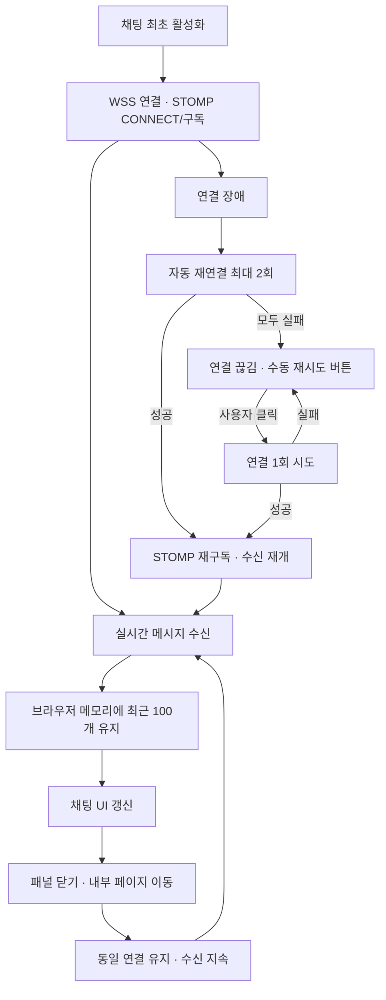

# FE-ADR-008. 실시간 채팅 WebSocket 연결 전략

| 항목        | 결정                                         |
| ----------- | -------------------------------------------- |
| 프로젝트    | 오늘의 수산                                  |
| 작성일      | 2026-10-23                                   |
| 상태        | **확정**                                     |
| 전송·메시징 | **WebSocket(WSS) + STOMP**                   |
| 클라이언트  | **@stomp/stompjs**                           |
| 관련 문서   | FE-ADR-003·005·007, 채팅 요구사항 및 UX 문서 |

## 1. 핵심 결론

오늘의 수산 채팅은 **현재 접속한 사용자 간의 일회성 라이브 채팅**으로 운영한다. WebSocket으로 지속적인 양방향 연결을 유지하고 STOMP로 메시지 송수신·구독을 처리한다. **채팅 최초 활성화 시 연결한 뒤 패널을 닫거나 앱 내부 페이지를 이동해도 유지**하며, 최근 수신 메시지 **최대 100개만 브라우저 메모리에 보관**한다. MVP에서는 영구 저장과 누락 메시지 복원을 제공하지 않는다.

오늘의 수산 채팅은 **수산물 품목별 독립된 일회성 라이브 채팅방**으로 운영한다. MVP에서는 갈치·고등어·전복 각각 하나의 채팅방을 제공한다.

WebSocket으로 지속적인 양방향 연결을 유지하고 STOMP로 품목별 메시지 송수신·구독을 처리한다.

동일한 익명 JWT를 사용하는 여러 브라우저 탭은 같은 익명 사용자로 식별하되, 각 탭은 해당 품목 채팅방에 독립적으로 참여한다. 탭당 WebSocket 연결은 최대 1개로 제한한다.

채팅 최초 활성화 시 연결하며 패널을 닫거나 앱 내부 페이지를 이동해도 연결을 유지한다. 품목별 최근 수신 메시지 최대 100개만 브라우저 메모리에 보관하고, 영구 저장과 누락 메시지 복원은 제공하지 않는다.

**선정 근거 (3줄)**

1. **실시간성:** WSS와 STOMP 구독으로 현재 접속자의 메시지를 즉시 주고받는다.
2. **UX:** 패널을 닫아도 수신을 이어가고, 연결 상태·실패·수동 재시도를 명확히 안내한다.
3. **MVP 단순성:** 메시지 저장·복원, 별도 외부 브로커, 복잡한 조건부 재연결 로직을 도입하지 않는다.

## 2. 기술 선택과 대안

| 선택지                              | 장점                                                     | 고려사항                                     | 결과          |
| ----------------------------------- | -------------------------------------------------------- | -------------------------------------------- | ------------- |
| Native WebSocket + 자체 JSON 메시징 | 의존성 적고 단순한 메시지 교환 가능                      | 구독·라우팅·재연결 규칙을 직접 설계          | 미채택        |
| **WebSocket + STOMP**               | **표준 SEND·SUBSCRIBE·MESSAGE, Spring Boot 메시징 통합** | **STOMP 프레임과 라이브러리 학습·설정 필요** | **채택**      |
| 외부 메시지 브로커 연동             | 다중 서버 확장 시 활용 가능                              | 인프라·운영 복잡도 증가                      | MVP 도입 유보 |

STOMP는 WebSocket을 대체하지 않는다. **WebSocket은 전송 채널**, **STOMP는 해당 채널에서 사용하는 메시징 규칙**이다. 서버는 초기 MVP에서 Spring의 내장 Simple Broker 활용을 전제로 하되, 실제 처리량은 부하 테스트로 확인한다.

## 3. 연결·메시지 생명주기



````mermaid
flowchart TD
    A["동일 브라우저 · 익명 JWT"]
    A --> B["탭 A · 갈치 상세"]
    A --> C["탭 B · 고등어 상세"]
    A --> D["탭 C · 전복 상세"]
    B --> E["WebSocket A"]
    C --> F["WebSocket B"]
    D --> G["WebSocket C"]
    E --> H["갈치 채팅방 구독"]
    F --> I["고등어 채팅방 구독"]
    G --> J["전복 채팅방 구독"]
    H --> K["Spring STOMP Broker"]
    I --> K
    J --> K
```


| 상황                            | 클라이언트 동작                                              |
| ------------------------------- | ------------------------------------------------------------ |
| 채팅 첫 활성화                  | 탭 내 단일 STOMP 클라이언트로 연결·구독                      |
| 패널 닫기·내부 이동             | 연결과 수신을 유지하고 최근 100개 기록을 보존                |
| 새로고침·탭 종료                | 기존 연결 및 브라우저 메모리 기록 소멸                       |
| 네트워크 장애·모바일 백그라운드 | 연결 유지 보장 없음; 장애 감지 시 재연결 정책 적용           |
| 재접속 성공                     | 다시 구독하고 **이후 도착하는 메시지만** 수신; 누락분 미복원 |

## 4. 재연결·Heartbeat 및 사용자 안내

| 항목                           | MVP 정책                                                                              |
| ------------------------------ | ------------------------------------------------------------------------------------- |
| 자동 재연결                    | 연결 장애당 **최대 2회** (예: 약 2초 후, 약 5초 후)                                   |
| 자동 재연결 소진               | 추가 자동 재시도 중단, **수동 재시도 버튼** 노출                                      |
| 수동 재시도                    | 클릭 시 단일 연결 시도, 실패 시 버튼 재노출                                           |
| 화면 복귀·네트워크 복구 이벤트 | 자동 시도 횟수를 추가하지 않음; 별도 조건부 자동 복구 제외                            |
| STOMP Heartbeat                | **송신·수신 희망 간격 각 10,000ms**; 실제 간격은 서버와 협상                          |
| 중복 연결 방지                 | 동일 탭에서 연결 및 재시도 중 새 연결 중복 생성 방지                                  |
| 연결 상태 UI                   | `연결됨` / `연결 끊김` / `자동 재연결 중` / `자동 재연결 실패·수동 재시도` / `복구됨` |

재연결 중·연결 끊김 상태에서는 메시지 전송을 비활성화한다. 재연결 후 **“연결이 복구되었습니다. 끊긴 동안의 메시지는 표시되지 않습니다.”**라고 안내한다. `@stomp/stompjs`의 재연결 기능만으로 2회 제한이 자동 보장되지는 않으므로 간단한 시도 횟수 관리가 필요하다. 성공하면 장애별 재연결 카운터를 초기화한다.

## 5. 범위·트레이드오프와 검증

- **MVP 제외:** 채팅 메시지 영구 저장, 과거·누락 메시지 조회 API, 다중 탭 간 WebSocket 공유, 외부 메시지 브로커, 사용자 신고·과거 대화 기록 조회 기능.
- **의도한 트레이드오프:** 저장 비용과 구현 복잡성을 줄이는 대신 새로고침·일시 단절 중의 메시지는 복원할 수 없다. 자동 재연결 2회 실패 후에는 사용자의 재시도가 필요하다.
- **프론트엔드 책임:** 탭당 연결 1개, STOMP 구독, 최근 100개 메모리 제한, 화면 상태·수동 재시도, 중복 연결 방지.
- **백엔드 책임(별도 설계):** 메시지 검증, 사용자당 초당 최대 5개 전송 제한, 브로드캐스트, 느린 수신자 버퍼·전송 제한, 인증·인가.
- **운영 이벤트 로그:** 연결 상태 파악, 장애 진단 및 서비스 운영을 위해 WebSocket 연결·해제·연결 오류·재연결 실패, 채팅 서비스 장애 및 운영 오류만 최대 30일 기록한다. 메시지 본문·전송/수신 이벤트·메시지별 발신자/수신자·개별 메시지 시각·복원 데이터·인증 토큰·불필요한 개인정보는 기록하지 않는다. 로그 저장 매체와 만료 구현은 백엔드 운영 설계에서 결정하며 메시지 영구 저장은 포함하지 않는다.
- **검증:** 동시 연결 **500개 목표**와 REST 가격 조회가 동반된 혼합 부하에서 메시지 처리량·전송 지연·메모리·연결 복구를 측정한다. 500명이 초당 5개씩 전송하면 전체 브로드캐스트 작업이 매우 커질 수 있으므로 목표 충족을 사전 보장하지 않는다. Heartbeat 10초와 재연결 간격은 실측 후 재검토한다.

## 6. 주요 질문과 답변

**Q. WebSocket만 쓰면 되는 것 아닌가?**
A. 가능하지만 구독·목적지 메시징 규칙을 직접 정의해야 한다. Spring Boot와의 통합 편의성을 고려해 STOMP를 선택한다.

**Q. 채팅 패널을 닫으면 메시지를 놓치는가?**
A. 정상 연결 중에는 수신을 유지하고 최신 100개를 메모리에 보관한다. 연결이 끊긴 시간의 메시지는 복원하지 않는다.

**Q. 재연결은 왜 무제한 자동 시도하지 않는가?**
A. 연결 상태를 명확히 전달하고 반복 재접속 부하를 제한하기 위해 자동 2회 후 수동 전환한다. 네트워크 복구·화면 복귀를 이유로 추가 자동 시도하지 않는다.

**Q. 동시 접속 500명을 STOMP만으로 보장할 수 있는가?**
A. 아니다. 실제 동시 접속·메시지 브로드캐스트·REST 혼합 부하를 검증해야 한다.

## 7. 최종 결정 및 재검토

**WSS + STOMP.js**, 최초 채팅 활성화 이후 연결 유지, 최신 메시지 **100개 메모리 보관**, 자동 재연결 **2회 후 수동 재시도**, STOMP Heartbeat **송·수신 각 10초 희망**으로 확정한다. 영구 저장·누락 복원·외부 브로커는 MVP에서 제외한다. 구현 이후 모바일 실사용 및 서버 부하 테스트 결과에 따라 주기·재시도·메시지 유지 정책을 조정한다.
````
