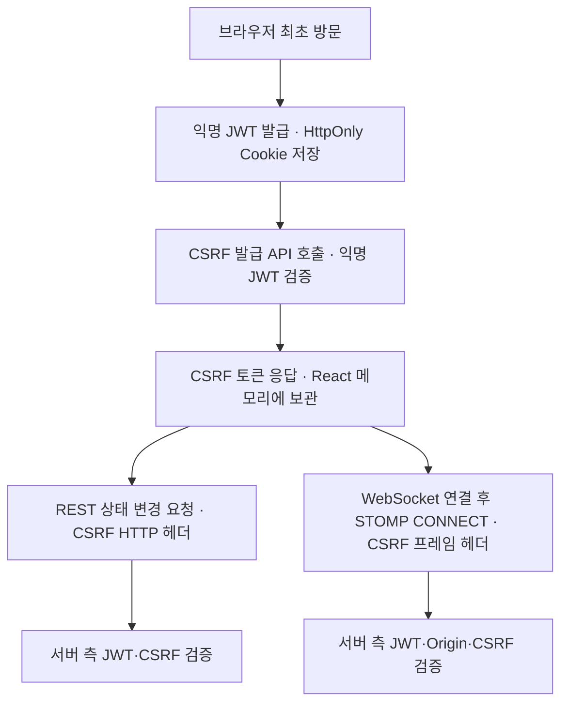

# FE-ADR-009. MVP 익명 사용자 식별 및 보안 토큰 관리 전략

| 항목        | 결정                                             |
| ----------- | ------------------------------------------------ |
| 프로젝트    | 오늘의 수산                                      |
| 작성일      | 2026-10-26                                       |
| 상태        | **확정 (세부 구현 및 일부 연동 정책 후속 검토)** |
| 사용자 식별 | **익명 JWT + HttpOnly Cookie**                   |
| CSRF 보호   | **별도 API 발급 + React 메모리 관리**            |
| 관련 문서   | FE-ADR-003·005·007·008, PRD 및 채팅 요구사항     |

## 1. 핵심 결론

MVP에는 **회원 로그인 기능을 도입하지 않는다**. 최초 방문 시 서버가 **7일 유효한 익명 JWT**를 발급하고 브라우저의 **HttpOnly Cookie**에 저장해 동일 브라우저의 여러 탭을 같은 익명 사용자로 식별한다. 서버는 이 식별자를 연결 현황 등 운영 관제에 활용할 수 있으나, **실제 사람의 신원 인증 수단으로 간주하지 않는다**. 회원 로그인과 Refresh Token은 V1에서 설계한다.

CSRF 토큰은 **익명 JWT 유효성 검증 후 별도 API로 제공**하며, React 메모리에 보관하여 보호 대상 REST 요청 헤더와 STOMP `CONNECT` 헤더에 제출한다. 구체적인 토큰 생성·검증·바인딩 방식은 백엔드 보안 설계에서 결정한다.

**선정 근거 (3줄)**

1. **최소 구성:** 회원 인증 없이도 브라우저 단위 익명 식별과 운영 관제를 지원한다.
2. **보안 책임 분리:** JWT는 식별·유효성 검증, 쿠키는 보관·전달, CSRF 토큰은 요청 위조 방어에 사용한다.
3. **MVP 집중:** 로그인·Refresh Token·IP 기반 요청 제한과 복잡한 WebSocket 토큰 전환은 후속 단계로 미룬다.

## 2. 기술 선택과 대안

| 선택지                         | 장점                                | 고려사항                                            | 결과     |
| ------------------------------ | ----------------------------------- | --------------------------------------------------- | -------- |
| 익명 ID + 서버 저장소          | 단순한 식별값, 서버에서 직접 제어   | 서버 측 유효성 상태 관리 필요                       | 미채택   |
| **익명 JWT + HttpOnly Cookie** | **서명·만료 검증, 탭 간 쿠키 공유** | **쿠키 삭제·재발급에 따른 식별 변경, 키 관리 필요** | **채택** |
| HTTP 서버 세션 + 쿠키          | 서버 측 세션 무효화·관리 용이       | 별도 세션 상태·운영 부담                            | 미채택   |
| 회원 로그인 기반 인증          | 사용자 계정 식별 가능               | MVP 범위 초과                                       | V1 유보  |

JWT는 **서명형 토큰(JWS)**을 전제로 한다. 일반적인 JWS의 Header·Payload는 Base64URL **인코딩**되며 암호화되지 않는다. 비밀정보를 Payload에 담지 않으며, 서버에서 서명·만료 등의 유효성을 검증한다.

## 3. 발급·전달·만료 정책

| 항목                   | MVP 정책                                                    |
| ---------------------- | ----------------------------------------------------------- |
| 발급 시점              | 최초 방문 시 익명 JWT 발급                                  |
| 저장·전송              | `HttpOnly; Secure; SameSite=Lax` 쿠키 사용                  |
| 유효기간               | JWT `exp` 7일, 쿠키 `Max-Age=604800`초                      |
| 만료·유효하지 않은 JWT | 새 익명 ID와 JWT 자동 발급; Refresh Token 사용하지 않음     |
| 여러 탭                | 동일 브라우저 프로필·사이트의 공유 쿠키로 동일 익명 ID 식별 |
| 쿠키 삭제·변조         | 기존 익명 사용자 복원이 아닌 새 익명 사용자로 처리          |
| IP 기반 Rate Limiting  | MVP 미도입; 필요 시 백엔드에서 재검토                       |

쿠키의 `Domain`, `Path` 및 Cross-Origin 요청의 `credentials`·CORS 설정은 실제 배포 도메인에 맞춰 결정한다. `SameSite=Lax`만으로 모든 CSRF 위험을 막는다고 가정하지 않는다. 최초 방문 시 여러 탭의 동시 발급에 따른 중복 ID·응답 경합도 구현 시 검증한다.

## 4. CSRF 및 WebSocket 연계

- **REST:** 조회 전용 GET 등 안전한 요청에는 원칙적으로 CSRF 토큰을 요구하지 않고, POST·PUT·PATCH·DELETE 등 상태 변경 요청을 보호한다. 로그인·발급 관련 엔드포인트의 보호 범위는 백엔드 설정에서 검토한다.
- **STOMP:** 브라우저 WebSocket 핸드셰이크의 Origin을 검증하고, STOMP `CONNECT`에서 CSRF 토큰을 검증한다. STOMP 프레임 헤더와 HTTP 요청 헤더는 서로 다르다.
- **CSRF 보관:** 별도 API에서 받은 값을 React 메모리에 유지한다. 새 익명 JWT 발급 후에는 이전 CSRF 토큰을 재사용하지 않고 다시 확보한다.
- **서버 책임:** CSRF 토큰의 세션·익명 JWT 바인딩, 저장소 또는 서명 검증 방식은 백엔드 보안 설계에서 확정한다. CSRF가 자동화 요청 남용을 방지하는 수단은 아니다.

## 5. 채팅 구조와 설계 경계

MVP의 채팅은 **수산물 품목별 독립 라이브 채팅방**이다. 갈치·고등어·전복 채팅방은 각각 구독 목적지를 가지며, 동일 익명 JWT를 사용하는 여러 탭은 같은 익명 사용자로 식별된다. 각 탭의 WebSocket 연결과 STOMP 구독은 별도이며, 사용자별 전송 제한 등 서버 정책은 익명 사용자 ID 기준으로 평가할 수 있다.

**이번 ADR에서 확정하지 않는 사항:** JWT 만료 시 기존 WebSocket 연결을 언제 닫고 새 연결로 전환할지, 전환 중 메시지 누락을 어떻게 다룰지, 서버 측 만료 감지·종료 방식 등은 **후속 검토**로 남긴다. FE-ADR-008의 채팅 메시지 비저장·누락 복원 미지원 정책은 그대로 유지한다.

## 6. 트레이드오프 및 주요 Q&A

**트레이드오프:** 익명 JWT는 별도의 회원·세션 DB 없이 브라우저 단위 식별을 가능하게 하지만, 쿠키 삭제·다른 브라우저·동시 최초 발급으로 식별 연속성이 깨질 수 있다. IP 기반 제한을 도입하지 않으므로 익명 ID 재발급을 통한 요청 제한 우회에 대한 완전한 방어는 제공하지 않는다. 실제 남용이 관찰되면 백엔드 보안 정책에서 보완한다.

**Q. JWT를 쓰면 반드시 `Authorization: Bearer` 헤더를 사용해야 하나?**

A. 아니다. JWT를 HttpOnly Cookie에 저장해 자동 전달하고 서버가 쿠키에서 검증할 수 있다.

**Q. CSRF 토큰을 JWT 쿠키 안에 넣으면 되나?**

A. 쿠키의 자동 전송만으로는 충분하지 않다. 이번 정책은 별도 API로 발급받은 CSRF 토큰을 React가 HTTP 요청 헤더 또는 STOMP `CONNECT` 프레임 헤더에 명시적으로 전달한다.

**Q. JWT가 만료되면 기존 WebSocket도 자동 종료되나?**

A. 아니다. 기술적으로 별도 연결이다. 만료 시 연결 종료·재연결의 상세 정책은 이번 ADR에서 정하지 않는다.

**Q. JWT를 사용하면 동일한 실제 사람을 식별할 수 있나?**

A. 아니다. 동일 쿠키를 가진 익명 브라우저 이용 흐름을 식별할 뿐이다.

## 7. 최종 결정 및 재검토

**익명 JWT + HttpOnly Cookie, 최초 방문 발급, 7일 만료·자동 신규 발급, 별도 CSRF API + React 메모리, REST 상태 변경 및 STOMP CONNECT 보호**를 MVP 정책으로 채택한다. 회원 로그인·Refresh Token·IP 기반 Rate Limiting은 이번 범위에서 제외한다. 실제 배포 도메인, Spring Security 설정, 여러 탭 최초 발급 경합, JWT 만료와 WebSocket 연결 전환 방식은 구현·후속 ADR 단계에서 검토한다.
