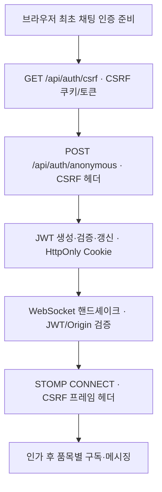

# FE-ADR-009. MVP 익명 사용자 식별 및 보안 토큰 관리 전략

- **버전:** V1

| 항목        | 결정                                                 |
| ----------- | ---------------------------------------------------- |
| 프로젝트    | 오늘의 수산                                          |
| 작성일      | 2026-10-26                                           |
| 상태 | 승인(Accepted) |
| 사용자 식별 | **익명 JWT + HttpOnly Cookie**                       |
| CSRF 보호   | **별도 API 발급 + React 메모리 관리**                |
| 관련 문서   | FE-ADR-003·005·007·008, [BE-TECH-SPEC-005](../../backend/tech-spec/BE-TECH-SPEC-005-사용자-식별-인증-세션.md), [BE-TECH-SPEC-006](../../backend/tech-spec/BE-TECH-SPEC-006-실시간-채팅.md), PRD·PF-005 |

## 1. 핵심 결론

MVP에는 **회원 로그인 기능을 도입하지 않는다**. 최초 **채팅 인증 준비** 시 서버가 **30일 유효한 익명 JWT**를 발급하고 브라우저의 **HttpOnly Cookie**에 저장한다. 만료까지 7일 이하 남은 유효한 JWT는 동일 사용자 ID로 갱신한다. 서버는 이 식별자를 연결 현황 등 운영 관제에 활용할 수 있으나, **실제 사람의 신원 인증 수단으로 간주하지 않는다**. 회원 로그인과 Refresh Token은 V1에서 설계한다.

CSRF 토큰은 **익명 JWT가 없어도 호출 가능한 `GET /api/auth/csrf`**로 먼저 발급받아 React 메모리에 보관한다. 이후 `POST /api/auth/anonymous`에 CSRF 헤더를 제출하여 사용자 발급·검증·갱신을 처리한다.

STOMP `CONNECT`에도 CSRF 토큰을 제출한다. 백엔드는 `CookieCsrfTokenRepository`를 사용하며 HTTP·STOMP 연계 동작을 통합 검증한다.

**선정 근거 (3줄)**

1. **최소 구성:** 회원 인증 없이도 브라우저 단위 익명 식별과 운영 관제를 지원한다.
2. **보안 책임 분리:** JWT는 식별·유효성 검증, 쿠키는 보관·전달, CSRF 토큰은 요청 위조 방어에 사용한다.
3. **MVP 집중:** 로그인·Refresh Token·IP 기반 요청 제한과 복잡한 WebSocket 토큰 전환은 후속 단계로 미룬다.

## 2. 기술 선택과 대안

| 선택지                         | 장점                                | 고려사항                                            | 결과     |
| ------------------------------ | ----------------------------------- | --------------------------------------------------- | -------- |
| 익명 ID + 서버 저장소          | 단순한 식별값, 서버에서 직접 제어   | 서버 측 유효성 상태 관리 필요                       | 미채택   |
| **익명 JWT + HttpOnly Cookie** | **서명·만료 검증, 탭 간 쿠키 공유** | **쿠키 삭제·재발급에 따른 식별 변경, 키 관리 필요** | **채택** |
| HTTP 서버 세션 + 쿠키          | 서버 측 세션 무효화·관리 용이       | 별도 세션 상태·운영 부담                            | 미채택   |
| 회원 로그인 기반 인증          | 사용자 계정 식별 가능               | MVP 범위 초과                                       | V1 유보  |

JWT는 **서명형 토큰(JWS)**을 전제로 한다. 일반적인 JWS의 Header·Payload는 Base64URL **인코딩**되며 암호화되지 않는다. 비밀정보를 Payload에 담지 않으며, 서버에서 서명·만료 등의 유효성을 검증한다.

## 3. 발급·전달·만료 정책

| 항목                   | MVP 정책                                                               |
| ---------------------- | ---------------------------------------------------------------------- |
| 발급 시점              | 최초 채팅 인증 준비 시 발급                                            |
| 저장·전송              | `HttpOnly; Secure; SameSite=Lax` 쿠키 사용                             |
| 유효기간               | JWT `exp` 30일, 만료 7일 전부터 동일 ID 갱신, 쿠키 `Max-Age=2592000`초 |
| 만료·유효하지 않은 JWT | 정상 만료: 새 익명 ID·JWT 발급 / 서명·Claim 오류: 401 거부             |
| 여러 탭                | 동일 브라우저 프로필·사이트의 공유 쿠키로 동일 익명 ID 식별            |
| 쿠키 삭제·변조         | 삭제: 새 사용자 생성 / 변조: 401 거부                                  |
| IP 기반 Rate Limiting  | MVP 미도입; 필요 시 백엔드에서 재검토                                  |

쿠키의 `Domain`, `Path` 및 Cross-Origin 요청의 `credentials`·CORS 설정은 실제 배포 도메인에 맞춰 결정한다. `SameSite=Lax`만으로 모든 CSRF 위험을 막는다고 가정하지 않는다.

최초 채팅 진입 시 여러 탭의 동시 발급에 따른 중복 ID·응답 경합도 구현 시 검증한다. 초기 경쟁에서 각 탭에 다른 ID가 발급되는 예외는 005가 허용하지만, PF-005의 품목별 참여자 세션 공유와 연결되는 서로 다른 사용자 ID는 별도 참여자로 처리할 수 있다.

같은 사용자 ID의 같은 품목 탭은 006의 참여자 세션을 공유한다.

## 4. CSRF 및 WebSocket 연계

- **REST:** `GET /api/auth/csrf`는 인증 없이 접근할 수 있다. `POST /api/auth/anonymous`는 CSRF 검증이 필수다. 조회 전용 GET 등 안전한 요청에는 원칙적으로 CSRF 토큰을 요구하지 않는다.
- **STOMP:** 브라우저 WebSocket 핸드셰이크의 Origin을 검증하고, STOMP `CONNECT`에서 CSRF 토큰을 검증한다. STOMP 프레임 헤더와 HTTP 요청 헤더는 서로 다르다.
- **CSRF 보관:** 별도 API에서 받은 값을 React 메모리에 유지한다. JWT 갱신만으로 CSRF를 강제 교체하지 않는다. 토큰 누락·변경·불일치가 발생하면 다시 확보한다.
- **서버 책임:** `CookieCsrfTokenRepository` 기반으로 세션 없는 HTTP CSRF를 처리하고, STOMP CONNECT와 연계해 검증한다. CSRF는 JWT 인증이나 자동화 요청 남용 방지 수단이 아니다.

## 5. 채팅 구조와 설계 경계

MVP의 채팅은 **수산물 품목별 독립 라이브 채팅방**이다. 갈치·고등어·전복 채팅방은 각각 구독 목적지를 가지며, 동일 익명 JWT를 사용하는 여러 탭은 같은 익명 사용자로 식별된다. 각 탭의 WebSocket 연결과 STOMP 구독은 별도이며, 사용자별 전송 제한 등 서버 정책은 익명 사용자 ID 기준으로 평가할 수 있다.

**연결 만료 정책:** BE-TECH-SPEC-005에 따라 JWT는 핸드셰이크 시 검증하고 연결 중 JWT 만료만으로 기존 WebSocket 연결을 종료하지 않는다. 재연결은 당시 유효한 JWT로 다시 인증한다. FE-ADR-008의 메시지 비저장·누락 복원 미지원 정책은 그대로 유지한다. 채팅 참여자 세션의 3분 예약·복원은 PF-005 및 BE-TECH-SPEC-006의 별개 책임이다.

## 6. 트레이드오프 및 주요 Q&A

**트레이드오프:** 익명 JWT는 별도의 회원·세션 DB 없이 브라우저 단위 식별을 가능하게 하지만, 쿠키 삭제·다른 브라우저·동시 최초 발급으로 식별 연속성이 깨질 수 있다. IP 기반 제한을 도입하지 않으므로 익명 ID 재발급을 통한 요청 제한 우회에 대한 완전한 방어는 제공하지 않는다. 실제 남용이 관찰되면 백엔드 보안 정책에서 보완한다.

**Q. JWT를 쓰면 반드시 `Authorization: Bearer` 헤더를 사용해야 하나?**

A. 아니다. JWT를 HttpOnly Cookie에 저장해 자동 전달하고 서버가 쿠키에서 검증할 수 있다.

**Q. CSRF 토큰을 JWT 쿠키 안에 넣으면 되나?**

A. 쿠키의 자동 전송만으로는 충분하지 않다. 이번 정책은 별도 API로 발급받은 CSRF 토큰을 React가 HTTP 요청 헤더 또는 STOMP `CONNECT` 프레임 헤더에 명시적으로 전달한다.

**Q. JWT가 만료되면 기존 WebSocket도 자동 종료되나?**

A. 아니다. BE-TECH-SPEC-005에 따라 기존 연결은 유지한다. 연결이 끊긴 뒤 다시 연결할 때는 당시 유효한 JWT로 인증하며, 만료된 JWT라면 신규 익명 사용자 발급 흐름을 따른다.

**Q. JWT를 사용하면 동일한 실제 사람을 식별할 수 있나?**

A. 아니다. 동일 쿠키를 가진 익명 브라우저 이용 흐름을 식별할 뿐이다.

## 7. 최종 결정 및 재검토

**익명 JWT + HttpOnly Cookie, 최초 채팅 인증 준비 시 발급, 30일 만료·잔여 7일 이내 갱신, 정상 만료 시 신규 발급, 별도 CSRF API + React 메모리, REST 상태 변경 및 STOMP CONNECT 보호**를 MVP 정책으로 채택한다. 회원 로그인·Refresh Token·IP 기반 Rate Limiting은 이번 범위에서 제외한다. 실제 배포 도메인, Spring Security 7 HTTP·STOMP CSRF 통합, 여러 탭 최초 발급 경합, 품목별 세션 공유·3분 복구는 구현·006에서 검증한다.

JWT 만료 또는 쿠키 삭제로 새 사용자 ID를 받으면 기존 채팅 세션을 복원하지 않는다. 유효한 동일 사용자 ID와 품목이 일치하는 경우에만 서버 상태 및 예약 기한을 확인해 복원한다.
