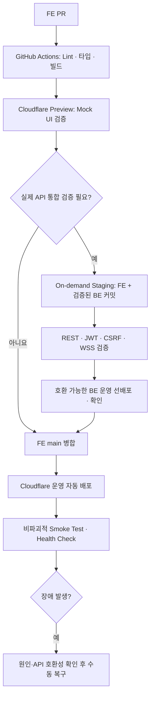

# FE-ADR-010. 프론트엔드 배포 및 CI/CD 전략

- **상태:** 결정
- **범위:** 오늘의 수산 MVP 프론트엔드
- **관련:** FE-ADR-002(SSG + CSR), FE-ADR-009(익명 JWT·CSRF)

## 결론

**프론트엔드는 Cloudflare Pages에 정적 배포하고, 백엔드는 AWS에서 별도로 운영한다.**

- **PR:** GitHub Actions로 Lint·타입·빌드를 검사하고, Cloudflare Preview에서 Mock 데이터로 UI를 확인한다.
- **운영:** `main` 병합 시 Cloudflare Pages에 자동 배포한다.
- **연동 변경:** 필요할 때만 Staging을 켜서 통합 검증한다. 호환 가능한 백엔드를 먼저 배포한 뒤 프론트엔드를 배포한다.
- **장애:** 원인과 API 호환성을 확인한 후, 필요하면 Cloudflare의 이전 정상 배포로 **수동 롤백**한다.

## 선택 이유

1. SSG 산출물은 별도 Next.js 서버 없이 CDN에서 제공할 수 있다.
2. 무료 정적 호스팅을 활용하고 AWS 비용을 백엔드에 집중한다.
3. PR Preview와 선택적 Staging으로 검증 수준을 나누어 운영 부담을 줄인다.

## 배포 흐름

## 운영 기준

| 항목         | 정책                                                           |
| ------------ | -------------------------------------------------------------- |
| 도메인       | 동일 상위 도메인의 FE·API 서브도메인 분리                      |
| 환경 설정    | 로컬 `.env.local`, Cloudflare Preview·Production 환경변수 분리 |
| Preview      | Mock 데이터 사용. 실제 API·인증 검증 용도 아님                 |
| Staging      | 통합 검증이 필요한 때만 기동. 운영 DB·채팅방과 격리            |
| 버전 고정    | Staging에서 검증한 FE·BE 커밋을 운영 배포에 사용               |
| 배포 순서    | FE·BE 연동 변경 시 **BE 먼저**, 단 기존 FE와 API 호환 필수     |
| 배포 후 점검 | 정적 페이지·리소스, 읽기 전용 Health Check 및 오류 지표        |
| 롤백         | 자동 롤백 제외. 이전 FE와 현재 BE의 호환성 확인 후 수동 실행   |

**주의:** `NEXT_PUBLIC_*` 값은 클라이언트에 공개된다. JWT 서명 키·DB 비밀번호 등은 AWS 백엔드에서 관리한다. 코드 롤백은 DB 데이터를 되돌리지 않는다. 사용자가 인지한 작업 결과와 실제 상태가 달라진 경우에만 영향 범위에 맞춰 안내한다.

## 제외·후속 검토

- 상시 Staging, PR별 백엔드, 자동 롤백은 MVP에서 제외한다.
- AWS 백엔드 In-place/Blue-Green, DB 변경·복구, Staging 인프라 자동화는 **별도 BE/인프라 ADR**에서 결정한다.
- 운영 도메인 연결 시 HTTPS·WSS, CORS, HttpOnly 쿠키 전송 및 WebSocket Origin을 검증한다.
