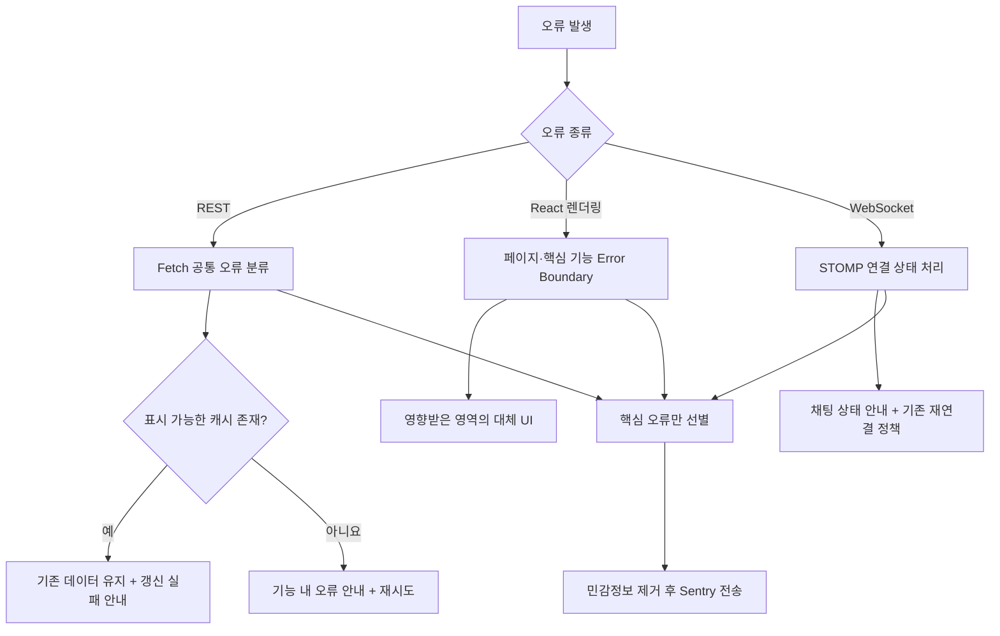

# FE-ADR-011. 프론트엔드 오류 처리 및 사용자 피드백 전략

- **상태:** 승인
- **범위:** 오늘의 수산 MVP 프론트엔드

## 결정

**공통 오류 분류 + 기능별 오류 UI**를 채택한다. 오류가 발생해도 정상 기능은 유지하며, 자동 복구에 실패하면 사용자가 직접 재시도할 수 있도록 한다. 핵심 오류는 **Sentry 무료 플랜**으로 수집한다.

## 선정 이유

1. 가격·Insight·이슈·채팅 중 한 기능의 장애가 전체 화면으로 번지는 것을 막는다.
2. 기존 TanStack Query·Fetch·STOMP의 재시도 정책을 재사용해 구현 부담을 줄인다.
3. 캐시 데이터의 최신성 한계를 알리고, 운영 오류를 민감정보 없이 추적한다.

## 오류 처리 흐름

## 핵심 정책

| 상황                  | 처리                                                                      |
| --------------------- | ------------------------------------------------------------------------- |
| 최초 API 조회 실패    | 해당 기능에 **Inline Error + 다시 시도**                                  |
| 백그라운드 갱신 실패  | 사용 가능한 **캐시 유지 + 지속적인 갱신 실패 안내**                       |
| 정상 응답·데이터 없음 | 오류가 아닌 **Empty State**                                               |
| 짧은 작업 결과 안내   | **Toast**; 가격 최신성 등 중요한 상태는 지속 표시                         |
| 페이지 렌더링 불가    | **Full-page Error**                                                       |
| 핵심 기능 렌더링 예외 | 페이지 및 차트·Insight·이슈·채팅 등 필요한 단위에 **Error Boundary** 배치 |
| API 재시도            | **FE-ADR-003**의 자동 재시도 적용, 최종 실패 시 수동 복구 제공            |
| 채팅 연결 오류        | **FE-ADR-008**의 연결·재연결 정책 유지                                    |
| 익명 인증·CSRF 오류   | **FE-ADR-009**에 따름. 401과 403을 구분하며 무한 재시도 금지              |

- **HTTP 오류 분류:** 네트워크, 잘못된 요청(400·422), 인증(401), 권한·CSRF 가능성(403), 리소스 없음(404), 요청 제한(429), 서버 장애(5xx). 사용자 문구는 유형별로 묶는다. **404와 정상적인 빈 데이터는 구분**한다.
- **상태 변경 요청:** 응답 유실 시 중복 처리 위험이 있으므로 조회 요청과 동일한 방식으로 무조건 자동 재시도하지 않는다.
- **복구 버튼:** 요청 중 중복 입력을 방지한다. Error Boundary 재시도는 렌더링 오류 복구이며 API 재조회와 구분한다.

## Sentry 선정 근거

1. **운영 오류 확인:** Cloudflare 정적 호스팅에서는 사용자 브라우저의 React·JavaScript 오류가 AWS 서버 로그에 자동으로 남지 않는다. Sentry로 실제 사용자 환경의 오류를 확인한다.
2. **구현 부담 최소화:** React 오류 추적·오류 묶음·발생 위치 확인 기능을 활용해 자체 수집 API와 저장소를 만들지 않는다.
3. **MVP 비용·범위 적합:** 무료 플랜에서 핵심 오류만 수집하며, Session Replay·Tracing은 제외해 수집량과 민감정보 노출 위험을 줄인다.

**대안 비교:** 브라우저 콘솔만 사용하면 운영 사용자 오류를 놓치기 쉽고, Cloudflare Web Analytics는 방문·성능 분석 중심이라 예외 추적을 대체하지 못한다. 자체 AWS 수집 서버는 구현·운영 부담이 크다.

## 오류 수집

- **Sentry 무료 플랜:** 처리되지 않은 JavaScript 예외, 주요 렌더링 오류, 핵심 API의 최종 실패, STOMP 최종 연결 실패를 선별해 수집한다.
- **미수집:** 정상 Empty State, 재시도 후 복구된 일시 오류(기본값), 사용자 행동 추적, 채팅 메시지 본문.
- **보안:** JWT·CSRF 토큰·쿠키·인증 헤더와 URL 등에 포함된 민감정보는 수집하지 않는다. 자동·수동 보고 중복을 제한한다.
- **MVP 제외:** Session Replay, Tracing, 자체 오류 수집 서버.

## 대안 및 트레이드오프

| 대안                             | 제외 이유                                           |
| -------------------------------- | --------------------------------------------------- |
| 모든 오류를 전역 화면으로 처리   | 기능 하나의 장애가 정상 영역까지 가림               |
| 모든 오류를 Toast로 처리         | 최초 실패 대응이 어렵고 중요한 최신성 안내가 사라짐 |
| 컴포넌트마다 Error Boundary 배치 | 경계·복구 로직이 과도하게 증가                      |
| 자체 AWS 오류 수집 API           | 저장·필터링·운영 부담 증가                          |

**트레이드오프:** 기능별 상태 UI와 Sentry 설정을 관리해야 한다. 대신 전체 화면 장애를 줄이고 실제 사용자 오류를 추적할 수 있다.

## 기존 결정 및 후속 작업

- **FE-ADR-003:** TanStack Query 캐시·재시도 정책 유지.
- **FE-ADR-007:** 공통 Fetch 클라이언트에서 HTTP 오류 정규화.
- **FE-ADR-008:** STOMP 재연결·메시지 비저장 정책 유지.
- **FE-ADR-009:** 익명 JWT·CSRF 처리 정책 재사용.
- **FE-ADR-010:** 운영 배포 이후 Sentry 오류 현황 확인.
- **구현 단계:** 오류 문구, Skeleton 디자인, Sentry 수집량·보관 설정을 구체화한다.
