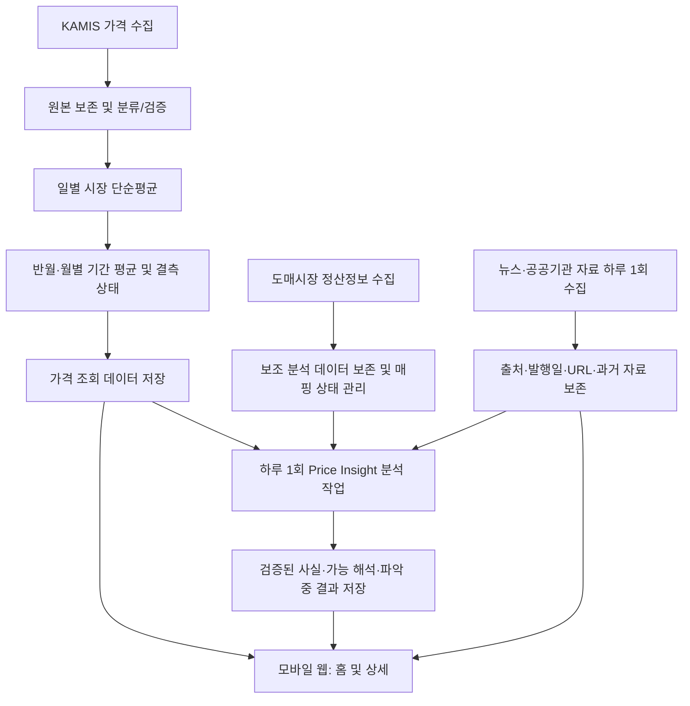

# PRD-001 오늘의 수산 MVP 제품 요구사항

> **핵심 결론:** 오늘의 수산 MVP는 회원가입·로그인 없는 **모바일 웹**으로 갈치·고등어·전복 3종의 **가격 차트, Price Insight, 최근 이슈, 품목별 실시간 채팅**을 제공한다. KAMIS의 국산 생물 중도매 가격을 시장별·기간별로 집계하고, 신뢰 수준을 구분한 분석을 사전 생성하여 제공한다. 결측 가격은 대체하거나 추정하지 않는다.
>
> **문서 상태:** `DRAFT — 기존 문서 정합성 검토 완료`  
> **작성 기준일:** 2026-10-14  
> **승인 상태:** 범위 결정 반영. 상세 미정 항목과 후속 정책 문서는 별도 승인 필요  
> **적용 범위:** MVP 제품 요구사항. 상세 데이터 산식·배치·화면별 상호작용·출시 기준은 후속 `PF`·`PP` 문서로 분리

## 1. 목적과 해결할 문제

수산물 가격을 볼 수 있어도 **어떤 수준으로 변했는지**, **그 변화에 참고할 만한 사실이 무엇인지**, **어떤 근거를 신뢰할 수 있는지** 이해하기 어렵다는 문제를 해결한다.

MVP는 가격 시계열과 검증 가능한 출처, 사실과 해석을 구분한 Price Insight를 한 흐름으로 연결한다. 가격 변화의 인과관계가 확인되지 않았을 때에는 원인을 확정적으로 표현하지 않는다.

### 1.1 제품 목표

- 이용자가 3종 수산물의 최근 1년 가격 추이를 쉽게 확인한다.
- 차트에서 분석 기간을 선택해 해당 구간의 평균가격과 Price Insight를 읽는다.
- 관련 뉴스·공공기관 자료의 제목·출처·발행일·원문을 확인한다.
- 같은 품목의 가격과 분석을 보면서 다른 이용자와 실시간으로 의견을 나눈다.
- 관측값 부족, 데이터 수집 실패, AI 해석 미생성 상태를 숨기거나 혼동하지 않는다.

### 1.2 초기 대상과 제공 채널

- **플랫폼:** 모바일 웹 중심, 인증 없이 누구나 열람.
- **초기 품목:** 갈치, 고등어, 전복 (3종).
- **핵심 사용자:** 가격 및 시장 배경을 탐색하려는 이용자. 세부 페르소나는 기존 PD 원문 확인 후 연결.
- **운영 목적:** 비영리 MVP, 배치/저장 방식 중심으로 비용 최소화.

---

## 2. MVP 범위

| 구분 | MVP 포함 | MVP 제외 / 후속 |
|---|---|---|
| 탐색 | 3종 목록·검색이 있는 홈, 품목별 상세 | 미지원 품목 검색/무제한 품목 |
| 가격 | 최근 1년 차트, 15일 기본·월별 전환, 기간 선택, 평균가격·변동률 | 가격 예측, 실제 소매 구매가로 오인시키는 표시 |
| 분석 | 기간별 Price Insight, 확인된 사실/가능한 해석/파악 중, 최대 3개 요인 | 실시간 사용자 요청별 AI 생성, 인과관계 단정 |
| 근거 | 선택한 과거 구간과 관련된 자료, 최근 30일 이슈 목록 및 원문 | 뉴스 기사 전문 무단 재게시 |
| 채팅 | 품목별 실시간 메시지 송수신, 임시 표시 이름, 연결·재연결 | 이미지·파일, 1:1 메시지, 영구 프로필, 고급 Moderation |
| 계정 | 익명 열람·채팅 참여 | 회원가입·로그인·계정 복구, 유료 구독 |
| 부가 | 데이터 상태 및 품질 정보 | 제철 정보, 개인 맞춤 알림, 광고 수익화 |

> **범위 제약:** PoC가 검증한 것은 KAMIS 가격 시계열의 가용성과 정산정보 일부 탐색이다. 거래량과 가격의 검증된 인과관계 또는 양 데이터의 세부 상품 1:1 대응을 제품 요구사항으로 가정하지 않는다.

---

## 3. 핵심 사용자 여정

1. 사용자가 홈에 진입하면 갈치·고등어·전복 목록을 보고 각 품목의 **최근 확정 평균가격**과 **변동률**을 확인한다. 값이 없으면 결측 상태를 확인한다.
2. 품목을 선택하면 상세 화면으로 이동해 최근 1년 가격 차트를 본다. 최초 표시 단위는 **15일**, **선택된 기간은 없다**.
3. 차트 상단의 `15일 | 월별` 컨트롤로 단위를 바꿀 수 있다. 단위 전환 시 이전 기간 선택은 해제된다.
4. 차트의 데이터 점을 터치하면 해당 반월 또는 해당 월이 선택된다. 선택 기간의 평균가격과 Price Insight가 표시된다.
5. Price Insight에서 확인된 사실, 가능한 해석 또는 파악 중 상태와 출처 정보를 확인하고 원문으로 이동한다.
6. 최근 이슈 영역에서 최근 30일 자료 5개를 최신순으로 확인하고, `더보기`로 나머지를 조회한다.
7. 같은 상세 화면의 품목별 채팅방에서 로그인 없이 메시지를 주고받는다.

---

## 4. 기능 요구사항

**우선순위 표기**

- `MUST`: MVP 출시 필수
- `SHOULD`: 목표이나 출시 정책 결정 필요

PRD는 기능 영역별 상위 역량을 `CAP-*` ID로 식별한다. 세부 기능 요구사항과 테스트 식별자는 각 `PF` 문서의 `FR-*` 체계에서 관리한다.

### 4.1 CAP-HOME — 홈 화면

| 우선순위 | 요구사항 |
|---|---|
| MUST | 홈에 갈치·고등어·전복 3종을 표시한다. |
| MUST | 각 품목에 최근 **확정** 기간의 평균가격과 변동률을 표시한다. 가격의 단위(예: 원/kg)는 실제 표준화 기준에 맞춰 명시한다. |
| MUST | 가격 또는 변동률 산출이 불가하면 `자료 없음` 또는 계산 불가 상태를 표시하고 숫자를 임의 생성하지 않는다. |
| MUST | 품목을 선택하면 해당 상세 화면으로 이동한다. 로그인·회원가입을 요구하지 않는다. |
| MUST | 갈치·고등어·전복의 이름으로 초기 지원 품목을 검색할 수 있다. 미지원 품목은 결과 없음 상태로 안내한다. |

#### 인수 조건

- Given 미인증 이용자가 홈을 열면, Then 세 품목을 모두 조회할 수 있다.
- Given 특정 품목의 최근 확정 가격이 없으면, Then `0원`이나 이전 값 대신 결측 상태가 보인다.
- Given 품목 카드 선택 시, Then 선택한 품목의 상세 화면으로 이동한다.

**미정 사항**

- `최근 확정` 기간의 정의
- 변동률 비교 구간
- 분모가 0이거나 결측일 때의 처리
- 상품별 표시 가격 자리수

### 4.2 CAP-CHART — 수산물 가격 차트

| 우선순위 | 요구사항 |
|---|---|
| MUST | 상세 최초 진입 시 최근 1년 가격 차트를 **15일** 집계 단위로 보여주고 기간은 선택하지 않는다. |
| MUST | 차트 상단에 `15일 \| 월별` 전환 컨트롤을 제공한다. |
| MUST | 15일 단위는 매월 `1~15일`, `16일~말일`을 의미한다. 월별은 해당 달 전체를 의미한다. |
| MUST | 기간별 값은 동일 날짜에 관측된 적격 시장 가격을 **시장별 단순평균**한 뒤, 해당 기간 내 관측일의 일별 평균을 다시 **단순평균**한다. |
| MUST | 가격이 없는 기간에 0원, 직전값 복사, 임의 보간 또는 냉동·수입 가격 대체를 적용하지 않는다. 결측 구간은 연결선을 끊고 `자료 없음`으로 표현한다. |
| MUST | 유효한 차트 점을 터치하면 해당 기간을 선택하고 기간 평균가격·Price Insight를 표시한다. 월별 점은 월 전체를 선택한다. |
| MUST | 단위 전환 시 기존 기간 선택과 이에 종속된 Insight 표시를 해제하고 기간 선택 안내 상태로 돌아간다. |
| MUST | 가격의 정의(중도매인 판매가격), 단위, 기준일/집계 구간과 관측일 수·시장 수를 확인할 수 있어야 한다. |
| MUST | 수집 실패와 실제 관측자료 없음은 내부 데이터 상태에서 구분하고, 화면에서도 사용자 오인을 방지하는 상태를 제공한다. |

#### 인수 조건

- Given 새로 품목 상세에 진입하면, Then `15일` 선택 상태이고 어느 기간도 선택되지 않으며 Insight 위치에는 기간 선택 안내가 표시된다.
- Given 15일 차트에서 2026년 2월 하반기를 터치하면, Then 기간을 2026-02-16~2026-02-28로 선택한다.
- Given 월별 차트의 2026년 8월을 터치하면, Then 2026-08-01~2026-08-31의 가격과 월 전체 Insight가 선택된다.
- Given 기간 선택 후 15일에서 월별로 전환하면, Then 이전 선택은 해제된다.
- Given 기간에 적격 가격 관측이 전혀 없으면, Then 가격 점이 0원으로 표시되지 않고 인접 기간을 잇는 선이 끊긴다.
- Given 날짜 D에 시장 A·B의 가격이 각각 10,000·12,000원이고 D+1에는 A만 11,000원이면, Then D의 일별 평균은 11,000원, D+1의 일별 평균은 11,000원, 두 관측일로 이루어진 기간 평균은 11,000원이다. 시장별 레코드 수로 가중하지 않는다.

**미정 사항**

- 1년 표시 범위의 기준일
- 결측 상태별 사용자 안내 문구
- 시장·관측일 최소 적격 기준
- 가격 반올림 및 표시 규칙

### 4.3 CAP-INSIGHT — Price Insight

| 우선순위 | 요구사항 |
|---|---|
| MUST | 선택한 품목 및 기간 집계 단위·시작일·종료일에 연결된 **저장된** 분석 결과를 조회한다. |
| MUST | 분석은 하루 1회 자동 수행·저장한다. 이용자가 상세를 조회할 때마다 LLM을 호출하지 않는다. |
| MUST | 가격 변동 관련 **가능 요인**은 최대 3개까지 제공한다. 근거가 부족하면 0~2개도 허용한다. |
| MUST | 콘텐츠를 `확인된 사실`, `가능한 해석`, `파악 중`으로 명확히 구분한다. |
| MUST | AI 분석 결과가 미생성이거나 실패했더라도 유효한 가격과 확인된 사실은 계속 표시하며, **AI 해석 영역만** `파악 중`으로 표현한다. |
| MUST | 거래량과 가격 변화의 상관·동시 변화만으로 원인·결과를 단정하지 않는다. |
| MUST | 근거 자료의 **출처 이름, 제목, 발행일, 원문 링크**를 제공하고 사실·해석의 근거를 추적 가능하게 한다. |
| MUST | 과거 분석은 관련 근거 추가 또는 원천 가격 데이터 변경 시 갱신 가능해야 하며 갱신 기록을 보존한다. |
| MUST | 선택된 과거 기간의 관련 근거는 `최근 30일` 제한과 독립적으로 조회할 수 있다. |

#### 인수 조건

- Given 기간이 미선택이면, Then Insight는 분석 문구 대신 `차트에서 기간을 선택해 주세요`에 준하는 안내를 제공한다.
- Given 유효한 월별 점을 선택하면, Then 해당 월 전체의 저장된 Insight를 조회하고 다른 반월 자료를 잘못 노출하지 않는다.
- Given 저장된 AI 해석이 없지만 가격·검증된 출처 기반 사실이 있으면, Then 가격·사실은 표시하고 해석만 `파악 중`이다.
- Given 후보 요인이 4개 생성되면, Then 사용자에게 노출되는 요인은 최대 3개다.
- Given 근거가 거래량 증가와 가격 하락의 동시 발생뿐이라면, Then `거래량 증가로 가격이 하락했다`는 확정 인과 문장을 제공하지 않는다.

**미정 사항**

- 최초 분석 실패 시 재시도 정책
- 분석 버전 및 유효기간
- 근거와 주장 연결을 위한 최소 기준
- 데이터 정정 시 재분석 완료 기준

### 4.4 CAP-ISSUE — 최근 이슈

| 우선순위 | 요구사항 |
|---|---|
| MUST | 뉴스 및 공공기관 자료를 하루 1회 수집한다. |
| MUST | 화면에 **최근 30일** 발행된 해당 품목 관련 자료를 최신순으로 정렬한다. |
| MUST | 최초 5개를 보여주고, `더보기`로 추가 자료를 조회한다. |
| MUST | 같은 사건의 서로 다른 기사·자료는 각각 유지하되 **동일 URL**의 중복 항목은 제거한다. |
| MUST | 출처, 제목, 발행일, 원문 링크를 제공하고 원문은 새 탭으로 연다. |
| MUST | 수집 실패와 실제로 게재된 자료가 없는 상태를 구분하여 처리한다. |

#### 인수 조건

- Given 최근 30일 관련 자료가 12건이면, Then 최초 5건을 최신순으로 표시하고 `더보기`로 나머지 건을 볼 수 있다.
- Given 서로 다른 URL로 같은 사건을 보도한 자료 2건이면, Then 2건 모두 남는다.
- Given 같은 URL이 중복 수집되면, Then 목록에는 1건만 남는다.
- Given 원문을 누르면, Then 외부 원문이 새 탭에서 열린다.

**미정 사항**

- 30일 포함 경계의 기준 시간대
- URL 정규화 규칙
- 발행일이 같은 자료의 정렬 기준
- `더보기` 추가 페이지 크기

### 4.5 CAP-CHAT — 품목별 실시간 채팅

| 우선순위 | 요구사항 |
|---|---|
| MUST | 갈치·고등어·전복 상세 화면에 품목별 채팅방을 제공한다. |
| MUST | 회원가입·로그인 없이 메시지를 전송하고 실시간으로 수신할 수 있다. |
| MUST | 참여자를 구분할 수 있는 임시 표시 이름과 메시지 작성 시각을 제공한다. |
| MUST | 연결 상태를 표시하고 연결이 끊어지면 재연결할 수 있다. |
| MUST | 품목별 채팅 메시지가 다른 품목 채팅방에 섞이지 않도록 분리한다. |
| MUST | 허용 길이와 전송 빈도를 제한하고 유효하지 않은 메시지를 거부한다. |

#### 인수 조건

- Given 로그인하지 않은 이용자가 갈치 상세에 진입하면, Then 갈치 채팅방을 조회하고 메시지를 보낼 수 있다.
- Given 두 이용자가 같은 품목 채팅방에 연결되면, When 한 이용자가 메시지를 보내면, Then 다른 이용자가 해당 메시지를 실시간으로 수신한다.
- Given 사용자가 고등어 채팅방에 메시지를 보내면, Then 갈치·전복 채팅방에는 해당 메시지가 표시되지 않는다.
- Given 채팅 연결이 끊기면, Then 연결 끊김 상태를 확인하고 재연결할 수 있다.

**미정 사항**

- 임시 표시 이름 생성·변경 방식
- 익명 참여자 식별자의 수명
- 메시지 길이·전송 빈도 제한의 확정값
- 메시지 보관 기간과 최초 조회 범위
- 신고·차단·금칙어 등 최소 Moderation 범위

---

## 5. 데이터 및 정책 요구사항

### 5.1 대표 가격의 의미

- 대표 가격 출처는 **KAMIS의 국산 생물 수산물 중도매 평균가격**이다. 단일 시장값, 경매 낙찰가격, 일반 소매 판매가격으로 설명해서는 안 된다.
- 표시할 상품의 기준가격은 KAMIS 시장별 관측값을 기반으로 산출하며 단위 통일·집계 방식·제외 사유는 추적 가능해야 한다.
- 공공데이터포털 **전국 공영도매시장 정산정보**는 거래량·정산금액 참고 데이터이며, KAMIS 대표 가격을 대체하지 않는다.
- 두 데이터의 품목군 코드 대응이 있어도 **상품 상태·원산지·등급·규격을 포함한 세부 1:1 대응**이 입증되었다는 뜻은 아니다.

### 5.2 국산 생물에 대한 MVP 운영상 분류 가정

- KAMIS **품목명·품종명**에 `수입` 표시가 없으면 **국산으로 간주**, `냉동` 표시가 없으면 **생물로 간주**한다.
- `생선`, `활어`, `신선`, `냉장`은 생물 분류에 포함한다.
- `건조`, `건어류`는 제외한다.
- 냉동·수입산으로 분류된 값은 대표 가격에서 제외하고 별도 분석용 원자료로 유지할 수 있다.
- 위 규칙은 **운영상의 데이터 분류 가정**일 뿐 실제 원산지의 확인·인증이 아니다. 이용자 안내 또는 방법론 설명에서 이를 오인시키지 않는다.
- 원본 상품명, 적용 규칙, 분류 결과, 처리 버전과 제외 사유를 별도로 보존한다.

**미정 사항**

- 표기 충돌 처리
- 유사어·오탈자 처리
- 등급 혼합 기준
- 복수 규격 처리 순서

### 5.3 결측과 품질 상태

- 관측자료가 없는 가격 구간은 **NULL/결측** 상태로 유지하고 0, 이전 값 복사, 보간, 다른 상품 유형으로 대체하지 않는다.
- `수집 실패`와 `정상 수집됐으나 관측 없음`을 분리 기록한다.
- 기간별 평균과 함께 **유효 관측일 수, 관측 시장 수**를 조회할 수 있도록 한다.
- 대표 가격 계산에는 분류 가정에 맞는 **적격 관측값만** 이용한다.
- 품질 기준 미달 기간의 처리와 자료 정정 시 재집계 정책은 PP-001에서 결정한다.

### 5.4 PoC와 초기 코드 대응

| 품목 | KAMIS | 정산정보 품목군 | 검증된 KAMIS 반월 가격 구간 |
|---|---|---|---|
| 갈치 | `613/01` | `71/04` 신선 해면어류·갈치 | 24/24 |
| 고등어 | `611/01` | `71/06` 신선 해면어류·고등어 | 21/24 |
| 전복 | `653/00` | `62/09` 활 패류·전복, `72/09` 신선 패류·전복 | 24/24 |

- 검증된 KAMIS 가격 기간은 **2025-10-01 ~ 2026-09-30**.
- 정산정보 검증은 일부 날짜와 시장의 탐색 수준으로 간주한다.
- 연간 전체 기간에 대한 공동 시계열 및 인과관계를 검증한 것으로 확대 해석하지 않는다.
- 위 수치는 `POC-003`의 계산 조건·표본·예외 처리와 대조했으며, 원천 데이터가 정정되면 함께 갱신한다.

---

## 6. 데이터 흐름 및 운영 요구사항

### 6.1 운영 요구사항

- 수집·분류·집계·AI 분석의 실패를 단계별로 구분해 관찰할 수 있어야 한다.
- 사용자 조회 API는 원칙적으로 미리 계산·저장된 가격과 분석 결과를 반환한다.
- 원본 데이터 수정·정정 이력과 분석 버전을 추적할 수 있어야 한다.
- 자격증명은 클라이언트·공개 저장소·응답 페이로드에 노출하지 않는다.
- 재시도, 배치 시각, 유지보수 비용, 보관 기간·외부 자료 이용 조건은 상세 정책에서 정의한다.

---

## 7. 측정 지표

### 7.1 핵심 KPI — Price Insight 이용률

> **정의:** 수산물 상세 화면 방문자 중, 평가 기간 동안 Price Insight를 한 번 이상 조회한 이용자의 비율.

**계산식**

`Price Insight 이용률 = 기간 중 Insight를 1회 이상 조회한 익명 이용자 수 / 같은 기간 상세 화면을 1회 이상 방문한 익명 이용자 수 × 100`

- **첫 평가:** MVP 출시 후 30일.
- **보조 지표:** 재방문율, 상세 진입률, 원문 클릭률.
- **운영 지표:** 데이터 수집 성공률, AI 분석 생성 성공률.
- **측정 제약:** 로그인하지 않는 서비스이므로 익명 식별자의 삭제·변경, 브라우저별 분리, 접근 차단에 따른 오차를 인정하고 대외 해석에 명시한다.

**미정 사항**

- 익명 식별 방식
- Insight 조회 이벤트 발생 조건
- 이벤트 중복 제거 정책
- 개인정보 동의 및 보존 정책
- KPI 목표 수치

### 7.2 분석 이벤트 후보

| 이벤트 | 발생 조건(초안) | 최소 속성(초안) |
|---|---|---|
| `home_view` | 홈 화면 표시 | 방문 시각 |
| `species_detail_view` | 품목 상세 화면 표시 | `species_id` |
| `chart_granularity_change` | 집계 단위 전환 | `species_id`, `granularity` |
| `price_period_select` | 유효한 가격 기간 선택 | `species_id`, `granularity`, `period_start`, `period_end` |
| `price_insight_view` | 해당 기간의 Insight 콘텐츠 표시 | `species_id`, `granularity`, `period_start`, `period_end`, `insight_status` |
| `issue_original_click` | 자료의 원문 링크 클릭 | `species_id`, `source_id` |

> 이벤트명과 사용자 식별 설계는 구현 계약이 아닌 **검토 초안**이다. `price_period_select`와 `price_insight_view`를 동일하게 간주할지 결정해야 KPI가 일관된다.

---

## 8. 비기능 요구사항과 출시 기준

| ID | 영역 | 인수 기준 방향 | 상태 |
|---|---|---|---|
| NFR-01 | 모바일 사용성 | 주요 화면 및 차트 터치 선택이 모바일 브라우저에서 작동 | MUST, 기기·브라우저 매트릭스 미정 |
| NFR-02 | 정확성 | 원자료 → 적격 필터 → 일별 평균 → 기간 평균을 샘플로 재계산해 일치 확인 | MUST |
| NFR-03 | 결측 무결성 | 가격 없는 기간에 보간·0원·상품 대체가 발생하지 않음 | MUST |
| NFR-04 | 출처 추적성 | 사실·해석에 연결된 출처와 원문 링크 확인 가능 | MUST |
| NFR-05 | 장애 내성 | AI 분석 실패해도 정상 수집한 가격과 검증 사실 조회 가능 | MUST |
| NFR-06 | 정보보호 | API 키·관리자 자격증명과 이용자 관련 민감정보가 공개 응답에 노출되지 않음 | MUST |
| NFR-07 | 운영 관측성 | 수집·집계·분석 단계의 수행 결과 및 실패 유형을 기록 | MUST |
| NFR-08 | 성능 | 모바일 초기 로딩·차트 응답·배치 완료 시간의 목표 수립 | 미정 |
| NFR-09 | 신선도·가용성 | 수집·분석 성공률, 허용 지연, 장애 대응 기준 수립 | 미정 |
| NFR-10 | 접근성 | 터치 대상 크기, 텍스트 대비, 차트 대체 설명 등 확인 | SHOULD, 기준 수립 필요 |
| NFR-11 | 채팅 | 품목별 메시지 격리, 연결·재연결, 전송 제한과 동시 접속 목표 검증 | MUST, 상세 기준 미정 |

### 8.1 출시 통과 원칙

다음 세 가지 영역을 모두 충족해야 MVP를 출시할 수 있다.

1. **핵심 기능:** 홈, 가격 차트, Price Insight, 최근 이슈, 품목별 실시간 채팅이 정상 작동한다.
2. **데이터 신뢰성:** 가격 집계 산식, 결측 처리, 출처 및 분석 근거가 검증된다.
3. **운영 안정성:** 수집·분석 작업의 실행 결과를 확인할 수 있고 일부 장애가 전체 조회 기능에 영향을 주지 않는다.

구체적인 허용오차·성공률·응답 시간은 `PP-003`에서 승인받기 전까지 임의 확정하지 않는다.

---

## 9. 추적 가능성 및 후속 문서

| 문서 | 본 PRD에서 위임할 내용 |
|---|---|
| `PF-001-홈-화면.md` | `CAP-HOME` — 카드 상태별 UI, 최근 확정가격 정의와 변동률 표시 |
| `PF-002-수산물-가격-차트.md` | `CAP-CHART` — 모바일 터치/툴팁, 축/눈금/결측 렌더링, 기간 전환 테스트 |
| `PF-003-Price-Insight.md` | `CAP-INSIGHT` — 결과 필드, 상태별 화면, 출처/가능 요인 표시 |
| `PF-004-최근-이슈.md` | `CAP-ISSUE` — 발행일·URL 중복·정렬·더보기·외부 링크 |
| `PF-005-실시간-채팅.md` | `CAP-CHAT` — 익명 참여, 메시지 송수신, 품목별 격리, 연결 상태와 최소 운영 정책 |
| `PP-001-가격-데이터-처리-정책.md` | 원본 보존, 분류 규칙, 정규화, 계산 산식, 데이터 품질·정정 |
| `PP-002-AI-분석-운영-정책.md` | 배치·프롬프트 검증·근거·버전·실패·재분석 정책 |
| `PP-003-MVP-출시-인수-기준.md` | 통합 E2E 시나리오, 데이터·운영·성능·측정 출시 게이트 |

기존 의사결정 출처: `PD-001~013`, `POC-001~003`.

문서 간 충돌 시 기존 결정과 새 기획 어느 쪽도 자동으로 우선하지 않고 사용자에게 확인한다.

---

## 10. 미정·승인 필요 항목

| ID | 질문 | 제안 상태 |
|---|---|---|
| OPEN-01 | 홈의 `최근 확정 평균가격`은 마지막 유효 15일 구간인가, 마지막 완결 구간인가? | 미정 |
| OPEN-02 | 홈 변동률 비교 대상은 직전 반월인가, 직전 유효 구간인가? 결측 시 어떻게 처리하는가? | 미정 |
| OPEN-03 | 최근 1년을 오늘/마지막 확정일 중 어디를 기준으로 고정할 것인가? | 미정 |
| OPEN-04 | 관측일·시장 수 최소 품질 임계치를 설정할 것인가? | 미정 |
| OPEN-05 | 등급·규격·중복 상품과 비정상 가격을 어떤 순서로 제외/합산할 것인가? | 미정 |
| OPEN-06 | 정산정보의 미승인 세부 매핑 데이터를 Insight에 어떤 수준까지 노출할 것인가? | 미정 |
| OPEN-07 | 사용자 KPI용 익명 방문자 정의와 실제 조회 이벤트를 어떻게 정할 것인가? | 미정 |
| OPEN-08 | 배치 스케줄·재시도·재분석 지연·데이터/AI 성공률 출시 기준은? | 미정 |
| OPEN-09 | 모바일 성능/접근성 최소 출시 품질 수치는? | 미정 |
| OPEN-10 | `AGENTS.md` 명명법·문서 양식과 기존 `PD` 원문의 충돌 여부는? | 원문 검토 필수 |

---

## 11. 문서 변경 및 승인 절차

1. `AGENTS.md`, `README.md`, `INDEX.md`, `PD-001~013`, `POC-001~003`과 정합성을 유지한다.
2. 기존 Accepted 결정을 변경할 때는 사용자 결정을 검사 이력과 관련 문서에 기록한다.
3. 미정 항목은 후속 정책 문서에서 승인받은 뒤 요구사항과 인수 조건에 반영한다.
4. 필수 범위와 후속 정책이 확정되면 `DRAFT`를 해제한다.
