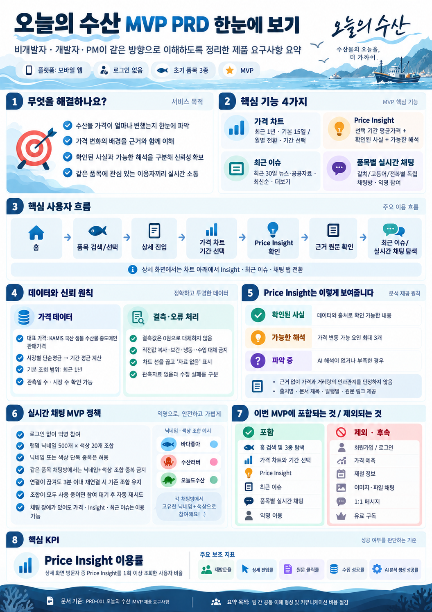
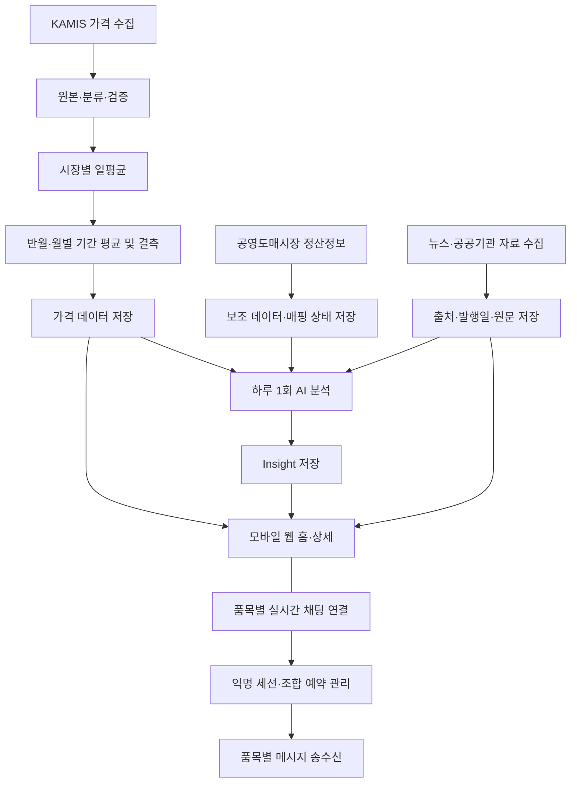

# PRD-001 오늘의 수산 MVP 제품 요구사항

> **핵심 결론:** 오늘의 수산 MVP는 로그인 없는 모바일 웹에서 갈치·고등어·전복 3종의 **가격 차트, Price Insight, 최근 이슈, 품목별 실시간 채팅**을 제공한다. 홈에서는 지원 품목 검색이 가능하다. KAMIS 국산 생물 수산물 중도매인 판매가격을 시장별·기간별로 집계하며, 확인된 사실과 가능한 해석을 구분한다. 결측값을 임의 대체하지 않는다. 채팅 참여자는 무작위 닉네임·색상을 할당받고 연결 단절 후 3분 이내에는 기존 조합을 복원한다.

- **문서 상태:** DRAFT — 승인된 채팅 정책 반영 및 문서 정합성 검사 완료
- **작성 기준일:** 2026-10-14
- **적용 범위:** MVP 상위 제품 요구사항. 기능별 상세는 `PF`, 공통 정책과 인수 기준은 `PP`, 사용자 흐름은 `UX` 문서에서 관리한다.
- **최초 출시 플랫폼:** 모바일 웹
- **초기 품목:** 갈치, 고등어, 전복

---

**MVP 요구사항 요약 인포그래픽**

> 이미지의 가격·메시지·화면 문구는 이해를 돕기 위한 예시이며, 확정 요구사항과 수치는 본문을 기준으로 한다.

## 1. 목적과 해결할 문제

수산물 가격이 얼마나 변했는지, 참고할 만한 사실이 무엇인지, 어떤 근거를 신뢰할 수 있는지 파악하기 어려운 문제를 해결한다. 가격 흐름, 출처가 확인되는 자료, 신뢰 수준을 구분한 Price Insight, 같은 품목에 관심 있는 이용자 간 실시간 대화를 한 경험으로 연결한다. 자료에 인과관계가 입증되지 않았다면 원인으로 단정하지 않는다.

### 1.1 제품 목표

- 최근 완료 반월 24개 또는 완료 월 12개의 가격 추이를 간편하게 탐색한다.
- 선택 기간의 평균가격과 Price Insight를 연결하여 확인한다.
- 근거가 되는 뉴스·공공기관 자료의 출처, 제목, 발행일, 원문을 확인한다.
- 같은 품목 상세 화면에서 익명으로 실시간 채팅에 참여한다.
- 결측, 수집 실패, AI 해석 부재를 명확히 구별한다.

### 1.2 서비스 원칙

- 핵심 사용자: 수산물 가격 및 시장 배경을 탐색하는 이용자. 세부 페르소나는 기존 `PD`를 따른다.
- 비영리 MVP로 운영하며 비용을 최소화한다.
- 데이터와 AI 분석은 가능한 한 배치 생성·저장 후 제공한다. 실시간 채팅은 별도의 실시간 통신 기능이다.
- 회원가입·로그인을 요구하지 않는다.

---

## 2. MVP 범위

| 구분 | MVP 포함 | 제외 또는 후속 |
|---|---|---|
| 홈 | 갈치·고등어·전복 목록, 3종 이름 검색, 가격·변동률, 결측 표시 | 미지원 품목 검색 결과 제공, 무제한 품목 |
| 가격 | 최근 24개 완료 반월 차트, 완료 월 12개 전환, 기간 선택, 평균가격·변동률, 관측 품질 | 진행 중 기간의 잠정값, 가격 예측, 실제 소매 구매가로 오인시키는 설명 |
| 분석 | 기간별 저장된 Price Insight, 최대 3개 가능 요인, 사실·해석·파악 중 구분 | 사용자 조회마다 LLM 실행, 인과관계 단정 |
| 근거 | 과거 선택 기간 근거, 최근 30일 이슈, 원문 새 탭 | 뉴스 전문 무단 재게시 |
| 채팅 | 품목별 실시간 메시지, 익명 자동 닉네임·색상, 연결·재연결, 입력 제한 | 파일·이미지, 1:1 메시지, 영구 프로필, 닉네임 변경, 고급 Moderation |
| 계정 | 익명 탐색·채팅 | 회원가입, 로그인, 계정 복구, 유료 구독 |
| 기타 | 데이터 상태·관측 품질 | 제철 정보, 개인화 알림, 광고 수익화 |

> **검증 경계:** PoC는 KAMIS 가격 시계열 가용성과 정산정보 일부를 탐색한 것이다. 거래량과 가격 사이의 인과관계나 세부 상품의 1:1 대응이 검증되었다고 가정하지 않는다.

---

## 3. 핵심 사용자 여정

1. 사용자가 홈에서 품목 3종의 최근 확정 평균가격·변동률을 살펴보거나 지원 품목 이름으로 검색한다. 검색 결과가 없으면 결과 없음 상태를 확인한다.
2. 품목을 선택해 상세로 이동한다. 최근 완료 반월 기준 **24개 완료 반월** 차트가 표시되며 최초에는 선택된 기간이 없다.
3. 차트 상단 `15일 | 월별`을 전환할 수 있으며 전환 시 선택 기간을 초기화한다.
4. 유효한 가격 점을 선택하면 선택 반월 또는 월 전체의 평균가격과 Price Insight를 확인한다.
5. 확인된 사실, 가능한 해석, 파악 중 상태 및 근거 원문을 확인한다.
6. 최근 이슈에서 최근 30일 자료를 최신순으로 5건 확인하고 필요하면 더보기를 사용한다.
7. 같은 상세 페이지의 **해당 품목 채팅방**에 로그인 없이 참여한다. 신규 연결 시 서버가 무작위 닉네임·색상을 부여하며, 실시간 메시지를 주고받는다.
8. 네트워크 단절 후 **3분 이내** 정상 복원 시 원래 조합을 유지한다. 조합이 모두 사용 중이면 신규 채팅 참여가 제한되고 자리가 생기면 자동으로 재시도한다. 채팅이 제한되어도 가격·분석·이슈는 이용할 수 있다.

---

## 4. 기능 요구사항

- **MUST:** MVP 출시 필수
- **SHOULD:** 권장하되 구체적 출시 기준 추가 합의 필요
- PRD는 상위 기능을 `CAP-*`로 식별하며 상세 요구사항과 테스트는 `PF` 문서의 `FR-*`에서 관리한다.

### 4.1 CAP-HOME — 홈·품목 검색

| 우선순위 | 요구사항 |
|---|---|
| MUST | 갈치·고등어·전복 3종을 표시한다. |
| MUST | 각 품목에 최근 **확정 기간** 평균가격과 변동률을 표시하고, 단위·기준 기간을 알 수 있게 한다. |
| MUST | 계산할 수 없는 가격·변동률을 임의 숫자나 0으로 대체하지 않는다. |
| MUST | 로그인 없이 품목 상세로 이동할 수 있다. |
| MUST | 3종의 **이름 검색**을 제공하고 일치하지 않는 검색어에 결과 없음 상태를 제공한다. |
| MUST | 검색 입력 시 지원 품목 3종을 즉시 필터링하며 기본 순서는 갈치→고등어→전복이다. |
| MUST | 대표 가격은 가장 최근 완료 반월만 사용하고, 해당 반월에 가격이 없으면 이전 유효 반월로 대체하지 않는다. |
| MUST | 변동률은 바로 직전 반월 대비 `(당기-전기)/전기×100`으로 계산하고 비교 가격이 없거나 0이면 계산 불가로 표시한다. |
| MUST | 가격은 원 단위 정수, 변동률은 소수 첫째 자리로 반올림한다. |
| MUST | 카드 조회 오류 시 카드를 유지하고 품목별 오류·재시도를 제공하며, 카드별 가격 기준 기간과 홈 최근 갱신 시각을 표시한다. |

**인수 조건**

- [ ] 로그인하지 않은 방문자가 품목 3종을 볼 수 있다.
- [ ] 유효한 품목명 검색 결과를 선택하면 해당 상세로 이동한다.
- [ ] 미지원 품목은 임의의 가격 결과를 제공하지 않는다.
- [ ] 최신 확정 가격이 없으면 `자료 없음` 등 올바른 상태를 보여준다.
- [ ] 한 품목 카드 조회가 실패해도 다른 카드를 유지하고 실패 카드에서 다시 시도할 수 있다.

**확정:** 최근 완료 반월, 직전 반월 비교, 분모 0·결측 시 계산 불가, 가격 원 단위·변동률 소수 첫째 자리 반올림을 적용한다.

### 4.2 CAP-CHART — 가격 차트

| 우선순위 | 요구사항 |
|---|---|
| MUST | 첫 상세 진입 시 가장 최근 완료 반월 기준 최근 **24개 완료 반월**을 기본 **15일** 단위로 표시하며 기간 미선택 상태다. |
| MUST | 차트 상단에 `15일 \| 월별` 전환을 제공한다. |
| MUST | 반월은 월 1~15일, 16~말일이며 월별은 해당 월 전체다. |
| MUST | 월별 전환 시 가장 최근 완료 월 기준 최근 **12개 완료 월**을 표시하며, 반월과 월의 종료 시점은 달라도 된다. |
| MUST | 진행 중인 반월·월의 잠정값은 포함하지 않는다. |
| MUST | 같은 날짜 적격 시장가격을 **시장별 단순평균**, 그 기간의 일별 평균을 **관측일 단순평균**한다. |
| MUST | 관측일 1일 이상·관측 시장 1개 이상이면 계산 가능하며 관측일 수와 시장 수를 보존·표시한다. |
| MUST | 같은 날짜·시장·상품 조건의 완전 중복만 제거하고, 검증된 단위·파싱 오류를 제외한다. 정상적 극단값은 가격 편차만으로 제거하지 않는다. |
| MUST | 서로 다른 등급·규격은 독립 관측으로 보존하며 대표가격 혼합 여부는 `PFV-013`에서 결정한다. |
| MUST | 결측 기간은 0·직전값·보간·냉동·수입 대체 없이 선을 끊고 `자료 없음`으로 표시한다. |
| MUST | 유효한 차트 점 터치 시 해당 반월 또는 월의 평균가격과 저장된 Insight를 표시한다. |
| MUST | 집계 단위 전환 시 선택 기간과 종속 Insight를 초기화한다. |
| MUST | 중도매인 판매가격임을 안내하고 단위·기준 기간·관측일 수·시장 수를 확인할 수 있게 한다. |
| MUST | 관측자료 없음과 수집 실패를 구분한다. |

**인수 조건**

- [ ] 첫 진입은 15일/미선택이며 Insight는 기간 선택 안내 상태다.
- [ ] 2026년 2월 하반기는 `2026-02-16~2026-02-28`로 선택된다.
- [ ] 2026년 8월 월별 점은 `2026-08-01~2026-08-31` 전체를 선택한다.
- [ ] 기간 선택 후 단위를 전환하면 이전 선택이 사라진다.
- [ ] 관측이 없으면 0원이 아닌 결측이며 인접 점을 잇는 선이 끊긴다.
- [ ] 날짜 D에 시장 A/B가 10,000/12,000원, D+1에 시장 A가 11,000원이면 두 날짜의 일별 평균과 전체 기간 평균은 모두 11,000원이다.

**보류:** 서로 다른 등급·규격을 대표가격 하나에 혼합할지는 `PFV-013`으로 보류한다. 정정 후 재집계 기술 상세는 기술 설계에서 결정한다.

### 4.3 CAP-INSIGHT — Price Insight

| 우선순위 | 요구사항 |
|---|---|
| MUST | `species_id`·집계 단위·기간 시작/종료가 일치하는 **저장된 분석**을 조회한다. |
| MUST | 분석 배치는 하루 1회 실행하고, 신규 완료 반월·월은 가격·외부 근거 등 입력 준비 완료 후 **2시간 이내** 생성·저장하는 목표를 적용한다. 두 조건을 함께 충족하는 트리거·실행 시점은 기술 설계에서 검증하며 화면 조회마다 LLM을 호출하지 않는다. |
| MUST | 가능한 가격 변동 요인은 최대 3개이며 근거 부족 시 0~2개도 허용한다. |
| MUST | `확인된 사실`·`가능한 해석`·`파악 중`을 구분한다. |
| MUST | AI 결과가 없거나 실패해도 유효한 가격 및 검증된 사실을 유지하고 **AI 해석만** `파악 중` 처리한다. |
| MUST | 근거 없이 거래량과 가격 변화의 인과관계를 단정하지 않는다. |
| MUST | 출처명·제목·발행일·원문 링크를 제공하고 주장과 근거의 연결을 추적 가능하게 한다. |
| MUST | 게시된 과거 Insight는 생성 당시 근거를 보존하는 고정 스냅샷이며 새 근거·단순 가격 변경으로 자동 재분석하지 않는다. |
| MUST | 명백한 가격 계산 또는 출처·주장 오류는 개발자가 검토해 수동 무효화하며, AI 해석을 `파악 중`으로 표시하고 유효한 가격·검증된 사실은 유지할 수 있는 범위에서 제공한다. |
| MUST | 기간별 정상 게시 버전은 하나만 활성화하고 기존 버전과 오류 확인·무효화 이력을 보존한다. 필요 시 수동 정정 또는 제한적 재분석한다. |
| MUST | 과거 기간의 근거 조회는 최근 30일 이슈 제한과 독립적이다. |

**인수 조건**

- [ ] 미선택 시 `차트에서 기간을 선택해 주세요`에 준하는 안내를 제공한다.
- [ ] 월별 선택 시 해당 월 전체에 연결된 결과만 표시한다.
- [ ] 분석 실패 시 유효한 가격·검증된 사실은 그대로이고 해석만 `파악 중`이다.
- [ ] 사용자에게 표시되는 가능 요인은 3개를 초과하지 않는다.
- [ ] 단순 동시 변화만으로 가격 변동 원인을 확정해 설명하지 않는다.
- [ ] 신규 근거가 추가되어도 게시된 과거 Insight가 자동 재분석되지 않는다.
- [ ] 무효화된 분석은 AI 해석을 `파악 중`으로 표시하고 기존 버전과 무효화 이력을 보존한다.

**보류:** 월간 AI 운영비 상한은 `PFV-025`, 분석 버전 보존 기간은 `PFV-026`으로 보류한다.

AI 생성 성공률의 정확한 목표는 PFV 식별자와 연결하지 않은 별도 미정 항목이다. 별도 관리자 대시보드는 MVP 필수 기능이 아니다.

### 4.4 CAP-ISSUE — 최근 이슈

| 우선순위 | 요구사항 |
|---|---|
| MUST | 뉴스·공공기관 발표 자료를 모두 하루 1회 수집하며 공공기관 자료를 우선 검토한다. 뉴스 API는 무료 이용 가능한 제공처를 우선 검토하되 상업적 사용·AI 분석·본문 저장 권한은 별도 검증한다. |
| MUST | KST 오늘을 포함한 최근 30개 달력 날짜, 즉 D-29 00:00 이상 D+1 00:00 미만의 발행 자료를 표시한다. 발행일을 확인할 수 없는 자료는 목록에서 제외하고 검토한다. |
| MUST | 품목명으로 후보를 수집한 뒤 제목·본문의 직접 관련성을 확인한다. |
| MUST | 최초 **5개** 표시 후 **5개씩** `더보기`를 제공한다. `cursor` 또는 `page`는 기술 설계에서 결정한다. |
| MUST | URL의 추적 파라미터만 안전하게 제거하고 의미 있는 파라미터는 보존한다. 동일 정규화 URL만 중복 제거하며 서로 다른 원문은 같은 사건이어도 유지한다. |
| MUST | 출처·제목·발행일·원문 링크를 제공하며 원문은 새 탭에서 연다. |
| MUST | 수집 실패와 실제 자료 없음 상태를 구분한다. |
| MUST | 원문 접근 가능 여부를 수집 시와 이후 하루 1회 확인하고, 접근 불가 자료는 목록에서 제외하되 내부 메타데이터와 상태는 유지한다. |
| MUST | 출처 단위 수집 실패는 5분·15분·30분 뒤 재시도하고 미복구 시 실패 당일 D부터 D+2까지 일별 재확인한다. 정상 출처와 기존 유효 자료 제공은 계속한다. |

**인수 조건**

- [ ] 관련 자료가 12건이라면 최초 5건을 최신순으로 표시하고 나머지를 더보기로 확인한다.
- [ ] 서로 다른 URL의 같은 사건 보도는 각각 남는다.
- [ ] 동일 URL은 한 번만 표시된다.
- [ ] 출처 원문은 새 탭에서 열린다.

**확정·보류:** 발행 시각이 있으면 최신순, 동률이면 안정적인 자료 식별자 순으로 정렬하며 없는 시각은 만들지 않는다. 메타데이터는 1년 보존하고, 원문 본문 보존 및 과거 Insight의 장기 출처 추적은 별도 검증한다. 실제 제공처와 이용약관은 PoC 후 확정한다.

### 4.5 CAP-CHAT — 품목별 실시간 채팅

| 우선순위 | 요구사항 |
|---|---|
| MUST | 갈치·고등어·전복 상세 화면에 **품목별로 격리된** 실시간 채팅방을 제공한다. |
| MUST | 로그인 없이 실시간 메시지 조회·전송·수신이 가능하다. |
| MUST | 최초 참여 시 서버가 닉네임 **500개 × 색상 20개** 풀에서 무작위 조합을 부여한다. |
| MUST | 닉네임 단독·색상 단독 중복은 허용하되, **동일 품목의 활성 참여자와 재연결 예약자 간 닉네임+색상 조합 중복은 금지**한다. |
| MUST | MVP에 닉네임·색상 직접 변경 기능을 제공하지 않는다. |
| MUST | 참여자를 닉네임·색상으로 표시하고 메시지 작성 시각을 제공한다. 색상만으로 작성자를 구분하지 않는다. |
| MUST | `localStorage`의 익명 식별자를 사용해 재연결을 요청하고, 서버에서 세션 소유·권한을 검증한다. |
| MUST | 연결 단절 시 기존 조합을 **3분** 예약하며 그 이내 세션 복원에 성공하면 기존 조합을 유지한다. |
| MUST | 모든 **10,000개 조합**이 활성·예약으로 점유된 품목 채팅방은 신규 참여를 일시 제한하고, 조합 여유 발생 시 자동 재시도한다. |
| MUST | 연결·재연결·참여 제한 상태를 표시하고, 채팅 장애가 가격·Insight·이슈 열람을 막지 않는다. |
| MUST | 메시지 길이·전송 빈도 제한을 두고 유효하지 않은 메시지를 거부한다. |
| MUST | 서버가 품목 격리와 조합 원자적 할당을 보장한다. |
| MUST | 메시지는 최대 **300 Unicode 문자**, 서버가 검증한 익명 참여자 세션당 **3초 1회 이하·1분 최대 20회**로 제한하며 여러 탭·연결을 통한 우회를 허용하지 않는다. |
| MUST | 최초 최근 메시지 **50개**만 조회하고 이전 메시지 추가 조회는 제공하지 않는다. 메시지는 7일 보존 후 일일 배치로 삭제하며 7일 초과 메시지는 노출하지 않는다. |
| MUST | 서버 측 정규화 금칙어 검사를 수행하고 포함 메시지를 거부해 이유를 안내한다. 사용자 신고·차단·운영자 삭제 UI와 별도 AI Moderation은 MVP 필수가 아니다. |
| MUST | 같은 브라우저의 같은 품목 다중 탭은 하나의 익명 참여자 세션을 공유하되 탭별 연결은 별도 관리할 수 있다. 서버 발급 복원 자격정보로 소유권·품목 권한을 검증한다. |
| MUST | 재연결은 1·2·4·8·16·30초 등 최대 30초 지수 백오프를 적용한다. 대기 순서와 서버 재시작 후 상태 복원은 기술 설계에서 결정한다. |
| MUST | 메시지 본문을 중복 저장하지 않는 최소 이벤트 로그를 30일 보존한다. |

**인수 조건**

- [ ] 익명 사용자가 갈치 상세에 접속해 갈치 채팅방의 메시지를 조회·전송할 수 있다.
- [ ] 같은 품목의 다른 연결 사용자에게 실시간으로 메시지가 전달된다.
- [ ] 고등어 메시지가 갈치·전복 채팅방에 나타나지 않는다.
- [ ] 신규 사용자는 닉네임과 색상을 자동 부여받으며 수정할 수 없다.
- [ ] 같은 닉네임/다른 색상 또는 같은 색상/다른 닉네임은 허용된다.
- [ ] 같은 품목의 활성·예약 참여자에게 동일한 전체 조합이 중복 할당되지 않는다.
- [ ] 연결 단절 후 3분 이내에 기존 세션을 복원하면 기존 닉네임·색상이 유지된다.
- [ ] 예약 중인 조합은 신규 참여자에게 할당되지 않고 만료 후 반환 가능하다.
- [ ] 10,000개 조합이 모두 점유되면 신규 참여를 제한하고 반환 후 자동 재시도한다.
- [ ] 재연결 중 또는 참여 제한 중에도 가격·Insight·최근 이슈는 이용할 수 있다.
- [ ] 메시지 유효성·길이·빈도 제한이 적용된다.
- [ ] 최근 메시지는 50개만 조회되고 7일 초과 메시지는 노출되지 않는다.
- [ ] 금칙어 포함 메시지는 서버에서 거부되고 사유가 안내된다.
- [ ] 같은 브라우저·같은 품목의 여러 탭이 하나의 참여자 세션 제한을 공유한다.

**확정 정책의 해석:** '현재 접속자 간 조합 중복 금지'의 예외로, 끊긴 연결의 **3분 재연결 예약 조합**도 신규 할당에서 제외한다. 재연결 대상 식별자는 브라우저의 `localStorage`에 보존하되 이 값만으로 권한을 신뢰하지 않는다. 예약 만료 후 기존 조합 복원은 보장하지 않는다.

**확정·보류:** 메시지 제한·보존·최초 조회·서버 금칙어 검사·다중 탭 세션 공유·재연결 백오프는 확정이다. 대기 순서, 서버 재시작 후 상태 복원, 세션 폐기 상세는 기술 설계로 보류한다.

---

## 5. 데이터 및 정책 요구사항

### 5.1 대표 가격의 의미

- 대표 가격은 KAMIS **국산 생물 수산물 중도매인 판매가격**을 대상 규칙에 따라 집계한 지표다. 경매 낙찰가격·일반 소매가격 또는 단일 시장가격으로 설명하지 않는다.
- 공영도매시장 정산정보는 거래량·정산금액에 대한 **보조 참고 자료**로 사용한다. KAMIS 대표 가격을 대체하지 않는다.
- 품목군 코드가 매핑돼도 원산지·상태·규격·등급까지 같은 상품이라는 뜻은 아니다.

### 5.2 MVP 운영상 분류 가정

- KAMIS 품목명·품종명에 `수입` 표시가 없으면 국산으로, `냉동` 표시가 없으면 생물로 **간주**한다.
- `생선`, `활어`, `신선`, `냉장`은 생물 범주에 포함한다.
- `건조`, `건어류`, 냉동·수입으로 분류된 상품은 대표 가격에서 제외한다.
- 이 규칙은 **운영상 추정**이며 실제 원산지 확인·인증이 아니다.
- 원본 명칭, 적용 규칙, 분류 결과, 버전, 제외 사유를 보존한다.

**미정:** 상충 표기, 유사어·오탈자, 등급 혼합, 복수 규격 처리 순서.

### 5.3 결측과 품질

- 원천 관측이 없는 구간은 `NULL`로 처리하고 0·보간·직전값·다른 상품으로 대체하지 않는다.
- 수집 실패와 정상 수집 후 관측 없음은 별도 상태로 기록한다.
- 관측일 수·관측 시장 수를 조회 가능하게 한다.
- 적격 관측만 평균 계산에 포함하며 최소 품질 기준과 정정 후 재집계 정책은 미정 사항으로 유지한다.

### 5.4 PoC 범위 및 코드

| 품목 | KAMIS | 정산정보 품목군 | 2025-10-01~2026-09-30 유효 반월 |
|---|---|---|---|
| 갈치 | `613/01` | `71/04` | 24/24 |
| 고등어 | `611/01` | `71/06` | 21/24 |
| 전복 | `653/00` | `62/09`, `72/09` | 24/24 |

정산정보 검증은 일부 날짜·시장 탐색에 한정한다. 위 기간의 가격 시계열 검증을 전체 공동 데이터의 인과 검증으로 확대하지 않는다. 원천 자료가 정정되면 `POC-003`의 조건·결과와 대조한다.

---

## 6. 데이터 흐름 및 운영

- 가격·뉴스·AI 분석 수집/집계 실패는 단계별로 추적한다.
- 가격·Insight 조회는 저장 결과 중심으로 제공한다. **채팅은 사전 배치 데이터가 아닌 실시간 서비스**로 운영한다.
- 가격·분석 정정 및 버전 이력을 관리한다.
- API 키와 서버 자격증명을 클라이언트·공개 저장소·응답에 노출하지 않는다.
- 서버 측 세션 검증과 채팅방 분리, 동시 입장의 조합 중복 방지, 재연결 예약 만료를 보장한다.
- 구체적인 배치 재시도, 유지비, 보관 기간·외부 자료 이용 조건은 별도 정책에서 정의한다.

---

## 7. 측정 지표

### 7.1 핵심 KPI — Price Insight 이용률

`Price Insight 이용률 = 평가 기간에 Insight를 1회 이상 조회한 익명 상세 방문자 수 / 같은 기간 상세 화면을 1회 이상 방문한 익명 사용자 수 × 100`

- 첫 평가: MVP 출시 후 30일.
- 보조 지표: 재방문율, 상세 진입률, 원문 클릭률.
- 운영 지표: 수집 성공률, AI 분석 생성 성공률.
- 익명 식별자 삭제·변경과 브라우저 분리에 따른 오차를 인정한다.
- 채팅 복구용 `localStorage` 식별자를 KPI용 방문자 식별자와 **같은 것으로 자동 간주하지 않는다**. 측정용 식별·동의·보관 정책은 별도 결정한다.

### 7.2 이벤트 후보 (미확정)

| 이벤트 | 발생 후보 조건 | 주요 속성 후보 |
|---|---|---|
| `home_view` | 홈 표시 | 방문 시각 |
| `species_search` | 지원 품목 검색 | 검색 결과 상태; 검색어 저장 범위 미정 |
| `species_detail_view` | 상세 표시 | `species_id` |
| `chart_granularity_change` | 집계 단위 전환 | `species_id`, `granularity` |
| `price_period_select` | 유효한 기간 선택 | `species_id`, `granularity`, `period_start`, `period_end` |
| `price_insight_view` | Insight 콘텐츠 표시 | 선택 기간, `insight_status` |
| `issue_original_click` | 이슈 원문 선택 | `species_id`, `source_id` |
| `chat_connection_status` | 연결·재연결·제한 상태 | `species_id`, 상태; 수집 여부 미정 |

이벤트 이름과 속성은 구현 계약이 아니다. 특히 기간 선택과 실제 Insight 조회의 판정은 별도 정의해야 한다.

**미정:** 익명 KPI 식별 방법, 이벤트 발생·중복 제거 기준, 개인정보 동의·보존, 목표 수치.

---

## 8. 비기능 요구사항 및 출시 기준

| ID | 영역 | 출시 기준 방향 | 상태 |
|---|---|---|---|
| NFR-01 | 모바일 사용성 | 주요 화면과 차트 터치 작동 | MUST, 기기 기준 미정 |
| NFR-02 | 가격 정확성 | 적격 분류→일평균→기간 평균 재계산 일치 | MUST |
| NFR-03 | 결측 무결성 | 결측의 0·보간·대체 금지 | MUST |
| NFR-04 | 근거 추적성 | 사실·해석별 원문 확인 | MUST |
| NFR-05 | 장애 내성 | AI 오류 시 가격·검증 사실 제공 | MUST |
| NFR-06 | 정보보호 | 자격증명·민감정보 노출 방지 | MUST |
| NFR-07 | 운영 관측성 | 단계별 작업 성공·실패 기록 | MUST |
| NFR-08 | 성능 | 차트·저장 Insight 조회 p95 ≤ 500ms, 모바일 LCP p75 ≤ 2.5초, 채팅 전달 p95 ≤ 500ms·품목별 500명 | MUST, 운영 유사 환경 증빙 필요 |
| NFR-09 | 신선도·가용성 | 원천 가격 확인 후 2시간 내 반영, 가격 수집 연속 7일 ≥ 95%, 신규 Insight 입력 준비 후 2시간 내 생성 | MUST, 분모·제외 조건 일부 보류 |
| NFR-10 | 접근성 | 터치 크기·대비·차트 대체 설명 | SHOULD, 기준 미정 |
| NFR-11 | 채팅 | 품목 격리, 실시간 송수신, 3분 복원, 조합 중복 금지, 입력 제한, 품목별 500명 동시 접속 검증 | MUST |

**출시 통과 원칙:** (1) 홈·검색·차트·Insight·최근 이슈·채팅의 필수 동작, (2) 데이터·근거 신뢰성, (3) 데이터 배치 및 실시간 채팅을 포함한 운영 안정성을 모두 충족한다. 상세 판정은 `PP-003`의 `PASS`·`CONDITIONAL_PASS`·`FAIL`·`PENDING`을 따르며 필수 항목에 `FAIL` 또는 `PENDING`이 있으면 출시할 수 없다. 현재 실측 증거가 없는 인수 항목은 `PENDING`이다.

---

## 9. 요구사항 추적 및 문서 역할

| 후속 문서 | 위임할 상세 내용 |
|---|---|
| `PF-001-홈-화면.md` | `CAP-HOME` — 검색, 가격/변동률, 결측 UI |
| `PF-002-수산물-가격-차트.md` | `CAP-CHART` — 터치, 축·집계, 결측 표현 |
| `PF-003-Price-Insight.md` | `CAP-INSIGHT` — 저장 결과, 사실/해석/상태/출처 |
| `PF-004-최근-이슈.md` | `CAP-ISSUE` — 30일, 5개, URL 중복·외부 링크 |
| `PF-005-실시간-채팅.md` | `CAP-CHAT` — 익명 조합, 3분 예약, 격리, 연결, 제한 |
| `PP-001-가격-데이터-처리-정책.md` | 원본 보존, 분류, 정규화, 가격 계산과 품질·정정 정책 (작성 예정) |
| `PP-002-AI-분석-운영-정책.md` | 배치, 근거 검증, 버전, 분석 실패·재분석 |
| `PP-003-MVP-출시-인수-기준.md` | E2E·데이터·운영·채팅 출시 게이트 |
| `UX-001-사용자-흐름-및-정보-구조.md` | 검색·가격 탐색·Insight·이슈·실시간 채팅 User Flow와 IA |
| [`UX-002-화면-상태-및-인터랙션-설계.md`](./ux/UX-002-화면-상태-및-인터랙션-설계.md) | 확정 UX 결정, 화면 상태·메시지·예외·모바일 조작 |

가격 데이터 처리의 세부 기준은 PP-001 작성 전까지 기존 관련 `PD`, `PF-002`, `POC-003`을 참조한다. `PD-001~013`·`POC-001~003`의 기존 확정 의사결정은 임의 변경하지 않는다.

---

## 10. 미정·추가 승인 필요 항목

| ID | 결정할 사항 | 상태 |
|---|---|---|
| OPEN-01 | 홈 최근 확정가격의 기준 기간 | 확정 — 가장 최근 완료 반월, 이전 기간 대체 금지 |
| OPEN-02 | 가격 변동률의 비교 기간 및 결측/0 처리 | 확정 — 직전 반월 비교, 결측·0이면 계산 불가 |
| OPEN-03 | 차트 표시 범위 | 확정 — 최근 완료 반월 24개·완료 월 12개 |
| OPEN-04 | 관측일·시장 최소 품질 임계치 | 확정 — 관측일 1일·시장 1개 이상 |
| OPEN-05 | 등급·규격·이상치 정규화·제외 순서 | 일부 보류 — 검증 오류·완전 중복만 제외, 정상 극단값 유지, 등급·규격 혼합은 `PFV-013` |
| OPEN-06 | 정산정보의 보조 근거 노출 수준 | 미정 |
| OPEN-07 | KPI용 익명 방문자·Insight 조회 이벤트 정의 | 미정 |
| OPEN-08 | 배치 재시도·정정·가용성 출시 임계치 | 일부 확정 — 외부 출처 재시도·수동 무효화·성능 목표 확정; AI 생성 성공률 목표와 하루 1회 배치·2시간 SLA 동시 충족 방식은 별도 보류 |
| OPEN-09 | 모바일 성능·접근성 목표 | 일부 확정 — LCP p75 ≤ 2.5초, 접근성 세부 기준 보류 |
| OPEN-10 | 문서 규칙·참조 경로의 저장소 실물 확인 | 확인 완료 — 문서 규칙과 참조 경로 확인 |
| OPEN-11 | 채팅 메시지 길이·전송 빈도 제한값 | 확정 — 300 Unicode 문자, 세션당 3초 1회·분당 20회 |
| OPEN-12 | 채팅 메시지 보관·초기 조회 및 최소 Moderation | 확정 — 7일·50개·서버 금칙어 검사 |
| OPEN-13 | 익명 채팅의 브라우저 다중 탭·세션 보안·폐기 | 일부 확정 — 다중 탭 세션 공유·서버 자격정보 검증, 폐기 상세는 기술 설계 |
| OPEN-14 | 단절 판정 시작과 자동 재시도 간격·방식 | 일부 확정 — 최대 30초 지수 백오프, 대기 순서·서버 재시작 복원은 기술 설계 |

**채팅 확정 정책:** 닉네임·색상 랜덤 자동 할당(500×20), 직접 변경 불가, 품목별 활성+예약 조합 중복 금지, `localStorage` 기반 복원 요청, **3분 예약**, 고갈 시 제한·여유 발생 후 자동 재시도. 위 사항은 OPEN 항목으로 되돌리지 않는다.

**UX 확정 사항:** 상세 화면은 차트 아래 `Price Insight / 최근 이슈` 탭을 사용하고, 채팅은 우측 하단 FAB로 여는 오버레이 패널로 제공한다. 패널 닫힘은 연결 종료가 아니며 메시지 상태와 연결을 유지한다. 재열림은 기존 연결을 사용하고 새 세션·연결을 만들지 않으며 최신 메시지로 이동한다. 세부 인터랙션은 `UX-002`의 `UX-D04`, `UX-D11`, `UX-D21`, `UX-D30`을 따른다.

---

## 11. 변경 및 승인 원칙

1. `AGENTS.md`, `INDEX.md`, 기존 `PD`·`POC`와의 정합성을 유지한다.
2. 확정된 의사결정의 변경은 사용자 승인을 받아 기록한다.
3. 미정 항목을 추정해 구현 기준으로 고정하지 않는다.
4. `PF-005` 또는 `UX-001`의 채팅 정책을 변경하면 관련 PRD·PP와 함께 문서 일관성 검사를 재실행한다.
5. 필수 미정 사항 및 후속 문서의 승인이 완료되기 전까지 `DRAFT` 상태를 유지한다.
