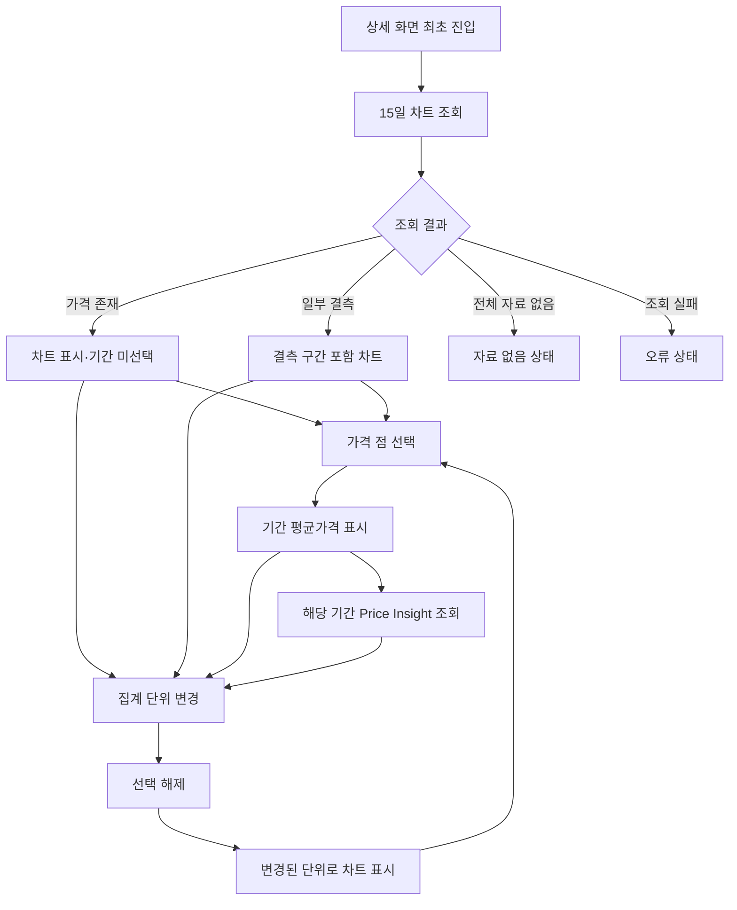

# PF-002 수산물 가격 차트

> **핵심 결론:** 오늘의 수산 MVP는 갈치·고등어·전복의 최근 1년 가격을 15일 또는 월별 차트로 제공한다. 기본 집계 단위는 15일이며, 사용자가 차트의 가격 점을 선택하면 해당 기간의 평균가격과 Price Insight를 조회한다. 가격이 없는 기간은 임의로 채우지 않고 결측으로 표시하며, 집계 단위 전환 시 선택된 기간을 초기화한다.
>
> - 문서 상태: DRAFT
> - 상위 문서: [PRD-001 MVP 제품 요구사항](../PRD-001-MVP-제품-요구사항.md)
> - 관련 기능: [PF-001 홈 화면](./PF-001-홈-화면.md), [PF-003 Price Insight](./PF-003-Price-Insight.md), [PF-005 실시간 채팅](./PF-005-실시간-채팅.md)
> - 관련 정책: PP-001 가격 데이터 처리 정책(작성 예정)
> - 적용 플랫폼: 모바일 웹
> - 우선순위: MVP 필수

---

## 1. 기능 목적

수산물 가격 차트는 이용자가 수산물 가격의 시간에 따른 변화를 살펴보고, 특정 기간에 발생한 가격 변화의 배경을 탐색할 수 있도록 돕는다.

### 1.1 사용자 목표

1. 수산물의 최근 1년 가격 흐름을 확인한다.
2. 15일 또는 월별 단위로 가격 추이를 비교한다.
3. 관심 있는 기간을 선택해 평균가격을 확인한다.
4. 선택한 기간의 Price Insight를 조회한다.
5. 가격 데이터의 결측 여부와 관측 품질을 확인한다.

### 1.2 설계 원칙

- 가격 차트는 서비스의 핵심 정보 탐색 수단이다.
- 단일 시장 가격이 아닌 여러 시장을 통합한 평균가격을 제공한다.
- 실제 관측값을 기반으로 가격을 계산한다.
- 결측 가격을 추정하거나 보간하지 않는다.
- 차트의 시각적 표현이 원본 데이터의 의미를 왜곡하지 않아야 한다.
- AI 분석 결과가 없더라도 가격 차트는 독립적으로 제공한다.
- 상세 구현 규칙은 공통 데이터 정책을 따른다.

---

## 2. 기능 범위

### 2.1 MVP 포함 기능

| 기능 | 설명 | 우선순위 |
|---|---|---|
| 최근 1년 차트 | 최근 1년간 수산물 가격 추이 표시 | MUST |
| 15일 집계 | 월 상반기·하반기별 평균가격 표시 | MUST |
| 월별 집계 | 월 전체 평균가격 표시 | MUST |
| 집계 단위 전환 | 15일과 월별 전환 | MUST |
| 기간 선택 | 차트 점 터치로 분석 기간 선택 | MUST |
| 기간 평균가격 | 선택 기간의 평균가격 표시 | MUST |
| Price Insight 연동 | 선택한 기간의 저장된 분석 조회 | MUST |
| 결측 처리 | 자료가 없는 구간을 끊어진 선으로 표현 | MUST |
| 가격 품질 정보 | 관측일 수와 시장 수 확인 | MUST |
| 데이터 상태 구분 | 수집 실패와 관측자료 없음 구분 | MUST |

### 2.2 MVP 제외 기능

- 사용자가 임의 시작일·종료일을 입력하는 기능
- 일별 차트 집계 단위 전환
- 실시간 가격 예측
- 향후 가격 전망 그래프
- 여러 수산물의 가격을 한 차트에서 비교
- 사용자별 차트 설정 저장
- 차트 이미지 다운로드
- 회원별 관심 품목 관리
- 사용자 요청 시 실시간 AI 분석 생성

---

## 3. 화면 구성

### 3.1 상세 화면 내 배치

수산물 상세 화면은 다음 순서로 구성한다.

1. 수산물명
2. 가격 차트 영역
3. 차트 집계 단위 전환 버튼
4. 최근 1년 가격 차트
5. 선택 기간 정보
6. 선택 기간 평균가격
7. Price Insight
8. 최근 이슈

단, 집계 단위 전환 버튼은 차트 상단에 배치한다.

### 3.2 가격 차트 영역

| 구성 요소 | 표시 내용 |
|---|---|
| 차트 제목 | 수산물 가격 추이 |
| 가격 정의 | KAMIS 중도매인 판매가격 기반 |
| 집계 단위 | 15일 또는 월별 |
| 기본 집계 단위 | 15일 |
| 조회 범위 | 최근 1년 |
| X축 | 반월 또는 월별 기간 |
| Y축 | 표준 단위당 평균가격 |
| 데이터 점 | 집계 기간별 평균가격 |
| 선택 상태 | 사용자가 선택한 기간 |
| 결측 상태 | 자료 없음 |
| 품질 정보 | 관측일 수, 관측 시장 수 |

### 3.3 집계 단위 전환

차트 상단에 다음 전환 버튼을 제공한다.

`15일 | 월별`

- 최초 진입 시 `15일`이 활성화된다.
- `월별`을 선택하면 월별 평균가격 차트로 전환한다.
- 다시 `15일`을 선택하면 반월 차트로 전환한다.
- 집계 단위가 변경되면 기존 기간 선택은 초기화된다.
- 전환 후 Price Insight는 기간 선택 안내 상태로 돌아간다.

---

## 4. 가격 데이터 정의

### 4.1 대표 가격

대표 가격은 KAMIS의 국산 생물 중도매 가격을 기반으로 계산한다.

가격 계산에 사용하는 관측값은 다음 조건을 만족해야 한다.

1. MVP 제공 대상 수산물에 해당한다.
2. 국산 생물 분류 규칙에 적합하다.
3. 유효한 가격 값을 가진다.
4. 가격 집계 대상 시장의 관측값이다.
5. 공통 데이터 처리 정책의 적격 기준을 충족한다.

### 4.2 국산 생물 분류

MVP에서는 다음 운영상 분류 가정을 적용한다.

| 분류 조건 | 처리 |
|---|---|
| 품목명·품종명에 `수입` 없음 | 국산으로 간주 |
| 품목명·품종명에 `냉동` 없음 | 생물로 간주 |
| `생선` | 생물에 포함 |
| `활어` | 생물에 포함 |
| `신선` | 생물에 포함 |
| `냉장` | 생물에 포함 |
| `건조` 또는 `건어류` | 대표 가격에서 제외 |
| `냉동` | 대표 가격에서 제외 |
| `수입` | 대표 가격에서 제외 |

이 분류는 MVP의 데이터 처리 가정이며 실제 원산지에 대한 공식 인증이 아니다.

원본 상품명과 분류 결과는 각각 보존한다.

세부 충돌 처리와 분류 우선순위는 PP-001에서 정의한다.

### 4.3 가격 단위

- 서로 다른 단위의 가격을 직접 평균하지 않는다.
- 집계 전 공통 가격 단위로 정규화한다.
- 가격 차트의 Y축과 선택 기간 평균가격에 단위를 표시한다.
- 표준 단위와 환산 가능 여부는 원본 자료에 따라 결정한다.
- 환산이 불가능한 관측값을 임의로 변환하지 않는다.

---

## 5. 가격 집계 규칙

### 5.1 집계 원칙

가격은 다음 두 단계로 계산한다.

**1단계: 날짜별 시장 평균가격 계산**

동일 날짜에 관측된 적격 시장별 가격을 단순평균한다.

일별 평균가격 = 해당 날짜의 적격 시장가격 합계 / 해당 날짜의 적격 시장 수

**2단계: 기간별 평균가격 계산**

선택 기간 내 유효한 일별 평균가격을 단순평균한다.

기간 평균가격 = 기간 내 유효한 일별 평균가격 합계 / 기간 내 가격 관측일 수

시장별 거래량이나 거래금액을 가중치로 적용하지 않는다.

### 5.2 계산 예시

다음은 산식 검증을 위한 가상 데이터이다.

| 날짜 | 시장 A | 시장 B | 시장 C | 일별 평균 |
|---|---:|---:|---:|---:|
| 10월 1일 | 10,000 | 12,000 | 14,000 | 12,000 |
| 10월 2일 | 11,000 | 13,000 | 자료 없음 | 12,000 |
| 10월 3일 | 15,000 | 자료 없음 | 자료 없음 | 15,000 |

기간 평균가격:

(12,000 + 12,000 + 15,000) / 3 = 13,000원

이 계산은 시장 수가 서로 다른 날짜라도 각 유효 관측일의 평균가격에 동일한 가중치를 적용한다.

단, 시장별 가격을 일별 평균으로 만드는 과정에서 동일 시장·날짜에 여러 적격 레코드가 존재할 경우 처리 방식은 PP-001에서 결정한다.

### 5.3 집계 시 주의사항

- 동일 날짜에 가격 관측이 없으면 해당 날짜를 평균의 분모에 포함하지 않는다.
- 가격이 없는 날짜의 값은 0으로 처리하지 않는다.
- 시장 수가 많은 날짜에 더 높은 가중치를 적용하지 않는다.
- 냉동·수입산 가격으로 생물 가격을 대체하지 않는다.
- 관측일 수와 시장 수는 품질 판단을 위해 별도 저장한다.
- 집계 과정에서 원본 데이터의 출처와 처리 이력을 추적할 수 있어야 한다.

---

## 6. 기간 집계 정책

### 6.1 15일 집계

한 달을 다음 두 기간으로 구분한다.

| 구간 | 시작일 | 종료일 |
|---|---|---|
| 상반기 | 매월 1일 | 매월 15일 |
| 하반기 | 매월 16일 | 매월 말일 |

예시:

- 2026년 8월 상반기: 2026-08-01 ~ 2026-08-15
- 2026년 8월 하반기: 2026-08-16 ~ 2026-08-31
- 2026년 9월 하반기: 2026-09-16 ~ 2026-09-30

각 구간은 해당 기간에 관측된 유효 일별 평균가격으로 계산한다.

### 6.2 월별 집계

월별 가격은 매월 1일부터 말일까지의 유효 일별 평균가격을 단순평균한다.

예시:

2026년 8월 월별 가격은 2026-08-01부터 2026-08-31까지 관측된 유효 일별 평균가격으로 계산한다.

월별 가격은 두 반월 평균가격의 단순평균으로 계산하지 않는다.

### 6.3 월별 계산 시 주의사항

상반기에 유효 관측일이 10일, 하반기에 15일 존재한다면 각 반월 평균가격을 동일 가중치로 평균하는 방식은 원래 월별 평균과 다를 수 있다.

따라서 월별 집계는 해당 월의 일별 평균가격 전체를 기준으로 계산한다.

### 6.4 윤년 및 월말 처리

- 2월 말일은 연도에 따라 28일 또는 29일로 처리한다.
- 30일까지 존재하는 월은 30일을 하반기 종료일로 사용한다.
- 31일까지 존재하는 월은 31일을 하반기 종료일로 사용한다.
- 날짜 범위는 시작일과 종료일을 모두 포함한다.

### 6.5 최근 1년 조회

기본 차트는 최근 1년의 가격 데이터를 조회한다.

다만 다음 사항은 추가 결정이 필요하다.

- 최근 1년의 기준을 현재 날짜 또는 마지막 확정 집계일 중 어디에 둘 것인지
- 현재 진행 중인 반월·월을 포함할 것인지
- 현재 진행 중인 집계 기간을 포함한다면 잠정값을 어떻게 표시할 것인지
- 조회 시작일과 마지막 구간의 경계 처리

위 정책이 확정되기 전까지 최근 1년을 무조건 24개 반월 구간 또는 12개 월별 구간으로 고정한다고 가정하지 않는다.

---

## 7. 사용자 상호작용

### FR-CHART-01. 최근 1년 가격 차트 표시

**요구사항**

수산물 상세 화면 진입 시 최근 1년 가격 차트를 표시한다.

**상세 조건**

- 기본 집계 단위는 15일이다.
- 최초 진입 시 선택된 기간은 없다.
- 가격 차트는 적격 관측값에 기반한다.
- 가격이 없는 기간은 결측으로 표현한다.
- 차트는 로그인 없이 조회할 수 있다.

**인수 조건**

- [ ] 상세 화면 최초 진입 시 15일 차트가 표시된다.
- [ ] 최초 진입 시 선택된 가격 기간이 없다.
- [ ] 가격이 존재하는 구간에만 유효한 가격 점이 표시된다.
- [ ] 결측 가격을 0원으로 표현하지 않는다.
- [ ] 최초 Price Insight 영역에는 기간 선택 안내가 표시된다.

### FR-CHART-02. 집계 단위 전환

**요구사항**

사용자는 15일과 월별 차트를 전환할 수 있다.

**상세 조건**

- 차트 상단에 전환 버튼을 제공한다.
- 기본 선택은 15일이다.
- 사용자가 월별을 선택하면 월별 집계 결과를 표시한다.
- 사용자가 다시 15일을 선택하면 반월 집계 결과를 표시한다.
- 단위를 실제로 변경하면 선택된 기간을 해제한다.
- 단위 전환으로 인해 잘못된 분석 기간이 유지되지 않아야 한다.

**인수 조건**

- [ ] 15일에서 월별로 전환할 수 있다.
- [ ] 월별에서 15일로 전환할 수 있다.
- [ ] 전환 후 올바른 기간별 집계 결과가 표시된다.
- [ ] 단위 변경 시 이전 기간 선택이 해제된다.
- [ ] 단위 변경 시 Price Insight는 기간 선택 안내 상태로 초기화된다.

### FR-CHART-03. 차트 기간 선택

**요구사항**

사용자가 가격 차트의 유효한 데이터 점을 터치하면 해당 기간을 선택한다.

**상세 조건**

- 15일 차트는 해당 반월 기간을 선택한다.
- 월별 차트는 해당 월 전체를 선택한다.
- 선택한 기간은 다른 기간과 시각적으로 구분한다.
- 선택한 기간의 시작일과 종료일을 확인할 수 있다.
- 선택 기간을 변경하면 평균가격과 Price Insight 조회 대상도 변경한다.
- 결측 구간을 정상 가격 데이터처럼 선택하지 않는다.

**인수 조건**

- [ ] 2026년 8월 상반기 점을 선택하면 8월 1~15일이 선택된다.
- [ ] 2026년 8월 하반기 점을 선택하면 8월 16~31일이 선택된다.
- [ ] 월별 차트에서 2026년 8월을 선택하면 8월 전체가 선택된다.
- [ ] 선택한 기간을 화면에서 구분할 수 있다.
- [ ] 다른 점을 선택하면 이전 선택 대신 새 기간이 적용된다.
- [ ] 결측 구간이 유효한 가격 점으로 오인되지 않는다.

### FR-CHART-04. 선택 기간 평균가격 표시

**요구사항**

차트에서 기간을 선택하면 해당 기간의 평균가격을 표시한다.

**상세 조건**

- 표시하는 가격은 기간별로 집계된 평균가격이다.
- 가격과 함께 해당 기간을 명시한다.
- 가격 단위를 표시한다.
- 시장별 단순평균 후 일별 평균의 기간 평균을 사용한다.
- 가격의 계산 가능 여부는 PP-001의 품질 정책을 따른다.

**인수 조건**

- [ ] 기간 선택 시 해당 기간의 평균가격이 표시된다.
- [ ] 다른 기간을 선택하면 평균가격도 변경된다.
- [ ] 15일과 월별 집계 결과가 혼동되지 않는다.
- [ ] 유효한 관측값만 가격 계산에 포함된다.
- [ ] 가격 단위를 확인할 수 있다.

### FR-CHART-05. 결측값 표현

**요구사항**

가격이 없는 기간은 데이터가 없는 상태로 표현한다.

**상세 조건**

- 결측 가격을 0원으로 표시하지 않는다.
- 이전 가격을 복사하지 않는다.
- 임의 보간을 수행하지 않는다.
- 냉동·수입산 가격으로 대체하지 않는다.
- 중간 결측 구간을 가로질러 차트 선을 연결하지 않는다.
- 차트의 결측 상태를 `자료 없음`으로 확인할 수 있어야 한다.

**인수 조건**

- [ ] 유효 가격이 없는 기간은 0원으로 표시되지 않는다.
- [ ] 결측 전후의 가격 점이 연속된 관측처럼 연결되지 않는다.
- [ ] 결측 기간에 임의 가격 점이 생성되지 않는다.
- [ ] 냉동·수입산 가격으로 대체하지 않는다.
- [ ] 사용자가 해당 기간에 가격 자료가 없음을 알 수 있다.

### FR-CHART-06. 관측 품질 정보

**요구사항**

기간별 가격의 데이터 품질을 확인할 수 있도록 한다.

**표시 대상 정보**

- 가격 관측일 수
- 가격 관측 시장 수
- 집계 대상 기간
- 가격 데이터 출처

**상세 조건**

- 관측일 수는 실제 유효한 가격이 존재한 날짜를 기준으로 한다.
- 시장 수는 해당 기간 가격 계산에 참여한 고유 시장 수를 기준으로 한다.
- 시장 수와 관측일 수를 혼동하지 않는다.
- 관측 품질에 따라 가격 유효성을 판단하는 최소 기준은 PP-001에서 정의한다.

**인수 조건**

- [ ] 기간별 관측일 수를 확인할 수 있다.
- [ ] 기간별 관측 시장 수를 확인할 수 있다.
- [ ] 가격이 없는 기간의 관측일 수를 허위로 생성하지 않는다.
- [ ] 중복 레코드로 시장 수가 과대 계산되지 않는다.

### FR-CHART-07. Price Insight 연동

**요구사항**

선택한 가격 기간에 해당하는 Price Insight를 조회한다.

**상세 조건**

- 차트 최초 진입 시 Insight를 자동 선택하지 않는다.
- 가격 기간을 선택하면 해당 기간의 저장된 Insight를 조회한다.
- 분석 조회에는 품목, 집계 단위, 시작일, 종료일을 사용한다.
- 15일 차트에서는 선택한 반월의 분석 결과를 조회한다.
- 월별 차트에서는 선택한 월 전체의 분석 결과를 조회한다.
- AI 분석 결과가 없어도 가격 차트는 유지한다.
- AI 해석이 없는 경우 해석 영역에 `파악 중`을 표시한다.

**인수 조건**

- [ ] 상세 최초 진입 시 Insight는 기간 선택 안내 상태다.
- [ ] 15일 차트에서 기간을 선택하면 해당 반월 분석을 조회한다.
- [ ] 월별 차트에서 기간을 선택하면 해당 월 전체 분석을 조회한다.
- [ ] 선택 기간이 변경되면 분석 조회 대상도 변경된다.
- [ ] AI 분석 생성 실패 시에도 가격 차트는 정상 표시된다.
- [ ] AI 해석 미생성 상태가 가격 데이터 결측으로 처리되지 않는다.

### FR-CHART-08. 수집 실패 및 오류 처리

**요구사항**

가격 데이터가 실제로 없는 경우와 수집 또는 조회 과정에 문제가 발생한 경우를 구분한다.

**상세 조건**

- 원천 데이터 수집 실패와 정상 수집 후 관측자료 없음을 내부적으로 구분한다.
- 조회 실패를 `가격 0원`으로 변환하지 않는다.
- 데이터 조회 오류가 발생하면 오류 상태를 표시한다.
- AI 분석 실패가 가격 조회 실패로 전파되지 않도록 한다.
- 오래된 가격 데이터를 사용해야 하는 경우 최신성 안내 정책을 따른다.

**인수 조건**

- [ ] 정상 조회 결과 관측자료가 없으면 자료 없음 상태로 처리한다.
- [ ] API 오류는 실제 자료 없음과 별도 상태로 기록한다.
- [ ] 조회 오류 시 임의 가격을 반환하지 않는다.
- [ ] AI 분석 오류가 정상 가격 차트를 제거하지 않는다.
- [ ] 데이터 조회가 실패해도 다른 품목의 가격으로 대체하지 않는다.

---

## 8. 차트 상태 관리

### 8.1 주요 상태

| 상태 | 설명 |
|---|---|
| INITIAL | 상세 최초 진입, 기간 미선택 |
| LOADING | 가격 데이터 조회 중 |
| READY | 가격 데이터 조회 완료 |
| PERIOD_SELECTED | 유효한 가격 기간 선택 |
| PARTIAL_DATA | 일부 기간 가격 결측 |
| NO_DATA | 조회 범위 전체에 유효 가격 없음 |
| ERROR | 데이터 조회 실패 |

위 상태는 개념적 구분이며 실제 구현에서는 집계 단위, 선택 기간, 데이터 조회 상태를 각각 관리할 수 있다.

### 8.2 상태 전이

### 8.3 선택 상태 초기화

다음 경우에는 선택된 분석 기간을 초기화한다.

- 품목 상세 화면에 최초 진입한 경우
- 15일에서 월별로 집계 단위를 변경한 경우
- 월별에서 15일로 집계 단위를 변경한 경우

품목 변경 또는 상세 화면 재진입 시 선택 상태를 복원할 것인지는 MVP의 별도 정책으로 정의하지 않았으므로, 현재는 최초 진입 시 미선택이라는 확정 요구사항을 우선 적용한다.

---

## 9. 데이터 조회 계약

본 절은 프론트엔드와 백엔드 간 필요한 데이터의 논리적 구조를 정의한다.

구체적인 REST 경로, DB 테이블, 기술 스택은 확정하지 않는다.

### 9.1 조회 요청

필요한 입력 정보는 다음과 같다.

| 필드 | 의미 | 필수 |
|---|---|---|
| species_id | 수산물 식별자 | 필수 |
| granularity | 집계 단위: HALF_MONTH / MONTH | 필수 |
| 조회 시작일 | 조회 범위 시작일 | 필수 |
| 조회 종료일 | 조회 범위 종료일 | 필수 |

### 9.2 가격 구간 응답

각 구간에는 다음 정보가 필요하다.

| 필드 | 의미 |
|---|---|
| species_id | 수산물 식별자 |
| granularity | 집계 단위 |
| period_start | 집계 시작일 |
| period_end | 집계 종료일 |
| average_price | 기간 평균가격. 결측 가능 |
| unit | 가격 표준 단위 |
| observed_days | 유효 가격 관측일 수 |
| observed_markets | 기간 내 유효 관측 시장 수 |
| data_status | 가격 데이터 상태 |
| source | 가격 데이터 출처 |

### 9.3 데이터 상태 값 제안

| 상태 코드 | 의미 |
|---|---|
| AVAILABLE | 정상 가격 존재 |
| NO_OBSERVATION | 정상 수집 결과 적격 관측값 없음 |
| COLLECTION_FAILED | 원천 수집 실패 |
| QUALITY_REVIEW_REQUIRED | 관측 품질 확인 필요 |

상태 코드는 구현을 위한 제안이며 PP-001에서 최종 확정한다.

특히 수집 실패가 발생한 기간에 기존 저장 데이터가 일부 존재할 수 있으므로, 실제 구현에서는 가격 존재 여부와 수집 실행 상태를 하나의 값으로 단순 통합하지 않도록 검토한다.

### 9.4 Price Insight 조회 조건

분석 결과를 식별하기 위해 다음 값이 필요하다.

- species_id
- granularity
- period_start
- period_end

조회 조건은 현재 선택한 차트 기간과 정확히 대응해야 한다.

월별 분석 결과를 두 반월 분석 결과의 단순 결합으로 대신하지 않는다.

---

## 10. 경계 조건과 예외 처리

### 10.1 관측일이 하루뿐인 경우

집계 구간에 유효한 관측일이 하루뿐이어도 계산 자체는 가능하다.

다만 해당 구간을 대표 가격으로 공개할 수 있는지는 최소 관측일 수 정책에 따라 결정한다.

### 10.2 일부 시장만 가격을 제공한 경우

해당 날짜의 적격 시장 가격만 사용해 일별 평균을 계산한다.

시장별 데이터 가용성 차이를 숨기지 않도록 관측 시장 수를 보존한다.

### 10.3 전체 시장 가격이 없는 경우

해당 날짜는 일별 평균가격을 계산하지 않는다.

구간 전체에 유효한 일별 평균이 없으면 기간 평균가격은 결측으로 처리한다.

### 10.4 특정 기간의 데이터 수집이 실패한 경우

수집 실패를 가격 0원 또는 관측자료 없음과 동일하게 처리하지 않는다.

수집 실행 기록에서 오류 상태를 확인할 수 있어야 한다.

### 10.5 가격 이상치가 존재하는 경우

가격이 극단적으로 높거나 낮더라도 검증되지 않은 기준으로 임의 제거하지 않는다.

이상치 탐지 및 제외 기준은 PP-001에서 확정한다.

### 10.6 시장별 중복 데이터가 존재하는 경우

동일 날짜·시장에 여러 가격 레코드가 존재하면 중복 여부를 판별해야 한다.

서로 다른 등급 또는 규격의 독립 관측인지, 동일 관측의 중복인지 구분한 뒤 공통 정책에 따라 처리한다.

중복 관측을 별도 시장처럼 계산하지 않는다.

### 10.7 분석 결과가 존재하지 않는 경우

가격 데이터는 정상 표시한다.

검증된 사실이 있다면 유지하고, AI 해석이 없는 영역만 `파악 중`으로 표시한다.

### 10.8 과거 가격 데이터가 정정된 경우

원천 가격의 변경이 확인되면 영향을 받는 기간의 평균가격을 재계산할 수 있어야 한다.

연결된 Price Insight의 재분석 및 버전 처리 기준은 PP-002에서 정의한다.

---

## 11. QA 테스트 시나리오

### 11.1 차트 기본 기능

| TC ID | 시나리오 | 기대 결과 |
|---|---|---|
| CHART-TC-001 | 상세 최초 진입 | 15일 차트 표시 |
| CHART-TC-002 | 상세 최초 진입 | 선택 기간 없음 |
| CHART-TC-003 | 15일에서 월별 전환 | 월별 가격 차트 표시 |
| CHART-TC-004 | 월별에서 15일 전환 | 반월 가격 차트 표시 |
| CHART-TC-005 | 단위 전환 전 기간 선택 | 전환 후 선택 해제 |
| CHART-TC-006 | 반월 점 선택 | 해당 반월의 기간과 가격 표시 |
| CHART-TC-007 | 월별 점 선택 | 해당 월 전체 기간 선택 |
| CHART-TC-008 | 다른 점 선택 | 평균가격과 Insight 조회 기간 변경 |

### 11.2 가격 집계 검증

| TC ID | 시나리오 | 기대 결과 |
|---|---|---|
| CHART-TC-009 | 같은 날짜에 3개 시장 가격 존재 | 적격 시장 3개의 단순평균 계산 |
| CHART-TC-010 | 서로 다른 날짜의 시장 수 차이 | 유효 일별 평균의 단순평균 계산 |
| CHART-TC-011 | 월별 평균 집계 | 월 전체 일별 평균으로 계산 |
| CHART-TC-012 | 2월 하반기 조회 | 실제 말일 적용 |
| CHART-TC-013 | 윤년 2월 하반기 조회 | 29일까지 적용 |
| CHART-TC-014 | 월말이 30일인 경우 | 30일까지 집계 |
| CHART-TC-015 | 월말이 31일인 경우 | 31일까지 집계 |
| CHART-TC-016 | 관측일 전부 결측 | 기간 평균가격 없음 |
| CHART-TC-017 | 일부 관측일 결측 | 유효 관측일만 평균 계산 |

### 11.3 결측 및 오류 검증

| TC ID | 시나리오 | 기대 결과 |
|---|---|---|
| CHART-TC-018 | 중간 반월 가격 없음 | 차트 선 끊김 |
| CHART-TC-019 | 가격 자료 없음 | 0원 표시 금지 |
| CHART-TC-020 | 생물 가격 없음, 냉동 가격 존재 | 냉동 가격으로 대체하지 않음 |
| CHART-TC-021 | 생물 가격 없음, 수입산 가격 존재 | 수입산 가격으로 대체하지 않음 |
| CHART-TC-022 | KAMIS 수집 실패 | 수집 실패 상태 기록 |
| CHART-TC-023 | 정상 수집 결과 관측값 없음 | 실제 자료 없음 상태 기록 |
| CHART-TC-024 | AI 분석 실패 | 가격 차트 정상 표시 |
| CHART-TC-025 | 가격 데이터 정정 | 영향 구간 재계산 가능 |

### 11.4 Price Insight 연동 검증

| TC ID | 시나리오 | 기대 결과 |
|---|---|---|
| CHART-TC-026 | 최초 진입 | 기간 선택 안내 표시 |
| CHART-TC-027 | 반월 기간 선택 | 해당 반월 Insight 조회 |
| CHART-TC-028 | 월별 기간 선택 | 해당 월 전체 Insight 조회 |
| CHART-TC-029 | 기간 변경 | 변경된 기간의 Insight 조회 |
| CHART-TC-030 | 집계 단위 변경 | 이전 Insight 선택 상태 해제 |
| CHART-TC-031 | AI 해석 미생성 | 가격 유지, 해석은 파악 중 |

---

## 12. 비기능 요구사항

### 12.1 모바일 사용성

- 모바일 화면에서 차트 전체를 탐색할 수 있어야 한다.
- 차트 점을 터치하여 기간을 선택할 수 있어야 한다.
- 선택한 기간을 시각적으로 구분해야 한다.
- 가격과 기간 정보가 화면 밖으로 잘리지 않아야 한다.
- 집계 단위 전환 버튼은 터치하기 쉬운 형태로 제공한다.
- 접근성을 위해 가격 정보를 색상에만 의존해 전달하지 않는다.

### 12.2 데이터 정확성

- 시장 평균 및 기간 평균 산식이 실제 계산 결과와 일치해야 한다.
- 날짜 경계를 올바르게 처리해야 한다.
- 결측값을 계산 과정에 포함하지 않아야 한다.
- 가격 단위가 서로 다른 데이터를 검증 없이 합산하지 않아야 한다.
- 원본 데이터와 집계 결과의 추적이 가능해야 한다.

### 12.3 운영 안정성

- 사용자 조회 시 원천 KAMIS API 호출을 필수로 요구하지 않는다.
- 사전에 수집·계산된 결과를 조회할 수 있도록 설계한다.
- 원천 데이터 수집 실패를 기록한다.
- AI 분석 실패가 가격 조회를 중단시키지 않아야 한다.
- 가격 데이터 갱신 및 정정에 따른 집계 재처리가 가능해야 한다.

### 12.4 성능

다음 성능 수치는 PP-003에서 확정한다.

- 가격 차트 데이터 조회 응답시간
- 차트 최초 렌더링 시간
- 집계 단위 전환 응답시간
- 기간 선택 후 평균가격 표시시간
- Price Insight 조회 응답시간

---

## 13. 미정 사항

| ID | 항목 | 결정 필요 사항 |
|---|---|---|
| CHART-OPEN-01 | 최근 1년 기준 | 현재 날짜 또는 마지막 확정 집계일 |
| CHART-OPEN-02 | 진행 중인 기간 | 잠정값 포함 여부 |
| CHART-OPEN-03 | 관측일 최소 기준 | 유효 가격 산출에 필요한 최소 관측일 수 |
| CHART-OPEN-04 | 시장 수 기준 | 유효 가격 산출에 필요한 최소 시장 수 |
| CHART-OPEN-05 | 복수 레코드 | 같은 날짜·시장의 등급·규격별 가격 처리 |
| CHART-OPEN-06 | 이상치 처리 | 이상 가격 판정·제외 기준 |
| CHART-OPEN-07 | 가격 표시 형식 | 반올림 및 소수점 정책 |
| CHART-OPEN-08 | 차트 X축 | 기간 라벨 노출 간격 |
| CHART-OPEN-09 | 결측 상호작용 | 결측 기간 터치 시 상세 상태 표시 여부 |
| CHART-OPEN-10 | 모바일 조작 | 차트 가로 스크롤 또는 전체 축소 표시 |
| CHART-OPEN-11 | 차트 라이브러리 | 실제 렌더링 기술 선택 |
| CHART-OPEN-12 | 갱신 정책 | 가격 정정 후 재집계 시점 |
| CHART-OPEN-13 | 분석 동기화 | 가격 갱신과 Insight 갱신 사이의 상태 처리 |

미정 항목은 기존 의사결정 문서에 정의되어 있는지 먼저 확인한 뒤 별도 확정한다.

---

## 14. 출시 인수 기준

수산물 가격 차트 기능은 다음 조건을 모두 충족해야 MVP 출시가 가능하다.

### 14.1 기능 검증

- [ ] 갈치·고등어·전복의 가격 차트를 조회할 수 있다.
- [ ] 최근 1년 가격 흐름을 표시한다.
- [ ] 기본 집계 단위는 15일이다.
- [ ] 15일·월별 전환이 가능하다.
- [ ] 집계 단위 변경 시 기간 선택이 초기화된다.
- [ ] 차트 점을 터치해 기간을 선택할 수 있다.
- [ ] 선택 기간 평균가격을 확인할 수 있다.
- [ ] 월별 선택 시 해당 월 전체 Insight를 조회한다.

### 14.2 데이터 검증

- [ ] 시장별 단순평균을 올바르게 계산한다.
- [ ] 일별 평균의 기간 평균을 올바르게 계산한다.
- [ ] 유효하지 않은 관측값을 대표 가격에서 제외한다.
- [ ] 결측값을 0으로 처리하지 않는다.
- [ ] 결측 구간을 임의 보간하지 않는다.
- [ ] 냉동·수입산 가격으로 생물 가격을 대체하지 않는다.
- [ ] 관측일 수와 시장 수를 확인할 수 있다.

### 14.3 운영 검증

- [ ] 수집 실패와 실제 관측자료 없음을 구분한다.
- [ ] AI 분석이 없어도 가격 차트를 조회할 수 있다.
- [ ] 데이터 정정 시 영향받는 기간을 재계산할 수 있다.
- [ ] 모바일 화면에서 주요 기능을 정상 사용할 수 있다.
- [ ] 승인된 성능 및 데이터 품질 기준을 충족한다.

---

## 15. 관련 문서

### 상위 요구사항

- [PRD-001 MVP 제품 요구사항](../PRD-001-MVP-제품-요구사항.md)

### 관련 기능

- [PF-001 홈 화면](./PF-001-홈-화면.md)
- [PF-003 Price Insight](./PF-003-Price-Insight.md)
- [PF-004 최근 이슈](./PF-004-최근-이슈.md)

### 관련 정책

- PP-001 가격 데이터 처리 정책(작성 예정)
- PP-002 AI 분석 운영 정책(작성 예정)
- PP-003 MVP 출시 인수 기준(작성 예정)

### 기존 의사결정 및 검증 근거

- PD-008 Price Insight
- PD-009 기준가격 정의
- PD-010 데이터 신뢰 정책
- PD-012 MVP 범위
- PD-013 가격 데이터 PoC 적용 원칙
- POC-001 aT 공영도매시장 API 데이터
- POC-002 외부 가격 데이터 검증 체크리스트
- POC-003 수산물 가격 데이터 연계

> 관련 PD·POC 문서와의 정합성 검토를 완료했다. 이후 Accepted 결정이 변경되면 본 기능 명세와 추적 링크를 함께 갱신한다.
