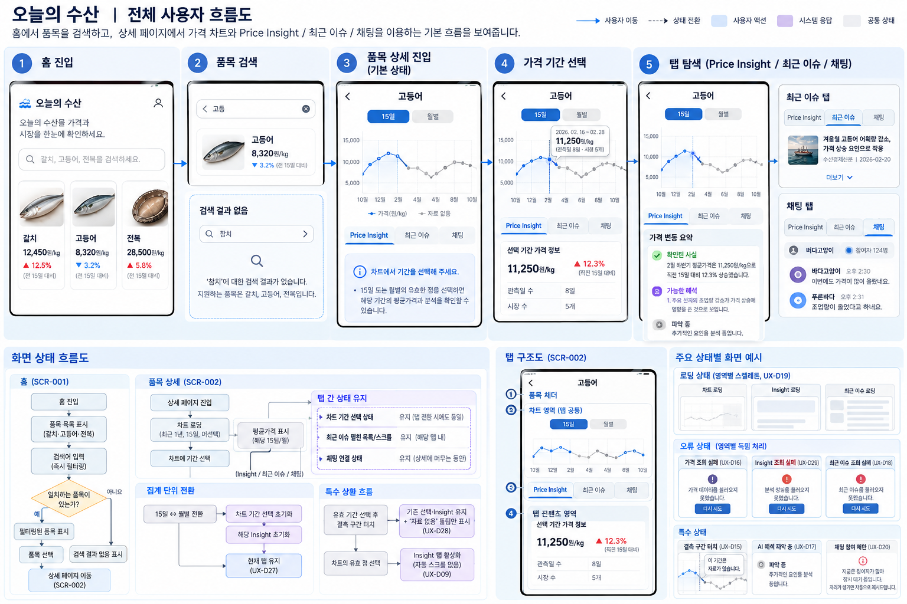
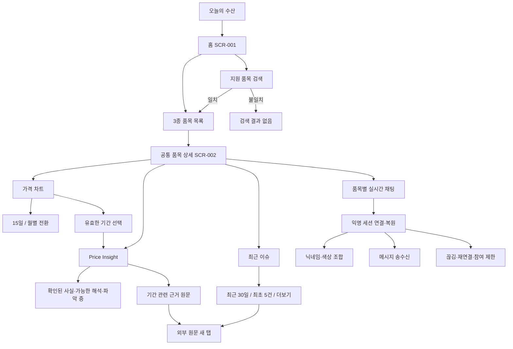
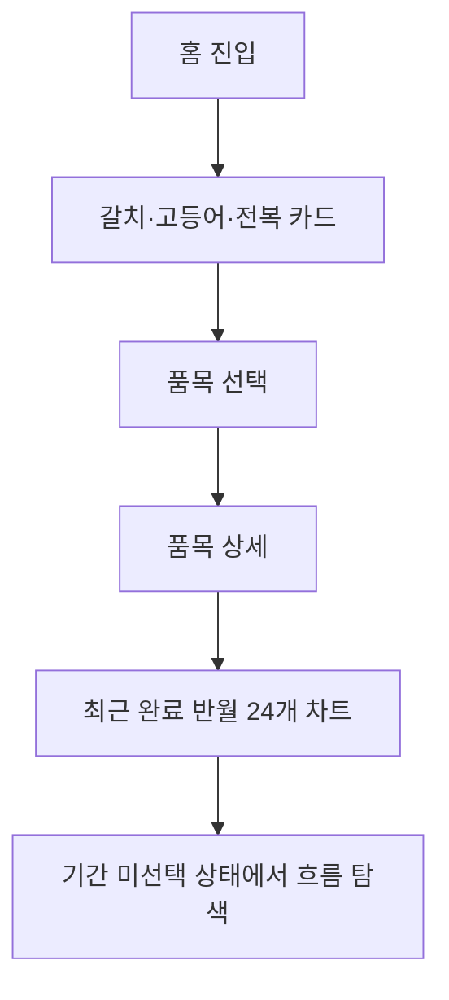
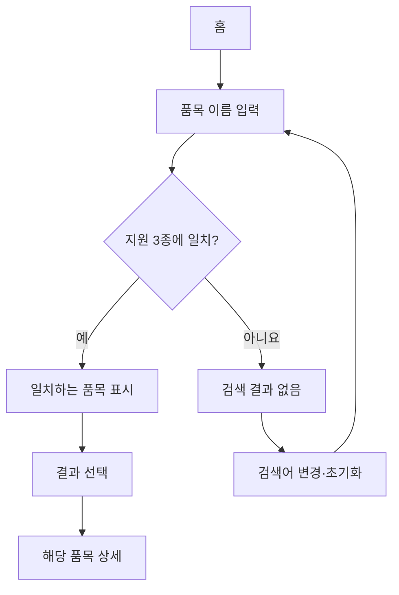
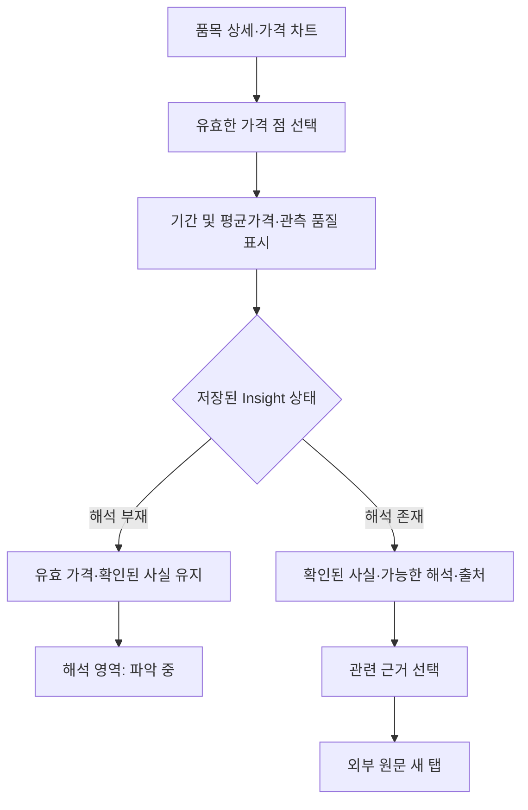
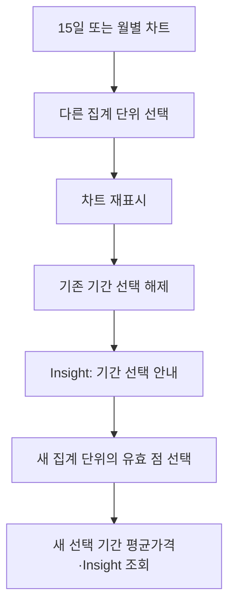
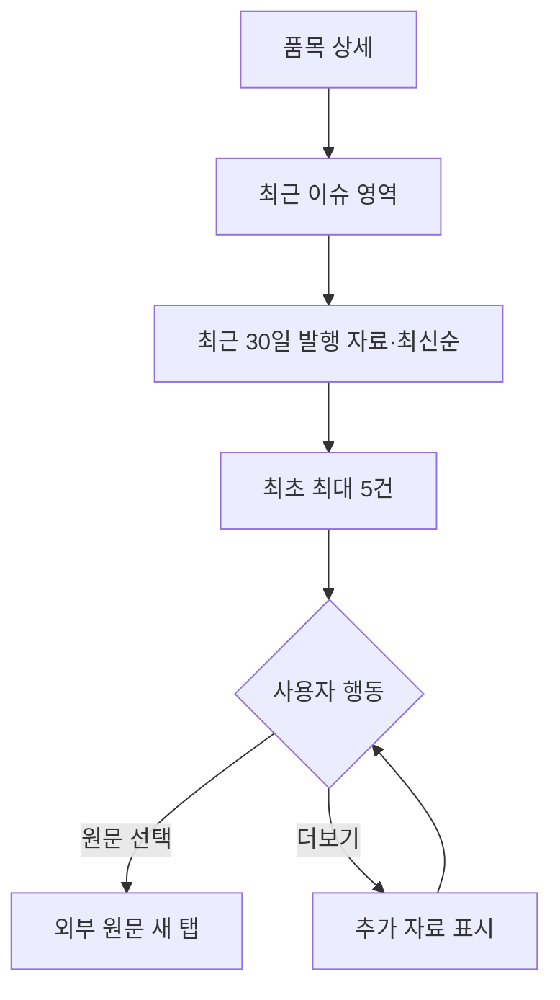
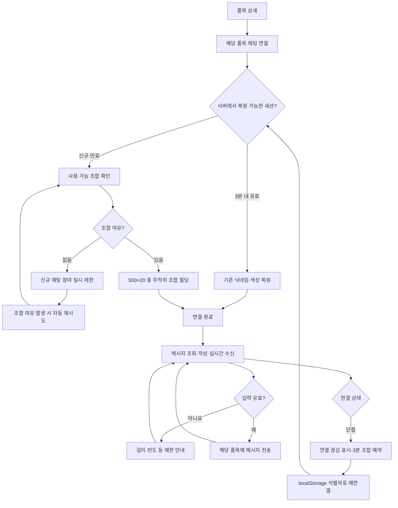

# UX-001 사용자 흐름 및 정보 구조

> **핵심 결론:** 오늘의 수산 MVP의 핵심 여정은 **홈 목록·검색 → 품목 상세 → 가격 차트·기간 선택 → Price Insight 및 근거 확인**이다. 상세 화면에서는 **최근 이슈**와 **품목별 실시간 익명 채팅**을 별도로 탐색한다. 채팅은 무작위 닉네임·색상 할당, 3분 재연결 예약, 조합 고갈 시 자동 재시도를 지원한다.

- **문서 상태:** DRAFT — PRD-001의 검색·채팅 필수 기능 및 승인된 채팅 정책 반영
- **상위 문서:** [PRD-001 MVP 제품 요구사항](../PRD-001-MVP-제품-요구사항.md)
- **관련 기능:** [PF-001 홈 화면](../features/PF-001-홈-화면.md), [PF-002 수산물 가격 차트](../features/PF-002-수산물-가격-차트.md), [PF-003 Price Insight](../features/PF-003-Price-Insight.md), [PF-004 최근 이슈](../features/PF-004-최근-이슈.md), [PF-005 실시간 채팅](../features/PF-005-실시간-채팅.md)
- **관련 정책:** [PP-002 AI 분석 운영 정책](../policies/PP-002-AI-분석-운영-정책.md), [PP-003 MVP 출시 인수 기준](../policies/PP-003-MVP-출시-인수-기준.md)
- **플랫폼:** 모바일 웹
- **작성 기준일:** 2026-10-14

---

**전체 사용자 흐름 예시**

> 화면의 가격·날짜·참여자 수·메시지는 흐름 이해를 위한 예시이며, 기능 범위와 확정 수치는 PRD·PF·PP 및 UX-002 본문을 기준으로 한다.

## 1. 설계 목적과 원칙

가격 흐름 탐색, 근거 확인, 품목별 대화를 간단한 탐색 구조로 연결한다.

1. **가격 중심:** 차트가 핵심 정보이며 임의 추정 가격을 보여주지 않는다.
2. **적은 화면 이동:** 홈·상세를 기본 화면으로 하며 상태 전환을 우선한다.
3. **점진적 제공:** 기간을 선택해야 해당 구간의 Insight를 보여준다.
4. **신뢰성:** 확인된 사실, 가능한 해석, 파악 중을 구분한다.
5. **실시간성 분리:** 가격·Insight는 저장 결과 조회, 채팅은 실시간 연결이다.
6. **독립적인 실패 처리:** 가격·AI·이슈·채팅의 실패가 다른 정상 영역을 차단하지 않는다.
7. **모바일 우선:** 터치·세로 스크롤 및 상태 표시를 기본으로 한다.

---

## 2. 사용자 목표

| ID | 목표 | 기능 |
|---|---|---|
| UG-01 | 세 품목의 최근 가격 수준 확인 | 홈 |
| UG-02 | 지원 품목 이름 검색 | 홈 검색 |
| UG-03 | 최근 완료 반월 24개·완료 월 12개 가격 흐름 확인 | 차트 |
| UG-04 | 특정 반월·월 평균가격 확인 | 기간 선택 |
| UG-05 | 가격 변화 관련 사실·가능 해석 확인 | Price Insight |
| UG-06 | 분석 근거 원문 확인 | 출처 링크 |
| UG-07 | 최근 관련 자료 탐색 | 최근 이슈 |
| UG-08 | 같은 품목의 이용자와 실시간 대화 | 품목별 채팅 |
| UG-09 | 접속 장애 뒤 기존 익명 표시 조합으로 복귀 | 채팅 재연결 |

---

## 3. 정보 구조(IA)

### 3.1 전체 구조

갈치·고등어·전복은 서로 다른 페이지 구조가 아니라 **품목 ID에 따라 콘텐츠와 채팅방이 달라지는 하나의 상세 템플릿**을 사용한다.

### 3.2 홈 IA

| 우선순위 | 정보 또는 기능 | 내용 |
|---|---|---|
| 1 | 서비스명 | 오늘의 수산 |
| 2 | 서비스 소개 | 가격 흐름과 관련 배경 탐색 안내 |
| 3 | 품목 검색 | 지원 3종 이름으로 검색, 일치 결과/결과 없음 |
| 4 | 품목 목록 | 갈치·고등어·전복 |
| 5 | 대표 가격 | 최근 확정 기간의 평균가격 |
| 6 | 변동률 | 기준 기간 대비, 계산 불가 상태 포함 |
| 7 | 가격 맥락 | 가격 단위·기준 기간 |
| 8 | 상세 진입 | 품목 카드 또는 검색 결과 선택 |

검색어 입력 즉시 지원 품목 3종을 필터링하며, 검색어를 제거하면 전체 목록을 복원한다. 세부 매칭 규칙은 PF-001과 구현 계약에서 정한다. 홈에 별도 뉴스나 채팅 목록을 신설하지 않는다.

### 3.3 품목 상세 IA

| 우선순위 | 정보 또는 기능 | 내용 |
|---|---|---|
| 1 | 품목/이동 | 품목명, 뒤로 이동 |
| 2 | 가격 차트 | 최근 완료 반월 24개·완료 월 12개, 미완료 기간 제외, 결측 구간 단절 |
| 3 | 단위 선택 | 차트 상단 `15일 \| 월별` |
| 4 | 가격 기간 선택 | 유효한 반월 또는 월 |
| 5 | 선택 기간 데이터 | 평균가격, 단위, 관측일 수·시장 수 |
| 6 | Price Insight | 확인된 사실, 가능한 해석 또는 파악 중 |
| 7 | 출처 | 출처·제목·발행일·원문 |
| 8 | 최근 이슈 | 최근 30일, 최신순, 최초 5건/더보기 |
| 9 | 실시간 채팅 | 임시 표시 이름·색상, 메시지·시각, 입력·전송, 연결 상태 |

위 순서는 **정보 우선순위**다. 상세 화면은 차트 아래 `Price Insight / 최근 이슈 / 채팅` 탭을 사용하고, 채팅은 고정 높이 패널로 제공한다. 구체적인 상태와 인터랙션은 `UX-002`를 따른다. 최근 이슈의 조회 기간은 차트 선택 기간과 독립적이다.

---

## 4. 핵심 User Flow

### UF-01. 품목 가격 탐색

- 로그인 없이 이용한다.
- 가격 또는 변동률이 없으면 결측/계산 불가를 표시한다.
- 상세 최초 진입 시 15일 기본, 기간 미선택이다.

**완료 조건:** 관심 품목의 가격 흐름을 확인한다.

### UF-02. 홈 검색

- 갈치·고등어·전복의 이름 검색만 MVP 필수 범위다.
- 미지원 품목의 결과는 생성하지 않는다.
- 검색 결과가 없어도 홈의 다른 탐색이 가능해야 한다.

**완료 조건:** 검색을 통해 지원 품목 상세에 진입하거나 결과 없음 상태를 확인한다.

### UF-03. 기간 선택 및 Price Insight

- 15일 점은 반월, 월별 점은 월 전체를 선택한다.
- Price Insight와 평균가격은 동일 품목·기간·단위에 대응한다.
- AI 해석이 없더라도 유효 가격 및 실제 확인된 사실을 유지한다.
- 결측 기간은 유효한 가격 점으로 취급하지 않는다.

**완료 조건:** 선택 기간의 가격과 근거 있는 해석 또는 파악 중 상태를 이해한다.

### UF-04. 집계 단위 전환

- 양방향 전환 모두 기간 선택을 초기화한다.
- 월별은 1일부터 말일까지의 전체 구간을 사용한다.

**완료 조건:** 다른 집계 단위로 가격을 탐색하고 다시 기간을 선택한다.

### UF-05. 최근 이슈 탐색

- 같은 URL의 중복은 제거하고 다른 URL의 동일 사건 자료는 유지한다.
- 차트 기간 선택과 최근 이슈의 최근 30일 범위는 별개다.

**완료 조건:** 최근 관련 자료를 확인하고 원문을 열 수 있다.

### UF-06. 품목별 실시간 채팅 참여·재연결

**확정 정책**

1. 로그인 없이 해당 품목 채팅에 참여한다.
2. 신규 사용자에게 닉네임 500개×색상 20개 중 무작위 조합을 자동 부여한다.
3. 닉네임만 같거나 색상만 같을 수 있으나, **같은 품목 채팅방 활성 참여자 및 3분 예약자 간 전체 조합 중복은 금지**한다.
4. 닉네임과 색상은 사용자가 변경할 수 없다.
5. 브라우저의 `localStorage` 익명 식별자를 이용해 복원을 요청하고 서버가 유효한 세션인지 검증한다.
6. 연결 단절 후 3분간 기존 조합을 예약하고 그 안에 복원하면 유지한다. 만료 후 유지 보장은 없다.
7. 10,000개가 모두 활성·예약으로 점유되면 **신규 참여만** 제한한다. 여유 발생 시 자동 재시도한다.
8. 메시지는 같은 품목 채팅방에서만 전달된다. 작성자 닉네임·색상·작성 시각을 표시한다.
9. 유효하지 않거나 길이·빈도 제한을 위반하는 메시지는 거부한다.
10. 채팅 장애·참여 제한 중에도 가격·Insight·이슈 조회는 정상 제공한다.

**완료 조건:** 익명 참여자가 자신의 조합으로 메시지를 교환하며, 단절 시 예약 기간 안에 복구하거나 불가 상태를 명확히 확인한다.

---

## 5. 화면 및 상태 목록

### 5.1 화면 ID

| ID | 화면 | 설명 |
|---|---|---|
| SCR-001 | 홈 | 3종 목록·검색·대표 가격 |
| SCR-002 | 품목 상세 | 공통 상세 템플릿, 가격·Insight·이슈·채팅 |

### 5.2 상태 ID

| ID | 상태 | UI 처리 방향 |
|---|---|---|
| ST-001 | 차트 기간 미선택 | Insight 선택 안내 |
| ST-002 | 반월 선택 | 선택 반월의 가격·Insight |
| ST-003 | 월별 선택 | 선택 월 전체의 가격·Insight |
| ST-004 | 가격 결측 | 0원 금지, 선 끊김 |
| ST-005 | AI 해석 파악 중 | 유효 가격·검증 사실 유지 |
| ST-006 | 가격 데이터 조회·수집 실패 | 관측 없음과 별도 안내 |
| ST-007 | 최근 이슈 자료 없음 | 자료 없음 안내 |
| ST-008 | 홈 검색 결과 없음 | 검색어 변경·초기화 가능 |
| ST-009 | 채팅 연결 중 | 접속 중 표시, 전송 비활성 |
| ST-010 | 채팅 연결됨 | 메시지 송수신 가능 |
| ST-011 | 채팅 연결 끊김·복구 중 | 연결 상태 및 재연결 안내 |
| ST-012 | 채팅 참여 제한 | 조합 고갈 안내, 자동 재시도 |
| ST-013 | 메시지 입력·전송 제한 | 유효성·빈도 등 오류 안내 |
| ST-014 | 메시지 없음 | 빈 메시지 영역 표시; 정확한 문구는 후속 카피 검토 |
| ST-015 | 채팅 메시지 전송 실패 | 입력 유지, 실패 안내, 다시 보내기 제공 |

`ST-014`의 정확한 안내 문구와 `ST-015`의 구체적인 배치는 후속 카피·와이어프레임 검토 대상이다. 서버의 3분 **조합 예약**은 내부 상태이며 사용자에게는 주로 재연결 상태로 표현한다.

### 5.3 상태 간 독립성

- **결측 가격**과 **수집 장애**를 하나로 합치지 않는다.
- **Insight 해석 없음**이 **가격 없음**을 뜻하지 않는다.
- **최근 이슈**는 차트 기간 선택과 무관하게 최근 30일을 조회한다.
- **채팅 연결 실패**가 가격·분석·이슈 탐색을 막지 않는다.
- **조합 고갈**은 신규 채팅 참여 제한이지 상세 화면 전체 접근 제한이 아니다.

---

## 6. 화면 간 데이터 흐름(논리 모델)

### 6.1 홈에서 상세로

- `species_id`: 갈치·고등어·전복 중 선택한 품목 식별자.
- 상세에서 해당 품목 가격·Insight·이슈 및 채팅방을 구분한다.

### 6.2 차트 선택에서 Insight로

| 필드 | 용도 |
|---|---|
| `species_id` | 선택 품목 |
| `granularity` | `HALF_MONTH` / `MONTH` |
| `period_start` | 기간 시작일 |
| `period_end` | 기간 종료일 |

- 차트 가격과 저장된 Insight의 조회 구간은 일치해야 한다.
- 결측 관측값은 0·보간·직전값으로 대체하지 않는다.

### 6.3 최근 이슈

- `species_id`를 기준으로 최근 30일 관련 자료를 조회한다.
- 차트의 `period_start`·`period_end`를 이슈 조회에 적용하지 않는다.

### 6.4 채팅

| 논리 필드 | 용도 및 유의점 |
|---|---|
| `species_id` | 품목 채팅방 분리 |
| `anonymous_session_id` | `localStorage`의 재연결 요청용 익명 식별자; 서버 검증 필수 |
| `nickname` | 서버가 선택한 500개 풀의 임시 이름 |
| `color_id` | 서버가 선택한 20개 풀의 색상 |
| `connection_status` | 연결 중·연결됨·끊김·제한 |
| `reservation_expires_at` | 서버 측 3분 조합 예약 만료 시각 |

이 표는 **논리적 데이터 전달 요구사항**이다. 실제 API 응답·토큰·비공개 필드 노출 정책은 기술 설계에서 정하며 보안상 세션 권한을 식별자만으로 신뢰하지 않는다.

---

## 7. 내비게이션과 상호작용 정책

- 홈 → 품목 선택/검색 결과 → 상세로 이동한다.
- 상세는 기본적으로 15일 차트·기간 미선택 상태로 진입한다.
- 기간 점 선택 시 평균가격과 해당 기간 Insight가 갱신된다.
- 유효 가격 점 선택 시 Insight 탭을 활성화하되 자동 스크롤하지 않는다.
- 단위 전환 시 현재 탭은 유지하고 선택 기간과 해당 Insight를 초기화한다.
- 근거·이슈 원문은 외부 새 탭에서 연다.
- 상세 화면은 차트 아래 `Price Insight / 최근 이슈 / 채팅` 탭으로 구성한다.
- 채팅은 고정 높이 패널로 제공하고 메시지 목록만 내부 스크롤한다.
- 상세 재진입 시 15일·기간 미선택·Insight 활성 상태로 초기화한다. 브라우저 히스토리 복귀의 구현상 구분은 기술 검증 대상으로 남긴다.
- 최근 완료 반월 24개 또는 완료 월 12개의 전체 시계열은 차트 너비 안에 표시하며 미완료 기간은 제외한다.
- 채팅의 메시지 입력과 연결 상태는 세로 모바일 환경에서도 확인 가능해야 한다.

---

## 8. Figma 와이어프레임 제작 범위

| 순서 | 프레임 | 검토 대상 |
|---|---|---|
| 1 | 홈 기본 | 3종 카드·가격·변동률·검색 |
| 2 | 홈 검색 결과·결과 없음 | 검색 상태·복귀 |
| 3 | 상세 기본 | 기본 15일 차트·기간 미선택·채팅 접근 |
| 4 | 상세 반월 선택 | 평균가격·Insight |
| 5 | 상세 월별 선택 | 월 전체 분석·선택 초기화 |
| 6 | 가격 결측/수집 실패 | 상태 구분 |
| 7 | AI 해석 파악 중 | 가격·확인 사실 유지 |
| 8 | 최근 이슈 더보기·자료 없음 | 목록 변화·오류 |
| 9 | 채팅 정상 연결 | 닉네임·색상·시각·메시지 입력 |
| 10 | 채팅 연결 중/단절·복원 | 연결 피드백·전송 제어 |
| 11 | 채팅 조합 고갈·자동 재시도 | 참여 제한 상태 |
| 12 | 채팅 메시지 입력 제한 | 오류 메시지·전송 불가 |

이는 **필요한 디자인 상태**이며 모든 항목을 별도 서비스 페이지로 구현한다는 뜻은 아니다.

---

## 9. UX 검증 기준

- [ ] 홈에서 갈치·고등어·전복 목록과 최근 확정 가격 상태를 확인한다.
- [ ] 지원 품목 검색과 미지원 검색 결과 없음 상태를 확인한다.
- [ ] 최초 상세는 15일 차트이고 기간이 미선택이다.
- [ ] 유효한 반월·월 가격 점 선택 시 같은 기간의 가격과 Insight가 나타난다.
- [ ] 집계 단위 전환 시 이전 선택이 해제된다.
- [ ] 결측 기간에는 0원·보간·연속선이 나타나지 않는다.
- [ ] AI 해석이 없더라도 유효 가격과 확인된 사실을 유지한다.
- [ ] 선택 기간의 역사적 근거와 최근 30일 이슈를 구분한다.
- [ ] 최근 이슈 최초 5건·더보기·원문 새 탭 동작이 확인된다.
- [ ] 품목별 채팅을 로그인 없이 이용한다.
- [ ] 신규 채팅 참여자에게 닉네임·색상이 자동 할당되고 변경 UI가 없다.
- [ ] 같은 품목의 활성·예약 세션 간 조합 중복이 없다.
- [ ] 메시지에 작성자 닉네임·색상·작성 시각이 보인다.
- [ ] 연결이 단절되면 복구 상태를 확인하고 3분 내 정상 복원 시 기존 조합을 유지한다.
- [ ] 10,000개 조합 점유 시 신규 참여를 제한하고 여유가 생기면 자동 재시도한다.
- [ ] 길이·빈도 제한을 초과한 메시지 전송은 거부된다.
- [ ] 채팅 장애가 가격·Insight·이슈 조회를 막지 않는다.

---

## 10. 후속 UX 확인 사항

기존 미정 UX 결정은 `UX-002`의 `UX-D01~D29`로 구체화했다. 남은 UX 세부 표현은 `UX-002`의 `UX2-OPEN-*`, 운영·기술 항목은 해당 문서의 `PF-OPEN-*`, `TECH-OPEN-*`, `PRD-OPEN`에서 관리한다.

닉네임 500개×색상 20개, 중복 기준, 변경 불가, 3분 예약, `localStorage` 복원 요청, 고갈 시 자동 재시도는 **미정 항목이 아니다.**

---

## 11. 관련 문서 및 관리 원칙

- [PRD-001 MVP 제품 요구사항](../PRD-001-MVP-제품-요구사항.md)
- [PF-001 홈 화면](../features/PF-001-홈-화면.md)
- [PF-002 수산물 가격 차트](../features/PF-002-수산물-가격-차트.md)
- [PF-003 Price Insight](../features/PF-003-Price-Insight.md)
- [PF-004 최근 이슈](../features/PF-004-최근-이슈.md)
- [PF-005 실시간 채팅](../features/PF-005-실시간-채팅.md)
- [PP-002 AI 분석 운영 정책](../policies/PP-002-AI-분석-운영-정책.md)
- [PP-003 MVP 출시 인수 기준](../policies/PP-003-MVP-출시-인수-기준.md)
- [UX-002 화면 상태 및 인터랙션 설계](./UX-002-화면-상태-및-인터랙션-설계.md)

이 문서는 PRD 상위 요구사항을 UX 흐름 및 IA로 구체화한 **설계 초안**이다. 구체적인 화면 상태·터치·오류·복귀 인터랙션은 `UX-002`를 기준으로 한다. 제품 결정과 상충하는 경우 사용자 확인 없이 의미를 변경하지 않는다.
