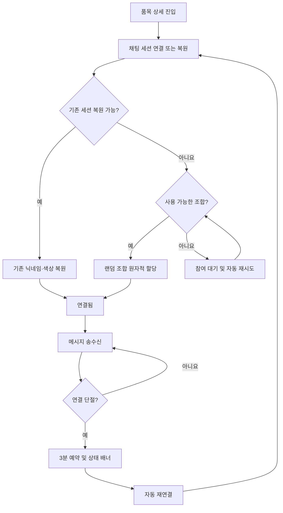

# UX-002 화면 상태 및 인터랙션 설계

> **핵심 결론:** 오늘의 수산 MVP는 **홈 실시간 검색 → 별도 품목 상세 페이지 → 최근 완료 반월 24개·완료 월 12개 가격 차트 → 선택 기간의 Price Insight**를 기본 흐름으로 사용한다. 상세 화면의 차트 아래는 **Price Insight / 최근 이슈 / 채팅** 탭으로 구성한다. 가격 결측·조회 오류·AI 해석 부재·채팅 연결 문제는 서로 구분하고, 정상 작동하는 다른 영역을 차단하지 않는다.

- **문서 상태:** DRAFT — UX 의사결정 UX-D01~D29 반영 완료, 미정 운영·기술 항목은 별도 문서에서 확정
- **작성 기준일:** 2026-10-14
- **적용 플랫폼:** 모바일 웹
- **상위 문서:** [PRD-001 MVP 제품 요구사항](../PRD-001-MVP-제품-요구사항.md)
- **선행 UX 문서:** [UX-001 사용자 흐름 및 정보 구조](./UX-001-사용자-흐름-및-정보-구조.md)
- **상세 요구사항:** [PF-001 홈](../features/PF-001-홈-화면.md), [PF-002 가격 차트](../features/PF-002-수산물-가격-차트.md), [PF-003 Price Insight](../features/PF-003-Price-Insight.md), [PF-004 최근 이슈](../features/PF-004-최근-이슈.md), [PF-005 실시간 채팅](../features/PF-005-실시간-채팅.md)

---

## 1. 범위와 설계 원칙

본 문서는 UX-001의 화면과 상태를 **화면 노출, 터치·입력, 상태 전환, 오류·복구 동작**으로 구체화한다. 제품 정책과 데이터 산식을 재정의하지 않는다.

1. **공통 상세 차트:** 품목별 상세에서 차트는 탭에 관계없이 위쪽에 표시한다.
2. **탭 콘텐츠 분리:** Insight·최근 이슈·채팅의 화면 상태는 서로 독립적이다.
3. **선택 기간 일치:** 평균가격과 Price Insight의 기간은 일치해야 한다.
4. **결측 보존:** 관측값이 없는 구간에 0·보간·직전값을 보여주지 않는다.
5. **독립 장애 처리:** 한 영역의 오류 때문에 다른 정상 영역을 전체 오류로 바꾸지 않는다.
6. **익명 채팅:** 닉네임·색상은 서버에서 부여하며 사용자가 수정하지 않는다.
7. **확정과 미정 구분:** 아래 결정표의 확정 사항 이외의 수치·기술 구현은 별도 설계에서 결정한다.

## 2. 확정 UX 결정 목록

| ID | 확정 내용 | 출처 |
|---|---|---|
| UX-D01 | 홈 검색어 입력 즉시 갈치·고등어·전복 목록 필터링 | 1차 Q1 |
| UX-D02 | 품목 선택 시 별도 상세 페이지로 이동 | 1차 Q2 |
| UX-D03 | 상세 페이지를 다시 진입하면 `15일` 및 기간 미선택으로 초기화 | 1차 Q3 |
| UX-D04 | 차트 아래 `Price Insight / 최근 이슈 / 채팅` 탭 | 1차 Q4 |
| UX-D05 | 최근 완료 반월 24개·완료 월 12개 시계열을 차트 너비에 모두 표시 | 2차 Q5 및 정합성 검토 6 |
| UX-D06 | 유효 가격 점 선택 시 강조 표시와 차트 내부 툴팁 | 2차 Q6 |
| UX-D07 | 상세 최초 진입의 활성 탭은 Price Insight | 2차 Q7 |
| UX-D08 | 탭 변경 시 차트 기간 선택 유지 | 2차 Q8 |
| UX-D09 | 유효 가격 점 선택 시 Insight 탭 활성화, 자동 스크롤은 하지 않음 | 2차 Q9 |
| UX-D10 | 최근 이슈 `더보기`는 동일 탭에서 하단 목록 확장 | 3차 Q10 |
| UX-D11 | 채팅은 고정 높이 패널이며 메시지 목록만 내부 스크롤 | 3차 Q11 |
| UX-D12 | 채팅 헤더에 본인 닉네임·색상을 항상 표시 | 3차 Q12 |
| UX-D13 | 연결 끊김 시 채팅 상단 상태 배너와 자동 재연결 | 3차 Q13 |
| UX-D14 | 하단 입력창 + 전송 버튼 + Enter 전송 | 3차 Q14 |
| UX-D15 | 결측 기간 터치 시 `자료 없음` 툴팁, 유효 기간으로 선택하지 않음 | 4차 Q15 |
| UX-D16 | 가격 조회 실패 시 차트 영역에 오류 안내 + `다시 시도` | 4차 Q16 |
| UX-D17 | AI 미생성·실패 시 확인된 사실은 유지하고 AI 해석만 `파악 중` | 기존 PRD |
| UX-D18 | 최근 이슈 자료 없음과 조회 실패 구분, 실패 시 `다시 시도` | 4차 Q18 |
| UX-D19 | 가격·Insight·최근 이슈는 영역별 스켈레톤 표시 | 4차 Q19 |
| UX-D20 | 채팅 조합 고갈 시 패널 내 참여 대기 안내 + 자동 재시도 | 4차 Q20 |
| UX-D21 | 상세에 머무는 동안 탭 전환과 관계없이 채팅 연결 유지 | 5차 Q21 |
| UX-D22 | 채팅 맨 아래에서는 새 메시지로 자동 스크롤, 과거 내역 열람 중에는 새 메시지 알림 | 5차 Q22 |
| UX-D23 | 모바일 키보드 표시 시 채팅 입력창을 키보드 위에 유지하고 메시지 영역 높이 조절 | 5차 Q23 |
| UX-D24 | 메시지 전송 실패 시 입력 내용 유지 + 실패 안내 + 다시 보내기 | 5차 Q24 |
| UX-D25 | 최근 이슈 탭 재방문 시 펼친 목록과 스크롤 위치 유지 | 5차 Q25 |
| UX-D26 | 메시지 길이·빈도 제한은 입력창 주변 인라인 오류로 안내 | 5차 Q26 |
| UX-D27 | 집계 단위 전환 시 활성 탭을 유지하고 차트의 기간 선택 및 해당 Insight만 초기화 | 6차 Q27 |
| UX-D28 | 유효 가격 기간 선택 후 결측 구간 터치 시 기존 선택·Insight 유지, 결측 툴팁만 표시 | 6차 Q28 |
| UX-D29 | Insight 조회 API 실패 시 Insight 영역에 조회 오류와 `다시 시도` 버튼 표시 | 6차 Q29 |

> **상위 정책:** 채팅의 랜덤 닉네임 500개 × 색상 20개, 동일 품목 활성·예약 세션 간 조합 중복 금지, 3분 재연결 예약, `localStorage` 익명 식별자, 풀 고갈 시 자동 재시도는 이미 확정된 제품 정책이다. UX-002는 사용자에게 보이는 동작을 정의하고 상세 서버 구현은 PF-005 및 기술 설계에 위임한다.

---

## 3. 화면 구조 및 상태 모델

### 3.1 화면과 탭

| 식별자 | 화면 | 핵심 영역 |
|---|---|---|
| SCR-001 | 홈 | 서비스 안내, 실시간 검색, 품목 카드 3종 및 가격 상태 |
| SCR-002 | 품목 상세 | 품목 헤더, 1년 가격 차트, 15일/월별, 탭 메뉴 |
| TAB-INSIGHT | 상세 하위 탭 | 선택 기간 Price Insight, 검증 사실·해석·근거 |
| TAB-ISSUES | 상세 하위 탭 | 최근 30일 목록, 더보기, 출처 링크 |
| TAB-CHAT | 상세 하위 탭 | 품목별 메시지, 연결 배너, 내 닉네임·색상, 입력창 |

탭은 독립적인 상세 페이지가 아니다. **차트와 선택 기간은 탭 공통 상태**이고 최근 이슈의 펼침 및 스크롤 위치는 해당 상세 페이지 내에서 유지한다.

### 3.2 기존 UX-001 상태 ID 대응

| UX-001 상태 | UX-002 구체화 |
|---|---|
| ST-001 기간 미선택 | Insight 탭에 기간 선택 안내 |
| ST-002 반월 선택 | 반월의 유효 가격, 툴팁, 해당 반월 Insight |
| ST-003 월별 선택 | 월 전체의 유효 가격, 툴팁, 해당 월 Insight |
| ST-004 가격 결측 | 차트 선 분리, 터치 시 `자료 없음` 툴팁 |
| ST-005 AI 해석 파악 중 | 가격·확인된 사실 유지, 해석만 `파악 중` |
| Insight API 조회 오류(확장 상태) | `파악 중`과 구분하여 Insight 영역 오류 + 재시도 |
| ST-006 가격 조회·수집 실패 | 조회 실패 시 차트 내 오류와 재시도, 관측 없음과 구분 |
| ST-007 최근 이슈 자료 없음 | 빈 상태 안내; 조회 실패라면 별도 오류·재시도 |
| ST-008 검색 결과 없음 | 검색 결과 없음 안내와 검색어 변경 가능 |
| ST-009 채팅 연결 중 | 상태 표시, 메시지 전송 불가 |
| ST-010 채팅 연결됨 | 닉네임·색상 및 메시지 송수신 표시 |
| ST-011 채팅 연결 끊김·복구 중 | 상단 상태 배너, 자동 재연결 |
| ST-012 채팅 참여 제한 | 조합 고갈 대기 안내, 자동 재시도 |
| ST-013 메시지 입력·전송 제한 | 입력창 인근 인라인 오류 |
| ST-014 메시지 없음 | 빈 메시지 영역; 정확한 안내 문구는 카피 작성 시 확정 |
| ST-015 메시지 전송 실패 | 입력 유지, 실패 안내, 다시 보내기 |

`ST-*`는 UX-001에서 사용한 상태 ID를 재사용한다. **서버 내부의 조합 예약은 별도 화면 ID로 분리하지 않는다.**

---

## 4. SCR-001 — 홈 및 검색

### 4.1 기본 상태

- 갈치·고등어·전복 3종을 표시한다.
- 카드에는 마지막으로 확정된 기준 가격, 변동률 및 단위를 제공한다. 실제 비교 기간·수치 표시는 PF-001의 확정 정책을 따른다.
- 유효 가격이 없으면 `자료 없음`을 표시하고 직전 가격으로 임의 대체하지 않는다.
- 품목 카드 선택 시 해당 품목의 **별도 상세 URL/페이지**로 이동한다.

### 4.2 검색 인터랙션 (UX-D01)

| 이벤트 | 처리 |
|---|---|
| 검색어 입력 | 키 입력에 맞춰 초기 지원 품목 3종 목록을 즉시 필터링 |
| 일치 항목 존재 | 해당 품목 카드 노출, 탭 시 상세 이동 |
| 일치 항목 없음 | 검색 결과 없음 상태 표시, 검색어 재입력 가능 |
| 검색어 제거 | 전체 3종 목록 복원 |

검색은 **지원 품목명 탐색**이며 외부 품목 확대 검색이 아니다. 부분 일치·띄어쓰기 처리 등의 세부 매칭 규칙은 PF-001/구현 계약에서 정한다.

---

## 5. SCR-002 — 상세 진입, 차트와 공통 상태

### 5.1 초기화·내비게이션 (UX-D02~04, UX-D07)

- 신규 상세 진입 및 홈에서 다시 진입: **15일 차트 + 선택 기간 없음 + Insight 탭 활성화**.
- 최초 상세 진입 시 차트에는 최근 완료 반월 24개가 표시된다.
- Insight 영역에는 `차트에서 기간을 선택해 주세요` 취지의 안내를 표시한다.
- 탭 목록은 `Price Insight / 최근 이슈 / 채팅`이다.
- 탭 전환 시 **차트의 기간 선택은 유지**한다.
- 상세를 떠난 후 다시 진입하면 이전 집계 단위·선택 기간을 복원하지 않는다.
- 브라우저 히스토리의 동일 페이지 복귀 처리와 상세 재진입의 구현상 구분은 기술 검증 과제로 남긴다. UX 기대값은 **상세 재진입 초기화**다.

### 5.2 차트 표시 및 기간 선택 (UX-D05~06)

- 기본 `15일` 시계열은 최근 완료 반월 24개, 전환한 `월별` 시계열은 최근 완료 월 12개를 **차트 너비 안에 표시**한다.
- 15일은 매월 1~15일 및 16일~말일, 월별은 해당 월 전체다.
- 유효 데이터 점 터치 시 해당 점을 강조하고 **차트 내부 툴팁**을 표시한다.
- 툴팁에는 선택 기간 및 평균가격을 제공한다. 실제 단위·가격 반올림 정책은 PF-002에 따른다.
- 선택 기간의 관측일 수·시장 수 및 가격 정의를 확인할 수 있게 한다. 노출 밀도·상세 위치는 와이어프레임 검증 시 최종 결정한다.
- 유효 점 선택 시 활성 탭을 **Price Insight로 변경**하고 페이지 자동 스크롤은 하지 않는다.
- 다른 유효 점을 선택하면 이전 선택과 Insight를 새 기간 데이터로 교체한다.

### 5.3 집계 단위 전환

| 기존 상태 | 이벤트 | 결과 |
|---|---|---|
| 15일 + 미선택 | 월별 전환 | 월별 전체 차트, 기간 미선택, Insight 선택 안내 |
| 15일 + 선택 | 월별 전환 | 선택 해제, 월별 전체 차트, Insight 선택 안내 |
| 월별 + 선택 | 15일 전환 | 선택 해제, 반월 전체 차트, Insight 선택 안내 |

집계 단위 변경 시 **현재 활성 탭은 유지**한다(UX-D27). 차트의 기존 선택 기간과 이에 종속된 Insight는 초기화한다. 사용자가 Insight 탭에 있을 때는 기간 선택 안내를 표시하며, 다른 탭이 활성화되어 있어도 Insight 내부 상태는 미선택으로 초기화한다.

### 5.4 결측 구간 터치 (UX-D15)

- 가격이 없는 기간은 차트에서 **선이 끊긴 상태**로 나타낸다.
- 해당 결측 구간을 터치하면 `자료 없음` 툴팁을 표시한다.
- 결측 구간은 **유효 가격 기간 선택으로 취급하지 않는다**.
- 결측 구간 터치만으로 Price Insight를 조회하거나 새 평균가격을 표시하지 않는다.
- **기존 유효 선택 기간이 있는 상태에서 결측을 터치하면 기존 선택과 Insight를 유지**하고 `자료 없음` 툴팁만 표시한다(UX-D28). 결측 터치로 활성 탭을 강제 전환하지 않는다.

### 5.5 가격 조회 실패·로딩 (UX-D16, UX-D19)

| 상태 | UI |
|---|---|
| 최초 가격 조회 중 | 차트 영역 스켈레톤 |
| 관측 없음 | 결측 구간과 `자료 없음`, 0원/보간 금지 |
| 요청/네트워크 실패 | 차트 영역 내 오류 안내 및 `다시 시도` 버튼 |
| 다시 시도 선택 | 차트 영역 재조회, 재시도 중 스켈레톤 |

가격 오류를 전체 상세 페이지 오류로 확장하지 않는다. 단, 차트 데이터가 없어 기간 선택이 불가능할 때는 Insight의 기간 선택 안내 또는 사용 불가 상태를 일관되게 표시한다.

---

## 6. TAB-INSIGHT — 기간 분석

### 6.1 기본과 정상 상태

1. **기간 미선택:** 기간 선택 안내. 임의의 과거 Insight 노출 금지.
2. **유효 기간 선택:** 해당 `species_id`, `granularity`, `period_start`, `period_end`로 저장된 결과 조회.
3. **정상 분석:** `확인된 사실`, `가능한 해석`, 근거 출처를 구분 표시.
4. **AI 해석 미생성·실패:** 유효 가격과 검증된 사실은 유지, **AI 해석만 `파악 중`**.
5. **근거 선택:** 출처명·제목·발행일이 확인되는 원문을 **새 탭**에서 연다.

가능 요인은 최대 3개이며, 확인되지 않은 인과관계를 확정적으로 단정하지 않는다. 과거 선택 기간의 근거는 최근 이슈 30일 필터와 독립적으로 조회한다.

### 6.2 로딩·탭 전환

- 분석 결과 조회 중 해당 Insight 영역에 스켈레톤을 표시한다.
- 가격 점 선택 시 **Insight 탭 활성화**, 자동 스크롤 없음.
- 사용자가 다른 탭을 열었다가 Insight로 돌아오면 기존 차트 기간 선택을 유지한다.
- 집계 단위 변경 시 이전 선택과 연동된 Insight 콘텐츠를 해제하고 기간 선택 안내로 돌아간다.
- AI 해석 부재(`파악 중`)와 **조회 API 실패**를 구분한다. API 조회 실패 시 **Insight 영역에 오류 안내와 `다시 시도` 버튼**을 표시한다(UX-D29). 재시도는 현재 선택된 품목·집계 단위·기간의 Insight만 다시 조회하며, 가격 차트·최근 이슈·채팅 상태는 유지한다.

---

## 7. TAB-ISSUES — 최근 이슈

### 7.1 정상 표시 (UX-D10)

- 현재 품목의 최근 30일 내 발행 뉴스·공공기관 자료를 최신순으로 표시한다.
- 최초 최대 5개를 노출한다.
- `더보기`를 누르면 **같은 탭 아래쪽에 목록을 추가 표시**한다.
- 서로 다른 URL은 같은 사건에 관한 자료라도 남기며 동일 URL의 중복만 제거한다.
- 제목·출처·발행일을 제공하고 원문 선택 시 새 탭을 연다.
- 가격 차트에서 선택한 기간은 최근 이슈 필터에 영향을 주지 않는다.

### 7.2 탭 재방문 (UX-D25)

- `더보기`로 확장한 목록은 동일 상세 페이지의 탭 이동 후에도 유지한다.
- 이슈 목록 내부의 스크롤 위치도 유지한다.
- 상세 페이지를 떠난 후 다시 진입하는 경우에는 신규 진입 상태로 초기화한다.

### 7.3 결측·오류·로딩 (UX-D18~19)

| 상태 | UI |
|---|---|
| 조회 중 | 최근 이슈 영역 스켈레톤 |
| 실제 게시 자료 없음 | 빈 목록 안내 |
| 조회 실패 | 오류 안내와 `다시 시도` |
| 재시도 | 해당 목록만 재조회; 차트·다른 탭 영향 없음 |

---

## 8. TAB-CHAT — 품목별 실시간 채팅

### 8.1 레이아웃 및 연결 유지 (UX-D11~14, UX-D21)

- 상세의 채팅 탭에는 **고정 높이 패널**을 배치한다.
- 메시지 목록만 패널 내부에서 스크롤하며, 패널 하단에 입력창과 전송 버튼을 둔다.
- **내 닉네임과 색상은 채팅 헤더에 항상 표시**한다.
- 입력창의 전송 버튼 클릭과 Enter 입력으로 메시지를 전송한다.
- 상세 페이지에 머무는 동안 사용자가 다른 탭을 선택해도 해당 품목의 **채팅 연결을 유지**한다.
- 채팅 연결은 가격·Insight 배치 조회와 독립적으로 관리한다.
- 채팅 상태가 연결 중·단절·대기일 때 메시지 전송 가능 여부를 구분한다.
- 모바일 소프트키보드의 Enter/전송 동작은 실제 기기 검증에서 조정하되, **전송 버튼은 항상 제공**한다.

### 8.2 익명 표시 조합 및 재연결

- 신규 참여자에게 서버가 **닉네임 500개 × 색상 20개**의 풀에서 무작위 조합을 부여한다.
- 이름만 같거나 색상만 같은 경우는 허용하지만, **동일 품목의 활성·3분 예약 세션 간 동일 조합은 허용하지 않는다**.
- 닉네임·색상 변경 UI는 제공하지 않는다.
- 서버 발급 복원 자격정보로 기존 세션 복원을 요청하고 서버가 소유권·품목별 권한을 검증한다. `localStorage` 식별자만으로 권한을 신뢰하지 않는다.
- 같은 브라우저의 같은 품목 다중 탭은 하나의 익명 참여자 세션을 공유하되 탭별 연결은 별도로 관리할 수 있다.
- 연결이 끊기면 3분간 기존 조합을 예약하고, 기한 내 정상 복구 시 기존 조합을 유지한다.
- 상단 **상태 배너**로 연결 끊김과 재연결 중임을 안내하고 **자동 재연결**한다.
- 재연결은 1·2·4·8·16·30초 등 최대 30초 지수 백오프를 적용한다.
- 3분이 지나면 기존 조합 복원을 보장하지 않으며, 이후 재참여 동작은 PF-005의 세션 정책을 따른다.

### 8.3 메시지 목록 스크롤 (UX-D22)

최초 진입 시 최근 메시지 50개만 표시하고 이전 메시지 추가 조회는 제공하지 않는다. 7일을 초과한 메시지는 사용자에게 노출하지 않는다.

| 사용자 위치 | 새 메시지 수신 시 |
|---|---|
| 메시지 목록 맨 아래 | 새 메시지로 자동 스크롤 |
| 과거 메시지 열람 중 | 현재 위치 유지, 새 메시지 알림 제공 |

새 메시지 알림을 탭하면 하단으로 이동시키는 등 세부 인터랙션은 와이어프레임에서 검증한다. 자동으로 과거 열람 위치를 빼앗지 않는다.

### 8.4 모바일 키보드 (UX-D23)

- 메시지 입력창에 포커스하여 모바일 키보드가 열리면 **입력창을 키보드 위에 유지**한다.
- 메시지 목록이 사용할 수 있는 높이를 조절한다.
- 키보드 표시로 차트·탭 콘텐츠가 의도치 않게 가려지거나 전송 버튼이 접근 불가능해지지 않도록 기기 테스트를 수행한다.

### 8.5 전송 및 실패 처리 (UX-D14, UX-D24, UX-D26)

| 조건 | UI 동작 |
|---|---|
| 연결 정상, 입력 유효 | 전송 버튼 또는 Enter로 메시지 전송 |
| 메시지 전송 성공 | 메시지 목록에서 확인 가능 |
| 전송 실패 | **입력 내용 유지**, 실패 안내, `다시 보내기` 제공 |
| 메시지 길이 초과 | 입력창 근처 인라인 오류 |
| 전송 빈도 초과 | 입력창 근처 인라인 오류 |
| 금칙어 포함 | 서버 전송 거부 사유를 입력창 근처에 안내 |
| 연결 끊김/참여 대기 | 상태 안내, 메시지 전송 비활성 |

유효성 검사는 클라이언트 UX뿐 아니라 서버에서도 수행해야 한다. 메시지는 최대 300 Unicode 문자이며 서버가 검증한 익명 참여자 세션당 3초 1회 이하·1분 최대 20회다. 여러 탭·연결로 제한을 우회할 수 없다. 서버는 정규화된 금칙어 목록을 검사하고 포함 메시지를 거부해 이유를 안내한다. 중복 전송 방지·전송 성공 확인 이벤트의 구체적 계약은 기술 설계로 위임한다.

### 8.6 조합 고갈 (UX-D20)

- 동일 품목에서 10,000개 조합이 모두 활성·예약 상태이면 신규 참여를 **일시 제한**한다.
- 채팅 패널 안에 참여 대기 상태와 자동 재시도 안내를 표시한다.
- 조합 여유가 생기면 **자동 재시도**로 참여를 시도한다.
- 이 상태에서 전송은 불가하지만 **가격·Insight·최근 이슈는 계속 이용**할 수 있다.
- 재시도는 최대 30초 지수 백오프를 적용한다. 대기 순서·서버 재시작 후 복원·서버 부하 제어·알림 문구는 기술 설계에서 결정한다.

### 8.7 채팅 상태 전이

---

## 9. 영역 간 상태 전환 규칙

| 이벤트 | 차트 | 활성 탭 | Insight 상태 | 최근 이슈 | 채팅 |
|---|---|---|---|---|---|
| 상세 최초 진입 | 15일, 미선택 | Insight | 선택 안내 | 독립 | 연결 진행 |
| 유효 가격 점 선택 | 선택·툴팁 | **Insight** | 해당 기간 조회 | 유지 | 연결 유지 |
| Insight → 최근 이슈 | 선택 유지 | 최근 이슈 | 데이터 유지 | 목록 노출 | 연결 유지 |
| 최근 이슈 → 채팅 | 선택 유지 | 채팅 | 데이터 유지 | 펼침·스크롤 유지 | 연결 유지 |
| 집계 단위 변경 | 기간 해제 | **현재 탭 유지** | 선택 안내로 초기화 | 유지 | 연결 유지 |
| 결측 구간 터치 | 자료 없음 툴팁, **기존 유효 선택 유지** | 강제 전환 없음 | **기존 Insight 유지**, 새 조회 없음 | 유지 | 연결 유지 |
| 가격 조회 실패 | 차트 내 재시도 | 기존 탭 유지 | 잘못된 분석 표시 금지 | 독립 | 연결 유지 |
| Insight API 조회 실패 | 기존 가격 선택 유지 | Insight | 영역 내 오류 및 `다시 시도` | 유지 | 연결 유지 |
| 채팅 연결 단절 | 유지 | 기존 탭 | 유지 | 유지 | 배너·자동 복구 |
| 홈으로 이동 후 상세 재진입 | 15일, 미선택 | Insight | 선택 안내 | 초기 목록 | 신규 연결 또는 세션 복원 |

**주의:** `상세 UI 상태 초기화`와 `채팅 익명 세션 복원`은 서로 다르다. 상세를 다시 열면 차트 상태는 초기화되지만, 서버에서 기존 채팅 세션을 복원할 수 있다면 3분 정책에 따라 닉네임·색상은 유지한다.

---

## 10. 화면 로딩 및 오류 카피 초안

| 상태 | 안내 문구 예시 | 행동 |
|---|---|---|
| Insight 기간 미선택 | 차트에서 기간을 선택해 주세요. | 유효 점 선택 |
| 가격 결측 | 해당 기간은 자료가 없습니다. | 다른 유효 기간 탐색 |
| 가격 조회 실패 | 가격 정보를 불러오지 못했습니다. | 다시 시도 |
| AI 해석 미생성 | 가격 변화의 배경을 파악 중입니다. | 가격·확인된 사실 열람 가능 |
| Insight API 조회 실패 | 분석 정보를 불러오지 못했습니다. | 다시 시도 |
| 최근 이슈 없음 | 최근 30일 동안 표시할 관련 자료가 없습니다. | 다른 정보 열람 |
| 최근 이슈 조회 실패 | 최근 이슈를 불러오지 못했습니다. | 다시 시도 |
| 채팅 연결 중 | 채팅방에 연결 중입니다. | 연결 대기 |
| 채팅 연결 끊김 | 연결이 끊어졌습니다. 다시 연결하고 있습니다. | 자동 재연결 |
| 채팅 참여 대기 | 현재 채팅 참여가 일시적으로 제한되었습니다. | 자동 재시도 |
| 채팅 전송 실패 | 메시지를 보내지 못했습니다. | 다시 보내기 |
| 검색 결과 없음 | 일치하는 수산물이 없습니다. | 검색어 수정 |

위 문구는 **마이크로카피 초안**이다. 의미와 상태 구분은 확정되었으나 문구 자체는 최종 UI 검토에서 조정할 수 있다.

## 11. Figma Make 및 와이어프레임 전달 기준

### 11.1 기본 프레임

1. 홈 기본 / 검색 일치 / 검색 결과 없음
2. 상세 최초 진입: 15일 차트, 기간 미선택, Insight 탭
3. 상세 반월 선택: 강조 점·차트 내 툴팁·Insight
4. 상세 월별 선택: 월 전체 기간·Insight
5. 최근 이슈 탭: 첫 5개 / 더보기 확장 / 탭 복귀
6. 채팅 탭: 정상 연결 / 메시지 목록 / 내 닉네임·색상

### 11.2 예외 프레임

7. 가격 결측 툴팁
8. 가격 조회 실패·차트 다시 시도
9. AI 해석 `파악 중` 및 확인된 사실 유지
10. Insight 조회 API 오류·다시 시도 / 최근 이슈 빈 상태·조회 오류
11. 채팅 연결 중·끊김·자동 재연결
12. 채팅 조합 고갈·참여 대기
13. 전송 실패·다시 보내기 / 입력 제한 오류
14. 키보드 표시 중 입력창과 스크롤 영역

시안의 가격 및 메시지는 **예시 데이터**로 명시하고 실제 서비스 가격처럼 오인되지 않게 한다.

---

## 12. UX 인수 기준

### 12.1 홈·차트

- [ ] 검색어 입력 즉시 3종 중 일치 항목만 표시한다.
- [ ] 미지원 품목 검색 시 결과 없음 상태가 나온다.
- [ ] 카드 선택 시 별도 상세 페이지로 이동한다.
- [ ] 상세 최초/재진입 시 15일 차트·기간 미선택·Insight 활성 탭이다.
- [ ] 최근 완료 반월 24개 또는 완료 월 12개가 차트 너비에 표시되고 진행 중 기간은 제외된다.
- [ ] 유효 가격 점 터치 시 선택 마커와 차트 내부 툴팁이 표시된다.
- [ ] 유효 점 터치 시 Insight 탭으로 전환하되 자동 스크롤하지 않는다.
- [ ] 탭 전환 후에도 차트 선택 기간이 유지된다.
- [ ] 집계 단위 변경 시 **활성 탭은 유지**하고 기간 선택과 이전 Insight는 해제된다.
- [ ] 결측 터치 시 `자료 없음` 툴팁을 표시하고 유효 기간으로 선택하지 않는다.
- [ ] 유효 가격 기간이 선택된 상태에서 결측 터치 시 기존 선택과 Insight가 유지된다.
- [ ] 조회 실패 시 차트 영역에 오류와 다시 시도를 제공한다.

### 12.2 Insight·이슈

- [ ] 가격·확인된 사실이 유효한 상태에서 AI 해석만 실패하면 `파악 중`으로 표시한다.
- [ ] 선택한 반월 또는 월 전체에 정확히 대응하는 저장된 Insight를 표시한다.
- [ ] 근거 원문을 새 탭에서 열 수 있다.
- [ ] 이슈는 KST 오늘 포함 최근 30개 달력 날짜를 최신순으로 표시하며 최초 5개 이후 5개씩 같은 탭에 확장된다.
- [ ] 이슈 탭을 떠났다 돌아와도 펼침 및 스크롤 위치가 유지된다.
- [ ] 이슈 자료 없음과 조회 실패를 구분하고 오류 시 다시 시도를 제공한다.
- [ ] Insight 조회 API 실패는 AI 해석 미생성과 구분하여 오류 안내와 `다시 시도`를 표시한다.
- [ ] Insight 재시도 시 차트의 기간 선택·최근 이슈·채팅 상태를 유지한다.
- [ ] 각 비동기 조회 영역에서 스켈레톤 UI를 사용한다.

### 12.3 채팅

- [ ] 채팅은 고정 높이 패널이며 메시지 목록만 내부 스크롤한다.
- [ ] 내 닉네임·색상이 채팅 헤더에 항상 표시된다.
- [ ] 전송 버튼과 Enter로 메시지를 전송할 수 있다.
- [ ] 상세 내 다른 탭 이동 중에도 채팅 연결을 유지한다.
- [ ] 맨 아래에서 새 메시지 수신 시 자동 스크롤하고 과거 열람 중에는 위치를 유지하며 알림을 제공한다.
- [ ] 모바일 키보드 등장 시 입력창이 키보드 위에 유지된다.
- [ ] 연결 단절 시 상단 상태 배너와 자동 재연결이 동작한다.
- [ ] 3분 내 복구 시 기존 닉네임·색상이 복원된다.
- [ ] 같은 품목의 활성·예약 세션 간 동일 닉네임·색상 조합이 중복되지 않는다.
- [ ] 조합 고갈 시 패널 내 대기 안내 및 자동 재시도가 동작한다.
- [ ] 메시지 전송 실패 시 내용이 유지되고 다시 보내기가 가능하다.
- [ ] 길이·빈도 위반 시 입력창 부근에 인라인 오류를 표시한다.
- [ ] 최대 300 Unicode 문자와 세션당 3초 1회·분당 20회 제한을 안내한다.
- [ ] 금칙어 포함 메시지는 서버에서 거부되고 이유가 안내된다.
- [ ] 최초 최근 50개만 표시되고 이전 메시지 추가 조회와 7일 초과 메시지 노출은 없다.
- [ ] 같은 브라우저·같은 품목의 여러 탭은 하나의 참여자 세션을 공유한다.
- [ ] 자동 재연결은 최대 30초 지수 백오프를 적용한다.
- [ ] 채팅 문제로 가격·Insight·최근 이슈가 차단되지 않는다.

---

## 13. 남은 확인 사항 및 책임 문서

핵심 UX 구조와 사용자가 선택한 **UX-D01~D29는 반영 완료**했다. 아래 사항은 별도 승인 또는 설계 검증이 필요하다.

| ID | 남은 항목 | 책임 문서/시점 | 구분 |
|---|---|---|---|
| UX2-OPEN-01 | 초기 채팅 메시지 0건의 정확한 문구·처리 | UI 카피/UX 검토 | UX 세부 |
| UX2-OPEN-02 | 새 메시지 알림의 위치·탭 클릭 동작 및 탭 비활성 중 알림 | Figma 와이어프레임/UX 검토 | UX 세부 |
| UX2-OPEN-03 | 기간별 관측 품질 정보와 근거 노출의 구체적 배치 | Figma 와이어프레임/UX 검토 | UX 세부 |
| PF-OPEN-01 | 해결 — 메시지 제한·보관·초기 조회·서버 금칙어 검사·다중 탭 세션 확정 | PF-005 | 확정 |
| TECH-OPEN-01 | 정확한 3분 예약 시작점, 대기 순서, 서버 재시작 복원·동시성·중복 전송 방지 | 기술 설계 | 구현 보류 |
| PRD-OPEN | 일부 해결 — 가격 비교·적격 관측·성능 목표 확정, 익명 KPI 정책 보류 | PRD/PF/PP | 제품·운영 |

**명시적 미정 항목은 임의로 확정하지 않는다.** `UX-001`의 미정 UX 항목 중 확정된 내용은 `UX-D01~D29`로 대체하며, 남은 UX 세부 표현은 `UX2-OPEN-*`로 관리하고 Figma 시안 검토 시 확정한다.

## 14. 문서 정합성 및 변경 관리

- PRD는 제품의 필수 기능과 범위, PF는 기능별 세부 요구사항, UX-001은 사용자 흐름·IA, 본 문서는 상태·인터랙션을 담당한다.
- 가격 데이터의 분류·산식과 Insight 운영 정책을 UX-002에서 재정의하지 않는다.
- `UX-001`의 정보 구조와 후속 확인 사항은 본 문서의 3개 탭 구조 및 `UX-D01~D29`와 동기화한다.
- `PF-005`의 재연결·닉네임 조합 정책은 유지하며, 사용자에게 보이는 전송 실패·스크롤 동작은 본 문서를 기준으로 한다.
- 문서 역할과 탐색 경로는 `INDEX.md` 및 `README.md`와 함께 관리한다.
- 이 문서는 DRAFT UX 명세다. 기존 Accepted `PD`의 제품 범위와 정책은 변경하지 않는다.
